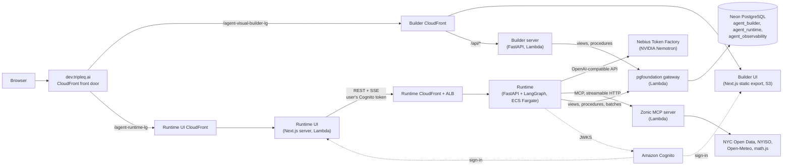
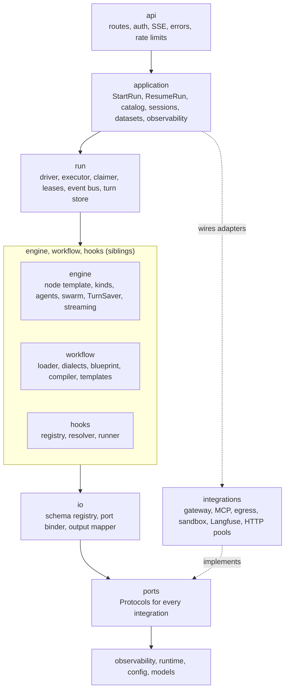
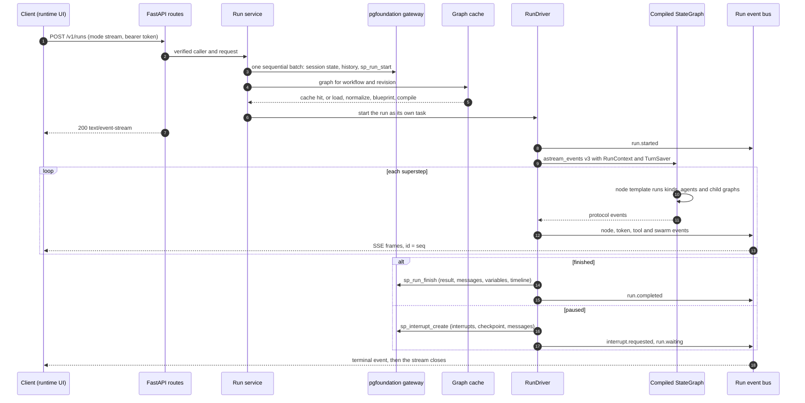

# Technical design: ZonicAgentRuntimeBackend_Python_LangGraph

How this repository is built. Setup, commands and the hackathon summary are in the [README](../README.md).

This section describes the whole platform first, because this runtime is its hub, and then the runtime itself. The specification is the [architecture design](zonic-agent-runtime-langgraph-architecture-design.md). Where the code and the design differ, this section follows the code.

## Platform architecture (end to end)

| Component | Repository | Runs on | Does |
|---|---|---|---|
| Front door | (infrastructure) | CloudFront on `dev.tripleq.ai` | Routes each app's path to that app's own CloudFront distribution, so each app deploys on its own |
| Builder UI | [ZonicAgentBuilderUI_NextJS](https://github.com/TripleQAI/ZonicAgentBuilderUI_NextJS) | Next.js static export in S3 | The visual workflow editor |
| Builder server | [ZonicAgentBuilderServer_FastAPI](https://github.com/TripleQAI/ZonicAgentBuilderServer_FastAPI) | FastAPI on Lambda | Validates, imports, exports and stores workflow documents in `agent_builder`; serves the node registry and model options |
| Runtime UI | [ZonicAgentRuntimeUI_NextJS_For_LangGraph](https://github.com/TripleQAI/ZonicAgentRuntimeUI_NextJS_For_LangGraph) | Next.js server on Lambda (streaming) | The chat. Signs in with Cognito. Its `/api/runtime` route proxies the runtime API and adds the user's access token on the server |
| Runtime | this repository | ECS Fargate behind an ALB and CloudFront | Compiles and runs workflows, streams events, stores runs, traces |
| MCP server | [ZonicMCPServer_FastAPI](https://github.com/TripleQAI/ZonicMCPServer_FastAPI) | FastAPI on Lambda | One MCP tool, `execute`, that runs database, API and function tools in one round trip |
| pgfoundation | [ZonicPostgresqlServer_FastAPI](https://github.com/TripleQAI/ZonicPostgresqlServer_FastAPI) | FastAPI on Lambda | The PostgreSQL gateway: views, procedures and batches over HTTP, per caller key and grants |
| Models | Nebius Token Factory | Managed | NVIDIA Nemotron, called through an OpenAI-compatible API |

**Design, publish, run.**
1. A person designs a workflow in the builder. The builder server saves the workflow document, with its nodes, edges, variables and per-node model codes, in the `agent_builder` schema through pgfoundation.
2. Publishing the workflow to a runtime channel (`catalog.runtimeChannels`: `api`, `qi-ui`) puts it in `agent_runtime.v_agent_catalog`, the list the chat shows. Development settings also list unpublished workflows.
3. When someone starts a chat, the runtime reads the stored document from `agent_builder.v_agent_export`, normalizes and validates it, and compiles it into a LangGraph `StateGraph`. The compiled graph is cached for that document revision, so the next run starts without compiling.
4. The document is never translated into code ahead of time. A change saved in the builder is a new revision and takes effect on the next run.

The runtime and the builder share the builder's node registry: [`resources/builder-registry.json`](../resources/builder-registry.json) is vendored from the builder (`scripts.sync_builder --check` in CI), and a contract test checks that the builder's node types and the runtime manifest's are the same set.

## Runtime architecture

The code is in layers under `src/zonic_runtime/`. Imports go downward only. [`.importlinter`](../.importlinter) enforces it in CI (`uv run lint-imports`).

The import contracts:
- **Layer direction.** `api`, `application`, `run`, then `engine`, `workflow` and `hooks`, then `integrations`, `io`, `ports`, `observability` and `runtime`, `config`, and `models` last.
- **Core depends on ports, not adapters.** `engine`, `workflow`, `hooks`, `io` and `models` may not import `integrations`. Tests run the same core on fakes.
- **Node kinds do not import blueprint analysis.** The blueprint is for validation and compilation. LangGraph alone schedules nodes: there is no ready queue, join counter or loop driver in `src/`.
- **No database drivers.** `psycopg`, `asyncpg`, `sqlalchemy` and `pyodbc` are forbidden everywhere.

Further rules are AST checks in [`tests/principles/test_principles.py`](../tests/principles/test_principles.py) (design Section 16.4). For example: no node type, handle, model ID or URL literals in `src/`; `os.environ` read only in [`config/env.py`](../src/zonic_runtime/config/env.py); no broad `except Exception` in `engine/`; no blocking calls; nothing cached may hold run data; child graphs run only through `invoke_child`.

## From workflow document to LangGraph

**Loading** ([`workflow/loader/`](../src/zonic_runtime/workflow/loader)):
1. **Visibility and read.** The workflow must be in `v_agent_catalog` (else `WORKFLOW_NOT_FOUND`); `export_json` comes from `v_agent_export`. Documents are cached by `(agenticWorkflowId, updated_at)`, so an unchanged workflow costs one catalog read.
2. **Version.** `schemaVersion` must be one of `settings.documentVersions` (1 and 2).
3. **Dialects.** `DocumentNormalizer` maps the builder dialect and the platform-import dialect onto one canonical model. It is driven entirely by [`resources/dialects.json`](../resources/dialects.json): 34 rules, operator aliases, layout keys to strip. Each rule that fires is a `DIALECT_RULE` finding, and each unknown field is reported (`DOCUMENT_UNKNOWN_FIELD`) and dropped from the canonical copy. The stored document is never changed.
4. **Validation.** The canonical copy is validated as a `WorkflowDocument`, with one configuration model per node kind.
5. **Revision.** The revision hash is the SHA-256 of the canonical JSON. It keys the blueprint and graph caches.

**Blueprint analysis** ([`workflow/blueprint/`](../src/zonic_runtime/workflow/blueprint)) is the immutable analysis of one revision:
- the entry node, and the nodes reachable from it (others are `NODE_UNREACHABLE` warnings);
- the edge index by `(source node, source handle)`;
- fan-in analysis: a join reached along paths that diverge at one parallel fan-out becomes a barrier ([decision 0003](decisions/0003-m1-design-deviations.md));
- strongly connected components (Tarjan), which scope visit limits, `loop.iteration` events and trace loop IDs;
- swarm container membership and sub-flow references;
- each node's ports and effective output schema, and a static check of every `{{nodes.X.output.path}}` template (`TEMPLATE_PATH_UNKNOWN`).

Every problem is collected before failing: the run fails with `PLAN_INVALID` before any node executes. Node roles come from the builder registry's node semantics, so the blueprint names no node type.

**The compiler** ([`workflow_compiler.py`](../src/zonic_runtime/workflow/compiler/workflow_compiler.py)) builds `StateGraph(RunState, context_schema=RunContext)`:
- one `add_node` per reachable node outside a container, with `defer` (barrier joins), `retry_policy`, a `TimeoutPolicy`, an `error_handler` and trace metadata from the manifest;
- one static edge, `START` to the entry node.

Every other transition is dynamic. A node returns the handles it activates, and the template turns them into `Command(update=..., goto=targets)` through the edge index ([`engine/routing.py`](../src/zonic_runtime/engine/routing.py)). A branch that is not taken is never scheduled, so there are no skipped nodes. Cycles compile as they are. The limits are:
- `engine.maxVisitsPerNode` (10) per node and `engine.maxSteps` (200) node executions per run (`LOOP_LIMIT_EXCEEDED`);
- `recursion_limit` (`engine.supersteps`, 400) as a backstop.

Building a graph makes no model call and holds no run data. Run data reaches nodes only through `RunContext` (`runtime.context`) and `config`.

**Run state** ([`engine/state.py`](../src/zonic_runtime/engine/state.py)) is a `TypedDict` with a reducer per namespace: `system`, `flow` (workflow variables), `input`, `history`, `nodes`, `turn_messages`, `visits`, `timeline`, `datasets`, `result`, `warnings`, `errors` and `usage`. The reducers give the same value whatever order LangGraph applies a superstep's writes in. For `flow` and `system`, the highest `(step, writer)` wins per key, and two writers of one key in one superstep are recorded as a conflict. Values are plain JSON built from the models, so checkpoints need no pickle.

**Templates** ([`workflow/templates/`](../src/zonic_runtime/workflow/templates)) are `{{namespace.path}}`, with namespaces and aliases from [`resources/templates.json`](../resources/templates.json): `system`, `flow` (alias `variable`), `nodes` (alias `node`), `history`, `messages`, `thread`, `input`, `run`, plus `nodeOutput`, `approval.response` and `human.response`. A string that is exactly one token yields the typed value, for example `{{nodes.energy_analyst.output.text}}`; embedded tokens become text. There is no `eval` and no code execution. Rule conditions use the builder's operators with type-aware comparison; a free-text rule expression is refused (`RULE_EXPRESSION_UNSUPPORTED`).

**The node manifest.** [`resources/node-runtime.json`](../resources/node-runtime.json) is the only place node types meet code. Each entry gives the `kind` (the class that executes the node); `io` (input ports with bindings from `configPath`, `template` or `statePath`, the output schema, output map and aliases); `handles` and `optionalHandles`; `retry` (attempts, backoff, retryable codes, and for HTTP the methods); `timeoutSeconds`, `joinPolicy` and `streamTokens`; and the Langfuse `observation` type and capture rules. Defaults: a 120 s timeout, one attempt, error policy `fail_run`, join policy `auto`. A node type that reuses a kind is a manifest entry with no code ([docs/extending.md](extending.md)).

| Node type | Kind | What it does |
|---|---|---|
| `start` | `entry` | Takes the user's query and the workflow's interface inputs |
| `llm` | `llm` | One governed model call, or a short tool loop (at most `models.llmMaxTurns`, 5) when it has tools; text or structured JSON |
| `agent` | `agent` | A LangChain `create_agent` loop with tools, history, `maxIterations` and handoff targets |
| `swarm` | `multi_agent` (`swarm`) | A swarm subgraph of member agents that hand off to each other |
| `workflow` | `subflow` | Runs another workflow's compiled graph inside the node |
| `rule` | `router` | Activates the first enabled branch whose conditions hold, else the default branch |
| `guardrail` | `guardrail` | Checks content with a policy model or Bedrock Guardrails; activates `pass` or `fail` |
| `approval` | `interrupt` (`approval`) | Pauses for a yes or no; activates `approved` or `rejected` |
| `human_input` | `interrupt` (`input`) | Pauses for a typed value |
| `variable` | `variable` | Applies state operations (`set`, `append`, `merge`, `increment`, ...) to `flow` |
| `db_query` | `mcp_execute` | A database tool through the MCP `execute` tool; rows become a dataset with an inline preview |
| `http_request` | `http` | One HTTP call through the egress guard |
| `tool` | `tool` | One configured tool without a model; `pass` on success, `fail` on a tool error |
| `external_agent` | `external_agent` | Calls an agent endpoint: A2A `message/send` over JSON-RPC, or plain HTTP |
| `script` | `sandbox` | Runs code in a Piston sandbox; off unless `features.scriptNode` is on |
| `view` | `view` | Grid, chart, table or sanitized HTML content parts |
| `output` | `output` | Builds the run result from its mapping; terminal |
| `note` | `ignore` | Not compiled |

**The node template.** Every compiled node is a `WorkflowNodeRunner` ([`engine/node_template.py`](../src/zonic_runtime/engine/node_template.py)) that runs the same steps: enforce limits, `interrupt()` first (interrupt kinds), `node.started`, bind and validate inputs, `beforeNode` hooks, execute under the run-wide permit, build and validate the output, `afterNode` hooks, `variableUpdates`, `node.finished`, route. Kinds implement only `execute`. Failures propagate to LangGraph's retry policy and then the node's error handler.

**The graph cache** ([`graph_cache.py`](../src/zonic_runtime/workflow/compiler/graph_cache.py)) is an LRU keyed by workflow ID, revision hash, role (root or child), manifest content hash and MCP tool catalog version. Concurrent runs of one revision share one compiled graph, since it holds no run data. A root graph is compiled with `TurnSaver`. A child graph is compiled with `checkpointer=None`, so it inherits the parent's checkpointer per invocation. The sizes are `settings.caches`: 256 blueprints, 128 graphs.

## Agents, multi-agent and swarm

**The agent loop** ([`engine/agents/`](../src/zonic_runtime/engine/agents)):
- `AgentFactory` builds one LangChain `create_agent` graph per node spec on its first visit. The kind keeps it, so it lives as long as the compiled graph.
- The system prompt and history are passed per visit, because they are templates. History is the session's last `history.maxMessages` (50) messages, trimmed to `history.maxTokens` (12,000).
- The middleware stack, outermost first:

  | Middleware | Does |
  |---|---|
  | `ToolApprovalMiddleware` | LangChain's `HumanInTheLoopMiddleware`, per call, for the tools in `settings.tools.requireApproval` |
  | `HookMiddleware` | Model and tool hook points |
  | `GovernorMiddleware` | Takes a model permit and token budget for each model call |
  | `ToolPermitMiddleware` | At most `tools.maxConcurrentPerTurn` (4) tool calls at once; assigns each call its idempotency key |
  | `TurnLimitMiddleware` | `maxIterations`. The loop ends with the last real answer and an `AGENT_TURN_LIMIT` warning |
  | `HandoffMiddleware` | Ends the loop once a handoff is chosen |

- After the loop, the kind converts the new messages into turn messages: the answer is visible in the chat, while tool calls, tool results and intermediate turns are `internal`.

**Tools** ([`tool_factory.py`](../src/zonic_runtime/engine/agents/tool_factory.py)):
- **MCP configured tools** (`database`, `api`, `function`) call the MCP server's `execute` tool with the configured tool, the model's input, and the visit's `flow` and `system`. Flow updates in the reply go back to the run.
- **A server's own MCP tools** keep the document's name, description and schema.
- **Built-ins** come only from `tools.builtinAllowList` (`calculator`, `current_time`). Shell, file and REPL tools do not exist.
- **Validation.** Every tool validates the model's input against its schema first. An invalid input or a failing upstream is a tool error the model can correct, not a failed node.
- **MCP connections.** `McpPool` holds one MCP client per server from [`resources/mcp-servers.json`](../resources/mcp-servers.json), shared by every run, with `maxInFlight` (32) per server. A `tools/list_changed` notification bumps the tool catalog version, which is part of the graph cache key.

**Handoffs between workflow nodes.** The builder's handoff targets become one `handoff_to(target, reason)` tool whose `target` is an enum of the targets' names. The node then activates `handoff-<target>`, or `default` when no handoff was chosen. Platform routing tools keep their own names and argument schemas.

**Model factory and catalog** ([`model_factory.py`](../src/zonic_runtime/engine/agents/model_factory.py), [`resources/models.json`](../resources/models.json)):
- A node names a model by catalog code, alias or provider model ID; empty means `defaultModel`. A model that is missing or disabled is `MODEL_NOT_ALLOWED`.
- Temperature and `maxTokens` come from the node, bounded by the entry's `parameters`. Retries (2) and the request timeout (120 s) come from `settings.models`. Nodes whose tokens must not stream get a model tagged `nostream`.
- Providers: `bedrock_converse`, `azure_openai` and `openai`. An entry may name its own endpoint and key variables (`endpointEnv`, `apiKeyEnv`), which is how the `openai` provider reaches Token Factory.
- The AWS overlay [`deploy/aws/resources/models.dev.json`](../deploy/aws/resources/models.dev.json) maps the catalog's Claude codes to OpenAI stand-ins (`substitutes`) until Bedrock is enabled for the account.

**Quotas and permits.** Each catalog model has one process-wide `ModelGovernor` ([`governor.py`](../src/zonic_runtime/engine/agents/governor.py)): an in-flight cap (`quota.maxInFlight`), token buckets for requests and tokens per minute, and a queue deadline (`maxQueueWaitMilliseconds`), after which the call fails with the retryable `MODEL_BUSY`. For example, `nemotron-3-ultra` allows 10 calls in flight, 100 requests and 200,000 tokens per minute, and a 30 s wait. A burst therefore queues or fails fast; it never makes a run hang.

**Structured output** ([`structured.py`](../src/zonic_runtime/engine/agents/structured.py)). An LLM node with `responseFormat: json` and an `outputSchema`, or the platform's `structuredOutput`, uses LangChain's `ProviderStrategy` when the catalog entry has `supportsNativeStructuredOutput` (all enabled Nemotron entries do), else `ToolStrategy`. The adapter adds the `title` and `description` a provider requires, and validates the answer against the JSON Schema (`STRUCTURED_OUTPUT_INVALID`).

**Swarm** ([`engine/agents/swarm/`](../src/zonic_runtime/engine/agents/swarm), [`swarm_kind.py`](../src/zonic_runtime/engine/kinds/swarm_kind.py)). The swarm is a LangGraph subgraph built by the runtime (design AD-8), not the `langgraph-swarm` package:
- **State.** `SwarmState` holds the task, the shared handoff messages, the active member, the handoff list, the step count and what each member produced.
- **Members.** There is one graph node per member, each running that member's own agent graph with its own model and tools. An LLM member is an agent without tools.
- **Handoffs.** Each member gets `transfer_to_<member>(message, context)` for every other member. A call returns `Command(goto=<member>, graph=Command.PARENT)` with a paired `AIMessage` and `ToolMessage`, so the shared history never holds a dangling tool call. `context` must be an object or null. A string such as `"None"` fails validation, which is why the swarm members run on Ultra.
- **End.** A member that answers without a handoff ends the swarm.
- **Limits.** Steps `min(maxHandoffs + 1, maxIterations)`, both 20 by default (`SWARM_STEP_LIMIT`); repetitive-handoff detection over a window (`SWARM_REPETITIVE_HANDOFF`); `executionTimeoutSeconds`, 900 by default (`SWARM_TIMEOUT`); a per-member node timeout.
- **Context.** `settings.swarm.contextMode` is `shared` (the next member gets the original task, the handoffs so far and the other members) or `handoff` (only the last handoff).
- **Events.** Members emit `swarm.member.started`, `swarm.member.finished` and `swarm.handoff`. Their tokens carry `member`.

**Sub-flows** ([`subflow_kind.py`](../src/zonic_runtime/engine/kinds/subflow_kind.py)). A `workflow` node loads the child through the same loader and caches, and runs it inside the node through `invoke_child`, which passes the parent's callbacks, checkpoint namespace, `RunContext`, deadline and permits. Input comes from the node's mapped `inputs`; `flow` is inherited per `subflow.inheritFlow` (`none`, `declared` by default, or `all`). Depth is limited to `subflow.maxDepth` (5), and `A -> B -> A` fails with `SUBFLOW_CYCLE`. An interrupt inside a child pauses the whole run; on resume, the child continues from its own checkpoint namespace.

## A run end to end

**Start.**
- `POST /v1/runs` takes `{agenticWorkflowId | sessionId, input, mode, options}`, with an optional `Idempotency-Key`: the same key returns the same run for 24 hours.
- The modes: `stream` (SSE); `sync` (`200 RunResult`, or `202` after `runs.syncWaitSeconds`, 30); `async` (`202` at once).
- A turn makes two gateway calls: the start batch and `sp_run_finish`. A pause adds one. No node writes to the database.
- A run executes as its own asyncio task, independent of the request that started it. A client disconnect does not cancel it (`runs.cancelOnDisconnect` is false).

**Admission and concurrency:**

| Level | Limit |
|---|---|
| Runs per process | `runs.maxConcurrentRuns` (150). Excess requests get `429 RATE_LIMITED` with `Retry-After`; excess `async` runs stay queued |
| Per session, user and tenant | `maxActivePerSession` (1, else `409 RUN_IN_PROGRESS`), `maxActivePerUser` (5), `maxActivePerTenant` (50). `sp_run_start` enforces them in the database, so they hold across instances |
| Process pressure | Event-loop lag p90 above 200 ms or RSS above 1,536 MB: new runs get `503 OVERLOADED`, and readiness reports `degraded` |
| Nodes in one graph, and across one run's nested graphs | `engine.maxConcurrencyPerGraph` (8), and a run-wide permit pool (`maxConcurrencyPerRun`, 8). Container kinds release their permit while their children run, so nesting cannot deadlock |
| Requests | 120 per user and 2,000 per tenant per minute |

**Interrupts and resume:**
- **Pausing.** Approval and Human Input nodes call LangGraph's `interrupt()` before any side effect, with a JSON Schema for the answer. Tool approvals interrupt inside the agent graph. Every child graph inherits the checkpointer, so swarm members and sub-flows can pause the run too.
- **Saving the pause.** The driver detaches the `TurnSaver` buffer, and `CheckpointStore` writes one `sp_interrupt_create`: the interrupt rows, one checkpoint row and the turn's messages so far. The checkpoint also pins the documents the run compiled, so a resume runs the original topology even if the workflow changed since.
- **Waiting.** The stream ends with `interrupt.requested` and `run.waiting`. The run holds no server resources while it waits.
- **Answering.** `POST /v1/runs/{runId}/interrupts/{interruptId}` validates the answer against the stored schema (`INTERRUPT_ANSWER_INVALID`), records it with `sp_interrupt_answer`, and resumes on any instance with `Command(resume={id: answer})`. Nodes that already finished do not run again.
- **Several interrupts.** With two pending, each answer resumes its own branch, and the run pauses again on the other ([decision 0007](decisions/0007-interrupt-rows-per-pause.md)).
- **Expiry.** An expiry job (`interrupts.expiryCheckSeconds`) applies `interrupts.onExpiry`: `cancel` cancels the run; `reject` resumes an approval as rejected.

**Async runs, the durable queue, leases:**
- **The queue.** `async` runs are durable, and `runtime_run` is the queue. `RunClaimer` calls `sp_run_claim`, which takes queued runs and runs whose lease expired with `FOR UPDATE SKIP LOCKED`, round-robin across tenants.
- **Leases.** One `sp_run_heartbeat` per instance renews all its leases every `leaseSeconds / 3` (lease 30 s). Every write carries the run's `attempt` as a fencing token, so a run taken over by another instance cannot overwrite the new attempt.
- **Drain.** On `SIGTERM`, the instance stops claiming. `async` runs stop at the next superstep boundary (`GraphDrained`): the checkpoint is saved (`sp_checkpoint_save`) and the run is released (`sp_run_release`). Another instance continues it without repeating finished nodes. `stream` and `sync` runs get `shutdown.drainSeconds` (30) to finish, then fail with `SHUTDOWN`.
- **Instance loss.** `runs.onInstanceLoss` decides: `async` runs restart the turn from the saved session state (or continue from a write-behind checkpoint when `state.asyncCheckpoints` is on); `stream` and `sync` runs fail.
- **Callbacks.** On completion, an optional callback posts the run summary through the egress guard, signed with HMAC-SHA256 in `X-Zonic-Signature`, with retries.

**Cancellation and deadlines:**
- `POST /v1/runs/{runId}/cancel` cancels the run's task. Cancellation reaches every node, model call and tool call, and a node that ignores it is abandoned after `runs.cancelGraceSeconds`.
- The run deadline is `engine.runTimeoutSeconds` (600), which ends the run as `timed_out`.
- Run states and transitions are in [`resources/run-states.json`](../resources/run-states.json), enforced by `sp_run_transition`.

**Measured** ([load report](load/p5-02-report.md); one process limited to 1 vCPU and 2 GB, simulated model, real gateway):

| Budget | Measured |
|---|---|
| Compile a 25-node document (cache miss), ≤ 50 ms | p95 15.9 ms; a cache hit p95 0.002 ms |
| Template and superstep overhead per node, ≤ 3 ms | p95 1.10 ms |
| Model chunk to SSE frame, p95 ≤ 20 ms | p95 6.5 ms |
| 150 concurrent streaming runs, event-loop lag p99 ≤ 50 ms | 450 of 450 completed; lag p99 24.7 ms |
| Memory per active run, ≤ 2 MB | 0.79 MB |

## Streaming protocol

**Events.** `RunDriver` consumes `astream_events(version="v3")`. `RunEventTransformer` ([`engine/streaming/`](../src/zonic_runtime/engine/streaming)) is the only module that reads LangGraph's stream. It maps the `messages`, `tools`, `custom` and `updates` modes into run events. An `astream(..., subgraphs=True, version="v2")` source feeds the same mapper as a fallback.

The envelope is `{id, runId, seq, type, ts, nodeId?, path?, truncated?, data}`. Each type is a Pydantic model, and its JSON Schema is published in [`generated/schemas/events/`](../generated/schemas/events).

| Group | Types |
|---|---|
| Run | `run.started`, `run.waiting`, `run.completed`, `run.failed`, `run.cancelled` |
| Nodes | `node.started`, `node.finished`, `loop.iteration` |
| Text | `token.delta`, `reasoning.delta` |
| Tools | `tool.started`, `tool.finished` |
| Swarm | `swarm.member.started`, `swarm.member.finished`, `swarm.handoff` |
| Other | `content.part`, `state.updated`, `interrupt.requested`, `warning`, `stream.gap`, `heartbeat` |

**Content parts** are data, never code: `markdown`, `table`, `grid` (with a `datasetRef` paged through `GET /v1/datasets/{datasetId}`), `chart` (ECharts options, allow-listed keys, no functions), `card`, `json`, `file`, `html` (sanitized on the server), `citation`, `error` and `form`. Their schemas are in [`generated/schemas/content/`](../generated/schemas/content).

**Framing.** Each SSE frame is `id: <seq>`, `event: <type>`, `data: <envelope>`:
- `seq` strictly increases per run from 1 and continues across a resume.
- Text deltas are coalesced on the server (16 ms or 1 KiB; a node's first delta goes out at once), before they get a `seq`, so every subscriber sees the same sequence.
- A `heartbeat` (no `id`) is sent after 15 s without events. The load balancer and CloudFront time out at 60 s or more, so streams stay open.
- Event data above 64 KiB is cut and marked `truncated`.

**Reconnection and replay:**
- Each run keeps a replay buffer of its last 5,000 events, held 300 s after the run ends. Events are never persisted.
- `GET /v1/runs/{runId}/events` with `Last-Event-ID` replays from the buffer and continues live, without duplicates.
- A slow subscriber falls behind on its own bounded queue and gets `stream.gap {fromSeq, toSeq}`. The run never waits for a client.
- A client that reaches an instance that does not drive the run is proxied to the driving instance's internal port (`/internal/runs/{runId}/events`, port 9000), whose address is in the run's lease.

## Persistence and observability

**No database driver.** All storage goes through pgfoundation over HTTP ([`integrations/gateway/`](../src/zonic_runtime/integrations/gateway)):
- **Calls.** Views (`/v1/datasources/{ds}/view`), procedures (`/procedure`) and batches (`/v1/batch`: `parallel`, `sequential` or `transactional`), authenticated as caller `zonic-agent-runtime` with its key.
- **Mapping.** One generic repository maps row and argument models (`@gateway_view`, `@gateway_procedure`, `Column` markers) to calls, so there is no SQL text in `src/`.
- **Ownership.** Owner-scoped views always get the owner filter. A cross-owner write is refused by the procedure and answered as `404`.
- **Retries.** Reads retry on 503 and transport errors. Writes retry only when idempotent, or when the gateway throttled the call (`429`, so it never ran).
- **SQL.** The scripts in [`db/`](../db) are vendored byte for byte from the Node.js runtime (`scripts.sync_sql --check`) and are idempotent, each recording its version in `schema_migrations`.

**`agent_runtime`** ([`db/runtime/`](../db/runtime)):

| Table | Holds |
|---|---|
| `runtime_session` | A conversation with one workflow: owner, tenant, title, status |
| `runtime_message` | The chat history, including agents' intermediate turns, with `thread`, `role`, `visibility` and content parts |
| `runtime_run` | One turn: status, mode, input, result, error, usage, node timeline, idempotency key, lease owner and expiry, `attempt`, callback. It is also the async queue |
| `runtime_interrupt` | Pending and answered interrupts, with prompt and answer schema |
| `runtime_checkpoint` | One row per paused, drained or write-behind run (`langgraph-jsonplus-zstd-v1`); deleted when the run finishes |
| `runtime_session_state` | Declared workflow variables across turns, with optimistic locking |
| `runtime_dataset` | Dataset metadata, and row chunks for the `database` store |
| `runtime_feedback` | Ratings and comments |

There are views (`v_agent_catalog`, `v_message`, `v_run`, `v_checkpoint`, ...) and procedures (`sp_run_start`, `sp_run_finish`, `sp_interrupt_create`, `sp_run_claim`, `sp_run_heartbeat`, ...). There are deliberately no event, log or per-node tables.

**`TurnSaver`** ([`engine/persistence/`](../src/zonic_runtime/engine/persistence)) is the root graphs' LangGraph checkpointer:
- It keeps an in-memory buffer per run, keyed by checkpoint namespace so child and agent graphs keep their own checkpoints. It never calls the gateway. Stream and sync runs use `durability="exit"`; async runs use `durability="async"`.
- At a pause or drain, the driver detaches the buffer. The checkpoints are serialized with `JsonPlusSerializer` (with LangGraph's AES `EncryptedSerializer` when `state.encryption.enabled`, on in production), zstd-compressed and base64-encoded into the checkpoint row.
- It passes LangGraph's checkpointer conformance suite (case P-07).

**Datasets.** Database and HTTP results are never truncated and never enter graph state. Each becomes a dataset, either in the cache service or as `runtime_dataset` chunks, and the node output carries a reference and an inline preview of `io.inlineRows` (50) rows.

**Traces** ([`integrations/langfuse/`](../src/zonic_runtime/integrations/langfuse)):
- **Recording.** The runtime uses the Langfuse Python SDK v5 on its own OpenTelemetry tracer provider. `ZonicLangfuseCallbackHandler` marks each builder node visit and types it from the manifest's `observation` block: `generation`, `agent`, `tool`, `guardrail`, `chain` or `span`. Model calls become generations with model and usage.
- **Storage.** `GatewaySpanExporter` maps finished spans to Langfuse-shaped records and writes them with `sp_obs_ingest` into `agent_observability`. That procedure is idempotent and retried. Sending the same spans to a Langfuse server is optional (`observability.exporters`).
- **Isolation.** The exporter runs on its own thread with a bounded queue, so a run never waits for tracing and never fails because of it.
- **Trace identity.** The trace ID is the run ID, constant across pauses and drains.
- **Capture and masking.** [`resources/observability.json`](../resources/observability.json) sets capture per node type (`full`, `summary` or `none`), masked keys (`password`, `token`, `apikey`, ...) and patterns (e-mail, card numbers, bearer tokens).
- **Sampling.** `observability.sampleRate` applies per trace; failed runs are always traced.

**`agent_observability`** ([`db/observability/`](../db/observability)) holds `obs_trace`, `obs_observation` (partitioned by month), `obs_score`, `obs_model_price` and daily rollups per node and per model. An hourly maintenance job on every instance creates partitions ahead, purges traces past `observability.retentionDays` (90) and refreshes the rollups. `GET /v1/runs/{runId}/trace` (the trace tree) and `GET /v1/observability/usage` (the rollups) are for the `runtime-support` and `runtime-admin` groups. `GET /v1/runs/{runId}/nodes` gives the node timeline.

**Token usage.** Usage is summed per run in `RunState.usage` and saved on the run. For Token Factory streams, `FinalUsageChatOpenAI` counts usage only from the closing chunk (see above).

## Security

| Control | Implementation |
|---|---|
| Authentication | Cognito tokens verified with PyJWT against the pool's JWKS, fetched with `httpx` and cached for `auth.jwksCacheSeconds` (3,600); an unknown `kid` refreshes the keys once. Issuer and audience are checked. The audience is an ID token's `aud` or an access token's `client_id`, and `ZONIC_OIDC_AUDIENCE` may list several app clients. Without a JWKS URL, every token is refused ([`api/auth.py`](../src/zonic_runtime/api/auth.py)) |
| Access model | The Cognito token is the only access control ([decision 0004](decisions/0004-cognito-only-access.md)). Sessions, runs, messages and datasets belong to the token's `sub` and `custom:tenant`. Another user's ID answers `404`, exactly like a missing one |
| Roles | `cognito:groups`: `runtime-support` and `runtime-admin` may read internal messages, node inputs and outputs, traces and usage. A missing role is `403` |
| Gateway | A dedicated caller, `zonic-agent-runtime`, with its own API key and grants. Its database role ([`db/runtime/006_grants.sql`](../db/runtime/006_grants.sql)) may read views and execute procedures in `agent_runtime` and `agent_observability`, and read only `v_agent_export` in `agent_builder`: no table is written directly |
| Egress | [`integrations/egress/guard.py`](../src/zonic_runtime/integrations/egress/guard.py) with [`resources/egress.json`](../resources/egress.json): `https` on port 443 only, allow-listed hosts per environment. Every resolved address must be public: private, loopback, link-local (cloud metadata), multicast and reserved ranges are `EGRESS_DENIED`. The connection goes to the checked address (no DNS rebinding) while TLS still verifies the host name. Redirects are off, responses are capped at 20 MiB, environment proxies are ignored, and template values in URLs are encoded |
| MCP | Server endpoints and bearer tokens come only from [`resources/mcp-servers.json`](../resources/mcp-servers.json) and the environment, never from a workflow document. The MCP server allow-lists its own functions and database connections |
| Secrets | [`config/env.py`](../src/zonic_runtime/config/env.py) is the only reader of the process environment, and keys are `SecretStr`. Documents hold `secret:<name>` references, resolved at call time from `ZONIC_SECRET_<NAME>`; a literal secret fails validation. On AWS, the ECS task definition injects every key from Secrets Manager |
| Sandbox | Script nodes are off by default (`features.scriptNode`). When on, the code runs on a Piston API, never in the runtime process. Inputs travel as one JSON string literal, never as code; a run is limited to 3 s and its output to 1 MiB |
| Output safety | No server-provided scripts. HTML parts keep only allow-listed tags and attributes; scripts, event handlers, `javascript:` URLs and external resources are removed. Chart options are allow-listed |
| HTTP hardening | Request bodies are limited to 1 MiB, unknown request fields are refused, security headers (CSP `default-src 'none'`, HSTS, `nosniff`, `DENY` framing) are set, and `/docs` is served only in development |
| Tracing | Masking before export; human-input answers are never captured |

## Reliability

**Retries per kind** (manifest `retry`, turned into LangGraph `RetryPolicy`). A retry happens only for an exception whose catalog code is listed:

| Node type | Attempts | Retried on |
|---|---|---|
| `llm` | 3 (0.5 s, ×2, at most 8 s, jitter) | `MODEL_UNAVAILABLE`, `MODEL_BUSY`, `TIMEOUT` |
| `db_query` | 2 | `TOOL_UNAVAILABLE`, `TIMEOUT` |
| `http_request` | 2, for `GET` and `HEAD` only; a `POST` is never repeated | `TIMEOUT`, `UPSTREAM_5XX` |
| everything else | 1 | none |

The model clients retry transport errors twice more on their own (`models.maxRetries`).

**Timeouts.** Per node attempt, as `TimeoutPolicy`: 120 s by default, 300 s for agents, 600 s for sub-flows, 900 s for a swarm. The whole run: 600 s. Model requests: 120 s. A timed-out attempt's writes are discarded. LangGraph's idle timeout does not detect a stalled model stream (streamed tokens do not count as progress), so the provider client's read timeout does that ([load report](load/p5-02-report.md), note 4).

**Error policy** ([`engine/error_policy.py`](../src/zonic_runtime/engine/error_policy.py)). After its retries, a failed node runs its `onNodeError` hooks, which may recover. Then its policy applies:
- `fail_run` ends the run with the node's code;
- `continue` records the error and follows `default`;
- `route` records it and follows the `error` handle.

Interrupts bypass both retries and handlers.

**Error catalog.** [`resources/error-catalog.json`](../resources/error-catalog.json) holds 76 codes, each with an HTTP status, a `retryable` flag and a user-safe message; 18 are retryable. Every error answer has one envelope: `{error: {code, message, details, traceId, retryable}}`. Messages contain no internal values, and clients branch on `code`.

**Idempotency:**
- **Requests.** `Idempotency-Key` on `POST /v1/runs` returns the same run for `runs.idempotencyTtlSeconds` (24 hours).
- **Saves.** `sp_run_finish` is idempotent per run and attempt. It is retried while the gateway is unavailable until `state.saveDeadlineMilliseconds` (30 s); after that the run fails with `STATE_UNAVAILABLE`. `run.completed` is sent only after the save succeeds.
- **Fencing.** The `attempt` number on every write discards a stale instance's work.
- **Tool calls.** Each tool call carries a deterministic key (`nodeId:visit:callIndex`) as its MCP request ID.
- **Traces.** `sp_obs_ingest` is idempotent, so the trace exporter retries it safely.

**Health.** `GET /healthz` is liveness. `GET /readyz` checks the gateway (`503` when it is unavailable) and reports `degraded` while tracing exports fail or the process sheds load.

## Deployment

The [deploy runbook](runbooks/deploy.md) covers it. [`deploy/aws/runtime.yaml`](../deploy/aws/runtime.yaml) is a CloudFormation stack, and [`deploy/aws/deploy.sh`](../deploy/aws/deploy.sh) deploys it:
- **Steps.** The script checks the AWS account, builds the image and pushes it to ECR (scan on push, immutable tags), writes the secrets to Secrets Manager, and deploys the stack. Secret values come from the git-ignored `.env` through temporary files, never from the command line.
- **Network.** The stack creates its own VPC with two public subnets, and an internet-facing ALB that accepts traffic only from CloudFront's address list. CloudFront serves HTTPS, with caching and compression off so the event stream is not buffered, and a 60 s origin read timeout. The ALB idle timeout is 120 s.
- **Compute.** ECS Fargate runs one task by default, with 1 vCPU and 2 GB. The container runs `python -m zonic_runtime.server` on `python:3.13-slim` as user 10001: one uvicorn process serves the public API on port 8000 and the internal port 9000. Instances scale horizontally and share nothing in memory but the runs they drive (design AD-11).
- **Rollout.** Deployments keep 100% healthy capacity, with a circuit breaker and automatic rollback. The health check is `/healthz`. The stop timeout is 90 s, so a stopping task can drain its runs, and target deregistration waits 45 s.
- **Permissions.** The task role may invoke Bedrock models and Bedrock Guardrails. The execution role may read the stack's secrets.
- **Configuration.** Tunable values live in [`resources/settings.json`](../resources/settings.json), with overlays per `ZONIC_ENV` and an AWS overlay in [`deploy/aws/resources/`](../deploy/aws/resources). The environment holds only endpoints and credentials.
- **Database.** The schemas are installed by [`scripts/init_db.sh`](../scripts/init_db.sh), and the gateway's datasource registration is in [`deploy/pgfoundation.agentruntime.yaml`](../deploy/pgfoundation.agentruntime.yaml).
- **Verification.** `uv run pytest -m live tests/live/test_deployed_live.py` runs against the deployed stack with a test identity.

The chat at https://dev.tripleq.ai/agent-runtime-lg reaches this runtime through the runtime UI's server-side proxy. The other platform services deploy from their own repositories.

## Testing strategy

**The catalog.** [`tests/catalog.yaml`](../tests/catalog.yaml) lists 296 sanity cases in 22 groups, generated from the design and the plan: API, streaming, documents, execution, node I/O, builder compatibility, compilation, kinds, swarm, human-in-the-loop, tools, persistence, security, resilience, performance, kind conformance, hooks, models, Langfuse, observability storage and live sanity. A test proving a case carries its ID in its name, for example `test_E03_exclusive_branches_join_once`. `scripts.catalog_check` fails CI when a case has no test.

**Fakes** ([`tests/fakes/`](../tests/fakes)). The offline suite needs no credentials and no network:
- `ScriptedChatModel` is a LangChain chat model that replays scripted turns: streamed text, tool calls, structured output, handoffs, errors mid-stream, delays and usage. One script drives an agent's whole loop.
- `InMemoryGateway` follows pgfoundation's view, procedure and batch semantics, and counts round trips.
- An in-process FastMCP server stands in for the MCP server.
- `FakeEgress` stands in for outbound HTTP.
- Recorded tool answers are vendored from the Node.js runtime ([decision 0006](decisions/0006-recordings-vendored-from-nodejs.md)). An unrecorded call fails the test.

**Suites:**

| Suite | Proves |
|---|---|
| `unit/` | Resolver, conditions, reducers, normalizer, blueprint, compiler, routing, egress, gateway, tracing. The compiler is property-tested (hypothesis) against a test-only reference interpreter of the routing semantics |
| `compat/` | Every vendored builder and platform document, in both dialects, loads, plans and compiles. The compiled graphs are snapshots in `tests/fixtures/compiled/` |
| `scenarios/` | Builder workflows run end to end through the app on the scripted model, in stream and in sync mode. Their event streams match golden files in `tests/fixtures/scenarios/` (volatile fields removed) |
| `conformance/` | Every registered node kind passes checks C-01 to C-16 through the real node template, inside a compiled one-node graph and a join graph |
| `api/` | Routes, auth, owner scope, run modes, SSE framing, interrupts, durable runs, swarm, persistence. `TurnSaver` is checked against LangGraph's checkpointer conformance suite |
| `principles/` | The design's engineering rules as AST checks over `src/` |
| `sql/` (`-m sql`) | The SQL scripts on PostgreSQL 17, inside transactions that roll back |
| `live/` (`-m live`) | Real models, the deployed MCP server and gateway, and the deployed runtime |
| `load/` | The performance budgets (see the load report) |

**Contract tests.** `generated/` (OpenAPI 3.1 and JSON Schemas) must match the models (`scripts.gen --check`, plus a snapshot test), and the vendored builder registry, workflows, recordings and SQL must match their sources. CI ([`.github/workflows/ci.yml`](../.github/workflows/ci.yml)) also runs ruff, mypy (strict), import-linter and `pip-audit`; the SQL suite runs nightly, and the live suite nightly when enabled.

## Key design decisions

| Decision | Why |
|---|---|
| Compile every document to a LangGraph `StateGraph` at run time, cached per revision ([AD-2, AD-5](zonic-agent-runtime-langgraph-architecture-design.md#44-architecture-decisions)) | LangGraph supplies supersteps, parallelism, interrupts, checkpoints, retries and timeouts, so the runtime has no interpreter or scheduler of its own. A builder change takes effect on the next run |
| Route by `Command(goto=...)` from one node template (AD-3) | One routing mechanism for every branching node. Dead branches are never scheduled, so there are no skip gates |
| Barrier joins with `defer=True`, chosen by fan-in analysis (AD-4, [decision 0003](decisions/0003-m1-design-deviations.md)) | A join after a parallel fan-out runs once, after every selected branch |
| `create_agent` invoked inside the node, with middleware (AD-7) | LangChain's agent loop, with hooks, quotas, approvals and limits as middleware instead of a hand-written loop |
| Swarm as a runtime-built handoff subgraph (AD-8) | Per-member models and tools, step and repetition limits, and the builder's context rules, which the prebuilt `langgraph-swarm` package does not provide |
| `TurnSaver`: checkpoints buffered in memory, saved only at turn boundaries (AD-6) | Two gateway calls per turn instead of a write per superstep, and no Postgres checkpointer, which would need a database driver |
| All storage through the pgfoundation gateway (AD-9) | One audited path to PostgreSQL with per-caller grants. No SQL or driver in the runtime |
| A durable queue in `runtime_run` with `SKIP LOCKED` leases and drain at superstep boundaries (AD-10) | Async runs survive restarts and deploys without a broker or worker fleet |
| One uvicorn process per container, scaled horizontally (AD-11) | Per-process caches, permits and the cross-instance proxy stay simple |
| `RunState` as a `TypedDict` with order-independent reducers; Pydantic models at the boundaries (AD-13) | LangGraph validates Pydantic state on every step. Here validation happens once, at binding, output and save |
| Process-wide model governors (AD-16) | Quotas per model, with token budgets and a queue deadline, not only provider throttling |
| Langfuse traces stored in PostgreSQL through the gateway (AD-12) | One system of record for runs and traces. A Langfuse server is optional |
| Pin LangGraph and LangChain minors, verified by spikes ([0001](decisions/0001-langgraph-verification-spikes.md), [0002](decisions/0002-langgraph-1.2.18.md)) | The design relies on ten behaviours the documentation does not state. 1.2.18 fixes node error handlers in streamed runs |
| The Cognito token is the only access control ([0004](decisions/0004-cognito-only-access.md)) | One security model. Data stays owner-bound |
| Interrupt rows per pause; resume with each answer ([0007](decisions/0007-interrupt-rows-per-pause.md)) | Fits the vendored SQL and LangGraph's partial-resume behaviour |
