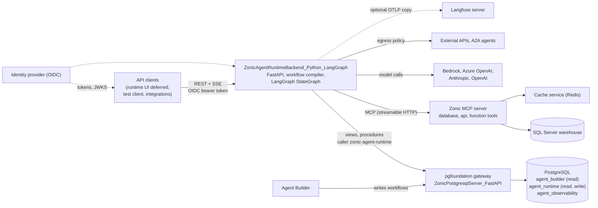
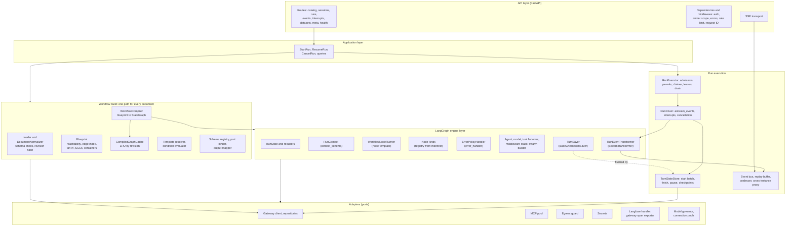
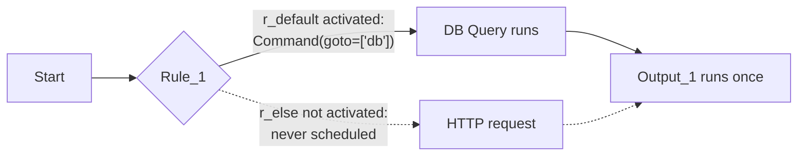
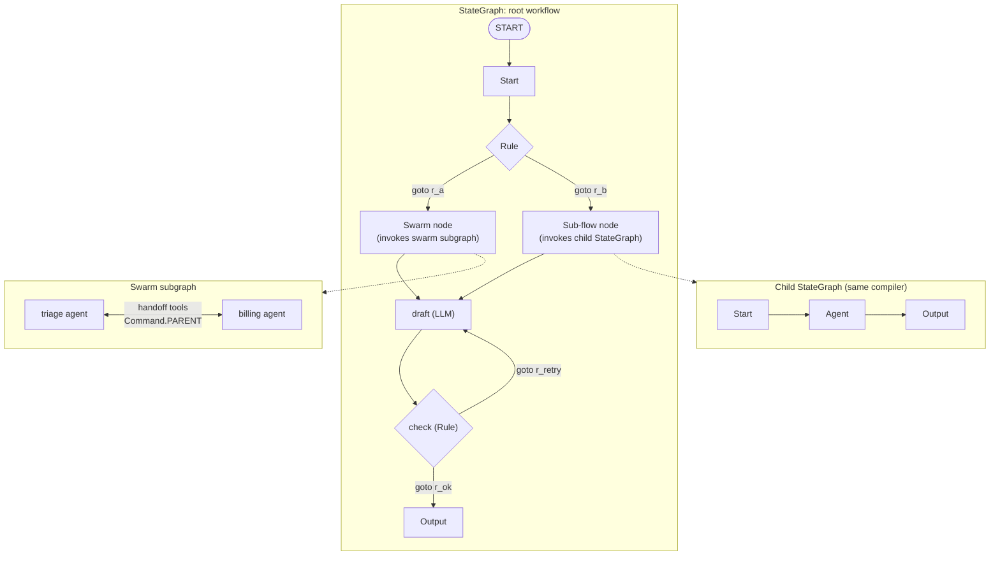
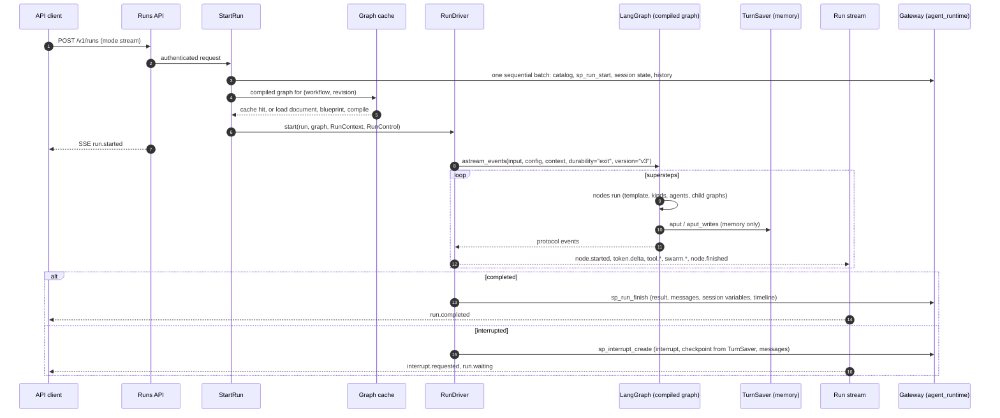

**INSITEINTELLIGENCE.COM**

---

# Zonic Agent Runtime on LangGraph: Target Architecture Design

Design for `ZonicAgentRuntimeBackend_Python_LangGraph` (Python, LangGraph Graph API), replacing the Django runtime backend. Backend only: the runtime UI is deferred

| Item | Detail |
|---|---|
| Date | 25 October 2026 |
| Status | Draft for review, revision 2. No code has been written. Changes by revision are in Section 21.2. |
| Scope | The runtime backend only. The runtime UI (`ZonicAgentRuntimeUI_NextJS`) is deferred and will be designed separately; this design defines the API, streaming and content-part contract that it, and any other client, will use (Section 3.6). |
| Supersedes | The execution engine of the [Strands design](../../ZonicAgentRuntimeServer_Nodejs/docs/zonic-agent-runtime-architecture-design.md) (revision 7, 24 October 2026). That design's requirements, API contract, database schemas, dialect rules, hook model and observability model are kept; its Strands-specific engine (activation gate, loop orchestrator, Strands snapshots) is replaced by LangGraph's own mechanisms. |
| Sources analyzed | `ZonicAgentRuntimeBackend_DjangoApp` (LangGraph compiler, runner, adapters, views), `ZonicAgentRuntimeFrontend_DjangoApp`, `ZonicAgentBuilderServer_FastAPI`, `ZonicAgentBuilderUI_NextJS`, `Strands-visual-builder` at commit `24e29ee` (node registry, `node_semantics.json`, `workflow-document-v2.schema.json`, fixtures), the Strands design and its sanity catalog, the LangGraph Python documentation (Graph API, use-graph-api, Pregel runtime, persistence, checkpointers, fault tolerance, interrupts, subgraphs, streaming, event streaming, backward compatibility, testing, v1 release notes), the LangChain v1 documentation (agents, middleware, multi-agent handoffs, models, structured output, human-in-the-loop, MCP), and the Langfuse Python SDK v5 documentation |
| Audience | InSite engineering and architecture |

---

## 1. Summary

The agent runtime executes the workflows that designers build in the Agent Builder. Today it is two Django projects: a LangGraph interpreter behind a Server-Sent Events (SSE) endpoint, and a one-page jQuery client. The interpreter executes 11 of the builder's 18 node types, buffers every token until the run ends, has no authentication, swallows errors, and reads builder tables directly.

This document designs the replacement runtime server as **`ZonicAgentRuntimeBackend_Python_LangGraph`**: a Python 3.13 service on FastAPI that builds every workflow **dynamically** from the builder's document into a **LangGraph `StateGraph`** (the Graph API) and runs it on the LangGraph runtime. This revision covers the backend only. The runtime UI is deferred: the backend publishes the API and event contract of the Strands design unchanged (Section 14), with generated OpenAPI and JSON Schemas, so that the UI can be built against it later without backend changes (Section 3.6).

The Strands design had to build three mechanisms around its SDK: an activation gate for "any" joins, a loop orchestrator because its graph cannot enter cycles, and a snapshot store. LangGraph already provides all three behaviors, so they disappear from this design:

| Concern | Strands design | This design |
|---|---|---|
| Routing after Rule, handoff, guardrail, approval | Unconditional edges plus an activation gate; dead nodes run as "skipped" | The node returns `Command(goto=[targets of its activated handles])`; nodes on dead branches never run |
| Joins after exclusive branches | Gate with join policy `any` | Native: a node runs in the superstep after any incoming edge fires |
| Joins after parallel branches | Gate waits for every live edge | `defer=True` on the join node (a barrier) |
| Loops (8 of 21 builder workflows, up to 6 entries) | `LoopOrchestrator` over body graphs, back-edge analysis | Native graph cycles; per-node visit limits and `recursion_limit` |
| Pause and resume | Strands interrupts, `SessionManager`, custom snapshot storage | `interrupt()` and `Command(resume=...)`, with a custom `BaseCheckpointSaver` that writes through the gateway |
| Timeouts, retries, error policy | Wrappers in the node template | `TimeoutPolicy`, `RetryPolicy` and `error_handler` on `add_node` (LangGraph 1.2) |
| Graceful shutdown | Release and restart the turn | `RunControl.request_drain()`: the run stops at a superstep boundary with a resumable checkpoint |
| Compiled objects | Built per run (Strands graphs hold run state) | Compiled graph cached per document revision; all run data travels in `context` and `config` |

**Twelve decisions carry the design:**

| # | Decision | Reason |
|---|---|---|
| 1 | Every workflow document compiles at run time into a LangGraph `StateGraph`. Sub-flows compile with the same compiler into child graphs; Swarm containers compile into a handoff subgraph of member agents (Section 6). | One build path for every document, on the Graph API. LangGraph schedules supersteps, runs branches in parallel, pauses, resumes and enforces limits; the runtime has no scheduler of its own. |
| 2 | Every builder node is one LangGraph node, whose function is the generic node template (`WorkflowNodeRunner`) around a node kind chosen by a JSON manifest (Section 8). | A new node type that behaves like an existing kind is a JSON entry. The compiler never names a node type. |
| 3 | Routing is one mechanism for every node: the node records the handles it activates, and the template returns `Command(goto=...)` with the targets of those handles from the blueprint's edge index. No builder edge becomes a static edge (Section 6.4). | Exclusive branches, handoffs, fan-out and joins all follow from LangGraph's trigger semantics; there is no activation gate and no skipped-node cost. |
| 4 | Joins after parallel fan-out are barriers (`defer=True`), chosen by the blueprint or by the manifest's `joinPolicy` (Section 6.5). | A join after unequal parallel branches would otherwise run once per arriving branch. |
| 5 | Run state is one `RunState` `TypedDict` with a reducer on every namespace; run-scoped dependencies travel in a `RunContext` (`context_schema`) (Section 7). | No `InvalidUpdateError` from parallel writes (a current defect); the compiled graph holds no run data, so it can be cached. |
| 6 | No node hard-codes its input or output: typed input ports bound by the manifest, a declarative output map, payload schemas in a versioned registry (Section 8.2). | One class-model contract for all node types; templates are checked against output schemas before a run. |
| 7 | State and chat history are saved once per workflow turn with two gateway calls; the LangGraph checkpointer is a `TurnSaver` that buffers checkpoints in memory and is flushed only at a pause, a drain or (optionally) by write-behind for `async` runs; runs use `durability="exit"` (Section 9). | No database call per node, while interrupts, resume and drain stay LangGraph-native. |
| 8 | Human input, approvals and tool approvals are LangGraph interrupts (`interrupt(..., response_schema=...)`, `HumanInTheLoopMiddleware`) (Section 9.4). | Pause anywhere, including inside sub-flows, swarm members and agent tool calls; resume on any instance. |
| 9 | Agent and LLM nodes are LangChain v1 `create_agent` graphs invoked inside the node, with runtime middleware for hooks, limits, handoffs, governance and tool approval (Section 8.5). | Agent loops, structured output and tool calling come from the framework; every model and tool call passes through one middleware stack. |
| 10 | The runtime executes every document the builder stores, in both dialects (the builder's and the InSite platform imports), through the data-driven normalizer of the Strands design (Section 5). | Verified there against all 21 workflows in `Strands-visual-builder`. |
| 11 | Concurrency is bounded at every level and all input and output is asynchronous; `async` runs are durable and claimed by any instance with leases; on a graceful shutdown they drain to a checkpoint and resume elsewhere (Section 11). | Many runs per process with little overhead beyond the wait for models and tools. |
| 12 | No ad hoc logs. Langfuse observations (Python SDK v5, OpenTelemetry-based) for every node visit, model call and tool call are stored in PostgreSQL (`agent_observability`) through the gateway; node hooks run at configurable points (Sections 12, 13). | One observability store in InSite's own database. |

**How this document is organized.** Section 2 maps requirements to the design. Section 3 states what carries over from the Strands design, what LangGraph changes, and which LangGraph capabilities are used. Sections 4 to 10 follow a workflow from its document to a finished turn: architecture, documents, compilation, state, nodes, running and pausing, streaming. Sections 11 to 15 cover performance, tracing, hooks, the API and the schemas. Sections 16 to 19 give engineering rules, extension paths, the project structure and the sanity test design. Section 20 lists the Phase 0 verification spikes, risks and open questions.

---

## 2. Requirements and How the Design Satisfies Them

| # | Requirement | How the design satisfies it | Section |
|---|---|---|---|
| 1 | Follow the target architecture of `zonic-agent-runtime-architecture-design.md` | The contracts of that design are kept as they are: API endpoints and run modes, run events, content parts, `agent_runtime` and `agent_observability` schemas, dialect normalization, the runtime manifest, node input and output, hooks, Langfuse records, security controls. Only the engine below them changes. | 3.1 |
| 2 | Python LangGraph **Graph API**; build the workflow runtime dynamically | Every document compiles at run time to a `StateGraph` (nodes, `Command` routing, `defer`, `RetryPolicy`, `TimeoutPolicy`, `error_handler`, child graphs), cached per revision; no generated code and no hand-written graph per workflow. The Functional API is not used for workflows. | 6 |
| 3 | Design informed by the LangGraph documentation | Section 3.4 lists every LangGraph and LangChain capability used, the minimum version, and where it is used; Section 20.1 lists the behaviors to verify before the build. | 3.4, 20.1 |
| 4 | Decoupled backend and frontend; streaming or REST | API-first backend: three run modes (`stream` SSE, `sync`, `async`) share one in-memory run stream; the OpenAPI document and the event and content-part JSON Schemas are generated from Pydantic models for any client. The runtime UI itself is deferred (Section 3.6). | 3.6, 10, 14 |
| 5 | Proper schema design, all schemas in class models | Pydantic v2 models are the only schema source: documents, node configurations, ports and payloads, API, events, content parts, resources, hooks, gateway rows and procedure arguments, observability records. JSON Schema and OpenAPI are generated. | 15 |
| 6 | Swarm node execution | `multi_agent` kind, `swarm` pattern: a handoff subgraph of member agents with `Command(graph=Command.PARENT)` handoff tools, limits and context enrichment. | 8.6 |
| 7 | Database only through `ZonicPostgresqlServer_FastAPI` | No database driver in the runtime; the checkpointer itself writes through gateway procedures. | 9.2, 15.4 |
| 8 | Design patterns, low-code, no hard-coded values | Patterns with what they remove; 14 low-code levers; CI rules reject literals. | 16 |
| 9 | Easy to extend with new node types | Manifest-only, one node kind class, or one multi-agent pattern; automatic conformance tests; the compiler never changes. | 17 |
| 10 | Sanity testing covering as many cases as possible | Layered strategy, LangGraph-aware test doubles, a catalog of sanity checks in 22 groups. | 19 |
| 11 | No ad hoc logs; Langfuse records per node, saved in PostgreSQL | Langfuse Python SDK v5 on an isolated OpenTelemetry tracer provider whose exporter writes `sp_obs_ingest` through the gateway; library loggers silenced. | 12 |
| 12 | Configurable hooks per node | Hook points before, after and on error of every node, and around model calls, tool calls and swarm members, bound by configuration. | 13 |
| 13 | Excellent performance, asynchronous and concurrent execution | Cached compiled graphs, async nodes end to end, bounded permits, a model governor, shared connection pools, two gateway calls per turn, durable `async` runs with leases and drain. | 11 |
| 14 | State and chat history persisted through the gateway once per workflow turn | `TurnSaver` buffers LangGraph checkpoints in memory; the turn's start batch and `sp_run_finish` are the only calls of a normal turn. | 9 |
| 15 | Full data of database and HTTP nodes saved | Datasets in the cache service or `runtime_dataset`, referenced from the node output. | 9.3 |
| 16 | Compatible with the builder's workflows | Data-driven normalization of both dialects; native loops handle the multi-entry loop of `agent.json`. | 5 |

---

## 3. Inputs: What Carries Over, What Changes, What LangGraph Provides

### 3.1 What carries over from the Strands design unchanged

The Strands design is the agreed target for everything above and around the engine. To keep the API contract, the database scripts and the builder alignment valid, these parts are carried over as they are and restated in this document only where needed:

| Part | Strands design section | Here |
|---|---|---|
| Requirements, capabilities to keep, defects not carried forward | 2, 3.1, 3.2 | 2, 3.3 |
| Document loading, dialect normalization (`resources/dialects.json`), templates and conditions | 5 | 5 |
| Generic node input and output: ports, payload schema registry, output maps, effective output schema | 7.3 | 8.2 |
| Runtime manifest `resources/node-runtime.json` (extended with LangGraph fields) | 7.4 | 8.3 |
| Turn persistence model: two gateway calls per turn, datasets, session variables, threads | 8.2 | 9 |
| Concurrency model, model governor, async runs with leases and fencing, cross-instance streams | 9 | 11 |
| Langfuse mapping, capture and masking rules, reliability | 10 | 12 |
| Hook points, hook types, binding model, precedence | 11 | 13 |
| API endpoints, run modes, run events, content parts, security | 12 | 14 |
| `agent_runtime` and `agent_observability` schemas, views, procedures, gateway access rules | 13 | 15 |
| `ZonicAgentRuntimeUI_NextJS` design | 16.2 | Deferred (3.6) |

### 3.2 What changes because the engine is LangGraph

| Concern | Strands TypeScript SDK constraint | LangGraph behavior (from its documentation) | Consequence |
|---|---|---|---|
| Join semantics | A node starts only when **all** incoming edges are satisfied | "A node becomes active when it receives a message on an incoming edge"; separate incoming edges run the target once per superstep in which any branch completes; `defer=True` postpones a node until no tasks are pending; a list-form `add_edge([a, b], c)` waits for all | Activation gate removed; barrier joins with `defer` |
| Cycles | Cannot be entered from outside | Cycles are ordinary; bounded by `recursion_limit` (default 1000 supersteps) and `RemainingSteps` | `LoopOrchestrator`, back-edge analysis and body graphs removed |
| Dynamic routing | Edge conditions only | `Command(goto=..., update=...)` returned from a node, with a list of targets; `Send` for map-reduce | Uniform handle routing (Section 6.4) |
| Compiled object reuse | `Graph` holds interrupt state; one invocation per `Agent` | A compiled graph is reusable; per-run data comes through `config` (`thread_id`) and `context` (`context_schema`) | Compiled graph cache per revision (Section 6.8) |
| Pause and resume | Strands interrupts and `SessionManager` snapshots | `interrupt()` raises, the checkpointer saves, `Command(resume=...)` resumes; **the interrupted node re-runs from its start** | Interrupt-first node template; idempotency rules (Section 9.4) |
| Persistence | Pluggable `SnapshotStorage` | `BaseCheckpointSaver` with `aput`, `aput_writes`, `aget_tuple`, `alist`, `adelete_thread`; durability modes `exit`, `async`, `sync`; a conformance suite | `TurnSaver` adapter; `durability="exit"` per turn |
| Timeouts, retries, failures | Hand-written in the node template | `timeout=` / `TimeoutPolicy`, `retry_policy=` / `RetryPolicy`, `error_handler=` receiving `NodeError` and returning `Command`; `set_node_defaults` (all LangGraph 1.2) | Native, configured from the manifest |
| Shutdown | Release and restart turns | `RunControl.request_drain()` raises `GraphDrained` after the current superstep with a resumable checkpoint | `async` runs move between instances without restarting the turn |
| Streaming | Strands stream events | `astream_events(..., version="v3")` projections (`messages`, `values`, `subgraphs`, `interrupts`, `output`), raw protocol events (`messages`, `tools`, `lifecycle`, `updates`, `custom`, `input`), `StreamTransformer`; the stream-mode API (`version="v2"`, `subgraphs=True`) remains | One transformer maps protocol events to run events (Section 10) |
| Agents | Strands `Agent` per visit | LangChain v1 `create_agent` returns a compiled LangGraph graph; middleware hooks `before_model`, `after_model`, `wrap_model_call`, `wrap_tool_call`; `HumanInTheLoopMiddleware`, `ModelCallLimitMiddleware`, `ToolCallLimitMiddleware`, `SummarizationMiddleware`, `ModelRetryMiddleware`, `ToolRetryMiddleware` | Agent layer on LangChain, hooks as middleware |
| Swarm | Strands `Swarm` | Handoffs pattern: agent subgraphs as nodes, handoff tools returning `Command(goto=..., graph=Command.PARENT)` | Swarm subgraph built by the compiler (Section 8.6) |
| Tracing | Strands OpenTelemetry spans | LangChain callbacks per node, model and tool call; Langfuse `CallbackHandler`; Langfuse Python SDK v5 is OpenTelemetry-based and accepts a `tracer_provider` | Langfuse callback handler with a gateway exporter (Section 12) |
| Concurrency | One Node.js event loop | One asyncio event loop per process plus the GIL; async nodes required for timeouts | One worker process per container; CPU offload to a process pool (Section 11) |

### 3.3 Defects of the Django runtime not carried forward

The Strands design's list (Section 3.2 there) applies in full. The LangGraph-specific defects of the Django runtime and their fixes in this design:

| Defect in the Django runtime | Design response |
|---|---|
| 6 of 17 builder node types (18 with Swarm) have no adapter, so `compile_workflow` raises and the whole run fails; a `note` or `tool` node breaks every workflow that contains one | Every builder type has a manifest entry; Note is `ignore`; an unknown type fails at blueprint time with `NODE_TYPE_UNSUPPORTED`, and CI compares the builder registry with the manifest |
| Rule edges classified by the `r_` prefix; platform documents use `r-`, so a Rule node gets no outgoing edge and the run ends there | Handles come from `node_semantics.branches` and the dialect rules, never from a prefix |
| Missing `__default__` in a route map crashes Rule and handoff nodes | Unmatched routing follows the declared default handle or fails with `ROUTE_UNRESOLVED` |
| Parallel branches writing `flow` raise `InvalidUpdateError` (a `LastValue` channel with two writers in one superstep) | A reducer on every `RunState` namespace (Section 7.1) |
| Recursion limit left at its default; no per-node limit | `recursion_limit` from settings as a backstop; visit limits per node and per run in the template |
| Compiled graph cached with adapters that create Bedrock clients and tool executors at compile time, shared by concurrent runs | Compiled graphs hold no run data and no per-run clients; ports and permits come from `RunContext` (rule 14) |
| Tokens buffered until the run ends; the run continues after a disconnect; the timeout path sends both `error` and `final` | Tokens forwarded as they arrive; runs detached from connections; one terminal event per run |
| The checkpointer is not used; state snapshot rows keep stale node outputs across turns | `TurnSaver`; only declared session variables persist between turns; node outputs never do |

### 3.4 LangGraph and LangChain capabilities used

| Capability | Minimum version | Used for | Section |
|---|---|---|---|
| `StateGraph(RunState, context_schema=RunContext)`, `add_node`, `START`, `compile(checkpointer=..., name=...)` | LangGraph 1.0 | The compiler | 6.3 |
| Reducers via `Annotated`, `Overwrite` | 1.0 | Every state namespace | 7.1 |
| `Command(update=..., goto=[...])` returned from nodes; `destinations` for rendering | 1.0 | Handle routing | 6.4 |
| `defer=True` | 1.0 | Barrier joins | 6.5 |
| Cycles, `recursion_limit` (top-level config), `RemainingSteps` managed value, `GraphRecursionError` | 1.0 (default limit 1000 since 1.0.6) | Loops and limits | 6.6 |
| Subgraph called inside a node, per-invocation checkpointing (`checkpointer=None` on the child) | 1.0 | Sub-flows, agents, swarms | 6.7, 8.5, 8.6 |
| `Runtime` (`context`, `stream_writer`, `execution_info`, `heartbeat`, `drain_requested`) | 1.1.5 for `execution_info`, 1.2 for drain | Node template | 8.1 |
| `RetryPolicy`, `timeout=` / `TimeoutPolicy(run_timeout, idle_timeout)`, `NodeTimeoutError`, `error_handler=` with `NodeError`, `set_node_defaults` | 1.2 | Error policy, timeouts, retries | 8.8 |
| `RunControl.request_drain()`, `GraphDrained`, resume with `invoke(None, config)` | 1.2 | Graceful shutdown of `async` runs | 9.5, 11.5 |
| `interrupt(value, response_schema=...)`, `Command(resume=...)`, resume maps by interrupt ID | 1.2.12 for `response_schema` | Human input, approvals | 9.4 |
| `BaseCheckpointSaver` contract and conformance suite; `JsonPlusSerializer`, `EncryptedSerializer`; durability modes | 1.0 | `TurnSaver` | 9.2 |
| `astream_events(..., version="v3")`, `StreamTransformer`, `StreamChannel`, `get_stream_writer` / `runtime.stream_writer`; `nostream` tag | 1.2 | Run event stream | 10 |
| `CachePolicy` and a compile-time `cache` | 1.0 | Not used for model nodes; available to the `cache` hook through the cache service instead (cross-process) | 13 |
| LangChain `create_agent` (`tools`, `system_prompt`, `middleware`, `response_format`, `state_schema`, `context_schema`, `name`) | LangChain 1.0 | Agent and LLM-with-tools nodes | 8.5 |
| Middleware: `before_agent`, `before_model`, `after_model`, `after_agent`, `wrap_model_call`, `wrap_tool_call`, `jump_to`; built-ins `HumanInTheLoopMiddleware`, `ModelCallLimitMiddleware`, `ToolCallLimitMiddleware`, `SummarizationMiddleware`, `ModelRetryMiddleware`, `ToolRetryMiddleware` | LangChain 1.0 | Hooks, limits, approvals, governor | 8.5, 13 |
| `ProviderStrategy` / `ToolStrategy` structured output (JSON Schema needs top-level `title` and `description`) | LangChain 1.0 | LLM JSON and agent structured output | 8.5 |
| `ToolRuntime` in tools (`state`, `context`, `tool_call_id`, `stream_writer`) | LangChain 1.0 | Owner-bound tools, handoff tools | 8.5, 8.7 |
| `init_chat_model` providers `bedrock_converse`, `azure_openai`, `anthropic`, `openai` | LangChain 1.0 | Model factory | 8.5 |
| `langchain.mcp.MCPAdapter` (FastMCP-based, beta) | `langchain[mcp]` 1.4 | MCP tools; in-process FastMCP servers in tests | 8.7 |
| Langfuse `CallbackHandler`, `propagate_attributes`, `Langfuse(tracer_provider=..., should_export_span=..., mask_otel_spans=..., sample_rate=...)` | Langfuse Python SDK 5 | Tracing | 12 |

Not used, with reason: the **Functional API** for workflows (documents have explicit topology; the Graph API gives visualization, supersteps and native joins); **LangGraph Agent Server and LangSmith deployment** (persistence must go through the pgfoundation gateway, authentication and the API contract are InSite's own); **`interrupt_before` / `interrupt_after`** (debugging only, per the documentation); **`DeltaChannel`** (beta; checkpoints are per turn and small, so there is no growth to optimize); the **`langgraph-swarm` and `langgraph-supervisor` prebuilts** (LangChain now documents migration away from prebuilt supervisors toward handoffs with `create_agent`; the builder's Swarm semantics also need limits the prebuilts lack); the **LangGraph `Store`** (session variables and history are runtime tables read through the gateway; a gateway-backed `BaseStore` is a later option for cross-session memory).

### 3.5 Constraints discovered in the dependencies

| Area | Constraint | Consequence for the design |
|---|---|---|
| Interrupts | The interrupted node re-runs from the start; code before `interrupt()` runs again; interrupts are matched by index within a node; do not catch the interrupt exception | The template calls `interrupt()` before any side effect for interrupt kinds; hooks with side effects never run before an interrupt; no broad `except Exception` around node bodies (Section 8.1) |
| Supersteps | A superstep is transactional: if one parallel branch raises, none of the superstep's updates apply; with a checkpointer, successful branches' writes are kept as pending writes | Error policy is applied inside each node through `error_handler`, so one branch's failure under `continue` does not discard its siblings |
| Command and static edges | `Command` adds dynamic edges and static edges still run; do not mix both from one node | No static edges except `START` to the entry node |
| `defer=True` | Waits until no task is pending **anywhere** in the graph, not only in the feeding branches | Barriers are used only where the blueprint finds parallel fan-in; documented timing in Section 6.5 |
| Node timeouts | Async nodes only; sync nodes with `timeout` fail at compile time | Every node function is async; blocking work goes through `asyncio.to_thread` or the process pool |
| Subgraph persistence | Per-thread subgraph checkpointing conflicts when the same subgraph runs twice in one node; per-invocation is the recommended mode | Child graphs compile with `checkpointer=None` (per invocation); `preserveContext` agents use a state key, not per-thread checkpointing |
| Backward compatibility | Resumed threads run the currently compiled graph; renaming or removing a node breaks a thread paused at it | Resume compiles from the document copy stored in the checkpoint row (revision-keyed), never from the latest builder document |
| Streaming of nested graphs | Without `subgraphs=True`, the parent's `messages` mode does not carry an inner agent's tokens; v3 exposes nested runs through `stream.subgraphs` and namespaces | The event transformer reads namespaced protocol events; verified in spike SP-3 |
| Python async | Streaming context propagation needs Python 3.11 or later | Python 3.13 |
| LangChain Bedrock | `ChatBedrockConverse` is built on boto3, whose calls are blocking | A bounded executor per model and a shared, pooled client; measured in spike SP-5 |
| `langchain.mcp` | Beta in `langchain[mcp]` 1.4 | Behind `McpPort`; `langchain-mcp-adapters` is the fallback adapter |
| pgfoundation (from the Strands design) | Views for reads with AND filters, positional procedures for writes, JSON as text, INOUT placeholders, procedures never retried, 50,000-row cap, about 30 concurrent operations account-wide on Lambda | Gateway client and repositories follow these rules; two calls per turn |
| Builder (from the Strands design and the 19 October review) | No publish or version concept; `ZonicAgentBuilderUI_NextJS` writes a free-text `expression` on Rule branches that no runtime evaluates, and offers no form for Output `outputMapping` | Revision hash per run; `expression` handled as in Section 5.2; open questions Q2 and Q9 |

### 3.6 Scope: the runtime UI is deferred

This revision designs the backend only. The runtime UI (`ZonicAgentRuntimeUI_NextJS`) will be designed and built later, on top of the contract below.

| Concern | In scope now (backend) | Deferred with the UI |
|---|---|---|
| API and streaming | Every endpoint, run mode and event of Section 14, with OIDC authentication, owner scoping, the replay buffer and `Last-Event-ID` resume | Screens, navigation, client state, the stream hook |
| Contract publication | The OpenAPI 3.1 document and the JSON Schemas of run events, content parts and interrupt answers, generated from the Pydantic models and committed under `generated/`; a contract snapshot test fails on any unreviewed change | Generating a typed client from them |
| Content | Content parts as validated data (markdown, table, grid with `datasetRef`, chart option JSON, card, json, file, sanitized `html`, citation, error, form); dataset paging through `/v1/datasets` | Renderers (AG Grid, ECharts, markdown, sandboxed `iframe` for `html`) |
| Human input | Interrupts with prompts, `uiSchema` hints and answer JSON Schemas; validation of answers; resume | Schema-driven forms |
| Interactive testing | A developer test client, `scripts/run_client.py`: signs in with a test token, starts a run, prints the event stream, answers interrupts from the terminal, pages a dataset (Section 18.1). FastAPI's interactive API docs are enabled only in development settings | Product UI, accessibility, end-to-end UI tests |
| End users | None: until the UI ships, end users stay on the Django runtime and its jQuery frontend; the new backend runs beside it in dev | The switch of end users to the new runtime (open question Q11) |

Rules that keep the contract usable for a client that does not exist yet: the server never returns HTML for a client to execute (content parts are data); every client-facing payload is a published schema; breaking changes to `generated/` need a version bump under `/v1` and are reviewed like code.

---

## 4. Target Architecture

### 4.1 System context



### 4.2 Responsibilities

| Tier | Owns | Must never |
|---|---|---|
| API clients (the runtime UI, deferred; the test client; integrations) | Rendering content parts, conversation, answering interrupts | Call the gateway, the MCP server or a model; execute server-provided scripts |
| Runtime server | Authentication, catalog visibility, compiling documents to LangGraph graphs and running them, the live run stream, persistence decisions, Langfuse tracing and its export | Open a database socket, hold SQL text, read builder tables except through views, schedule nodes itself |
| LangGraph (library, in process) | Supersteps, parallel execution, routing by `Command`, deferral, interrupts, checkpoints, retries, timeouts, drain | Know about runs, owners, tenants or the gateway (it sees only `TurnSaver` and `RunContext`) |
| pgfoundation gateway | SQL compilation, pooling, transactions | Know about runs or agents |
| PostgreSQL | Storage, constraints, atomic procedures | Decide workflow behavior |
| Zonic MCP server | Warehouse queries, API calls, functions, dataset caching | Decide workflow flow |
| Agent Builder | Authoring, validation, the workflow document and its JSON Schema | Execute workflows (beyond its mock run) |

### 4.3 Runtime server internal architecture



Dependency direction is inward: routes depend on use cases; use cases on the build layer and the run driver; node kinds on ports, never on adapters. An import-linter contract enforces it in CI. The runtime has no scheduler of its own: LangGraph decides which node runs when, and `src/` contains no ready queue, join counter or loop driver (rule 12, Section 16.4).

### 4.4 Architecture decisions

| ID | Decision | Alternatives considered |
|---|---|---|
| AD-1 | FastAPI with Pydantic v2; uvicorn with uvloop; OpenAPI generated from the models | Django REST (the current stack; no schema-first async routing), Litestar (smaller ecosystem in the team) |
| AD-2 | Every document compiles to a LangGraph `StateGraph` (Graph API); sub-flows to child graphs by the same compiler; Swarm containers to handoff subgraphs | Functional API `@entrypoint` interpreting the document (an interpreter of our own, determinism rules on resume, no superstep parallelism); a hand-written graph per workflow (not dynamic); the Strands design's engine (needs gate and loop orchestrator) |
| AD-3 | Routing by `Command(goto=...)` from one node template, using the blueprint's edge index by handle | `add_conditional_edges` with a route function per branching node type (the current design: one code path per type, and route functions see only state); static edges plus a skip gate (cost of skipped nodes, LangGraph would run dead branches) |
| AD-4 | Barrier joins with `defer=True`, chosen by the blueprint from fan-in analysis or by `joinPolicy` | List-form `add_edge([...], join)` (never fires when one branch is not taken, and cannot be combined with `Command` routing from the same sources); counting arrivals in the template (a scheduler of our own) |
| AD-5 | Compiled graphs cached per (`agenticWorkflowId`, revision hash, manifest version, tool catalog version); run data only in `config` and `RunContext` | Compile per run (cheap but repeated agent-graph construction and MCP tool discovery); caching with run data in closures (the current defect) |
| AD-6 | `TurnSaver`, a `BaseCheckpointSaver` that buffers per thread in memory; `thread_id` = run ID; `durability="exit"`; flushed at pause, drain or write-behind | `langgraph-checkpoint-postgres` (a direct database driver, forbidden; writes per superstep); `thread_id` = session ID with checkpoints across turns (state grows with every turn, node outputs leak into later turns, the whole history is rewritten per turn) |
| AD-7 | Agent and LLM-with-tools nodes as `create_agent` graphs invoked inside the node; hooks and limits as middleware | A hand-written model and tool loop (the current `agentic_loop.py`); `create_agent` added directly as a node (the agent's state schema would have to be the workflow's state) |
| AD-8 | Swarm as a handoff subgraph built by the compiler | `langgraph-swarm` prebuilt (external package, no step and repetition limits, different context rules); Swarm as a single agent with dynamic prompts (loses per-member tools and models) |
| AD-9 | Persistence through pgfoundation into `agent_runtime`; the checkpoint row is the only place LangGraph data is stored | A LangGraph-managed Postgres (outside the gateway) |
| AD-10 | Runs execute on every instance under a `RunExecutor` with admission; `async` runs queued in `runtime_run` and claimed with `SKIP LOCKED` leases; drain hands a run over at a superstep boundary | A broker and a worker fleet; LangGraph Agent Server task queue (its own database) |
| AD-11 | One uvicorn worker process per container, scaled horizontally | Several workers per container (per-process caches and permits multiply; the cross-instance proxy needs per-process addresses); free-threaded Python 3.13t (library support not established) |
| AD-12 | Langfuse Python SDK v5 on an isolated OpenTelemetry tracer provider; `ZonicLangfuseCallbackHandler` types and enriches node observations; a gateway span exporter writes `agent_observability` | LangSmith (outside InSite's database); a Langfuse server as the system of record (its traces live in ClickHouse) |
| AD-13 | Pydantic v2 models as the single source of every schema; `RunState` is a `TypedDict` whose values are produced and validated through those models | Pydantic model as the graph state schema (the documentation notes it is slower and it validates on every step); dataclasses (no JSON Schema generation) |
| AD-14 | Hooks as configured bindings to a registry of hook classes, run by the node template, the run driver and agent middleware | Hooks coded in node kinds; user scripts as hooks |
| AD-15 | Pin `langgraph`, `langchain`, `langchain-aws`, `langchain-openai`, `langfuse` to one minor version each; upgrade behind the compiler, conformance and scenario suites | Floating versions (LangGraph 1.2 features used here are new) |
| AD-16 | Model calls governed process-wide (`GovernedChatModel`: in-flight cap and token buckets per model ID, bounded executor for blocking clients) | Provider throttling and SDK retries alone; LangChain's `InMemoryRateLimiter` alone (requests per second only, no token budget or queue deadline) |

---

## 5. Workflow Documents: Loading, Dialects and Templates

This section is the Strands design's Section 5, which this design keeps; it is summarized here with the additions found in this review.

### 5.1 Loading and validating

1. Resolve the workflow through `agent_runtime.v_agent_catalog` (visibility: enabled, root, published to the runtime channel, allowed for the caller's groups). Otherwise `WORKFLOW_NOT_FOUND`.
2. Read `export_json` from `agent_builder.v_agent_export`; sub-flow documents are loaded on demand with an `in` filter.
3. Check `schemaVersion` (missing means 1.0, as written by `ZonicAgentBuilderServer_FastAPI` and the Django builder; 2.0 by `Strands-visual-builder`); accepted major versions come from `settings.documentVersions`, else `DOCUMENT_VERSION_UNSUPPORTED`.
4. Normalize the dialect with `DocumentNormalizer` (`resources/dialects.json`), convert to the `WorkflowDocument` model and validate it, including each node's configuration model. A CI contract test keeps the models aligned with `workflow-document-v2.schema.json`.
5. Strip layout-only keys (`position`, `positionAbsolute`, `width`, `height`, `style`, `selected`, `dragging`, `parentId`, `data.offset`).
6. Compute the revision hash (SHA-256 of canonical JSON); it keys the blueprint and the compiled graph cache.

### 5.2 Both dialects

The runtime executes the documents the builder stores, unchanged: the builder dialect (the 7 Zonic exports, the 4 builder templates, `new-workflow.json`) and the InSite platform imports (`agent.json` and its 8 sub-agents), 21 documents in all at `Strands-visual-builder` commit `24e29ee`. The normalization rules of the Strands design's Section 5.2 apply as they are: model strings and model objects to `ModelRef`; `promptTemplate`; `structuredOutput`; routing tools and `handoff` edges to the canonical `handoff-<targetNodeId>` handle with `toolResults`; tool nodes; node-level `variableUpdates` keyed `fieldName` to `StateUpdate`; `thread.*` targets; writable `system.userQuery` and `system.attachments`; rules with `r-` and `r_` IDs, `enable`, `logicType` and `conditionLogic`; the operator alias table; the three `outputMapping` shapes; `outputKey` and `outputVariable`; views; the template namespaces `nodeOutput`, `runtime.workflowMetaData`, `thread`, `messages`, `approval.response`, `human.response` and bare names.

Two additions from the analysis of `ZonicAgentBuilderUI_NextJS`:

| Construct | Canonical form in the runtime |
|---|---|
| Rule branch with a free-text `expression` and empty `conditions` (written by the Next.js builder's condition widget) | Not executable: the runtime has no expression language by design (no `eval`). The blueprint reports `RULE_EXPRESSION_UNSUPPORTED` as an error for that branch unless `settings.compat.ruleExpression` is `parse_simple`, which accepts only the form `{{path}} <op> <literal>` with an operator from the alias table and converts it to one `Condition`. The builder should write structured conditions (open question Q9). |
| Output node without `outputMapping` (the Next.js builder offers no field for it) | The result fallback chain of Section 8.1 applies (last agent text, then last LLM text), with a blueprint warning `OUTPUT_MAPPING_MISSING` |

### 5.3 Templates and conditions

- Syntax `{{namespace.path}}`. A string that is exactly one token yields the typed value; embedded tokens become strings, objects as JSON. No `eval`, no code execution.
- Namespaces and aliases from `resources/templates.json`: `system`, `flow`, `nodes` (`node` alias), `variable` (alias of `flow`), `history`, `messages`, `thread`, `input`, `run`, `nodeOutput`, `runtime.workflowMetaData`.
- `nodes.<name or id>` resolves through the blueprint's name index, so state stores node records once, by node ID.
- Output aliases from the manifest (`result` to `text` for LLM nodes, `result` to `output` for script and tool nodes).
- Missing values give `null` or an empty string with a `template.missing` warning; settings can make them errors per node type.
- Conditions use the builder's operator list, type-aware comparison (booleans as booleans, numbers as numbers, trimmed strings), `contains` on strings and lists.

---

## 6. Compiling Workflows to LangGraph

### 6.1 From the document to a `StateGraph`

| Builder construct | LangGraph construct |
|---|---|
| Workflow document (root or sub-flow) | `StateGraph(RunState, context_schema=RunContext)`, compiled with `TurnSaver` (root) or `checkpointer=None` (child, per invocation) |
| Reachable node outside Swarm containers | `add_node(name, WorkflowNodeRunner(spec, kind), defer=..., retry_policy=..., timeout=..., error_handler=..., destinations=..., metadata=...)` |
| Entry node (`node_semantics.entry`) | `add_edge(START, entry)`, the only static edge |
| Edge | An entry in the blueprint's edge index `(source, sourceHandle) -> [targets]`; becomes a `Command(goto=...)` target at run time |
| Join after parallel fan-out | `defer=True` on the join node |
| Cycle | Kept as it is |
| Sub-flow node | `subflow` kind invoking the child compiled graph inside the node |
| Swarm container and its members | `multi_agent` kind invoking a compiled swarm subgraph; members are not nodes of the workflow graph |
| Agent node | `agent` kind invoking a `create_agent` graph inside the node |
| LLM node | `llm` kind: one governed model call (a `create_agent` graph when the node has tools) |
| Human Input, Approval | `interrupt` kind |
| Note | Not compiled |
| Output node | `output` kind; terminal (activates no handle) |

### 6.2 Blueprint analysis

The blueprint is the immutable analysis of one document revision, cached by revision hash. It holds no LangGraph objects.

| Element | Built from | Used by |
|---|---|---|
| Node specs | Node, manifest entry, validated configuration model, LangGraph node name (Section 6.9) | Compilation |
| Entry node | The type whose `node_semantics.entry` is true; exactly one | `START` edge |
| Reachable set | Walk from the entry over the edge index | Only reachable nodes are compiled; others give `NODE_UNREACHABLE` warnings |
| Edge index | Edges by `(source, sourceHandle)`; a missing handle defaults to the manifest's `defaultHandle`; handles of each node type from the builder registry and `node_semantics` | Routing (Section 6.4) |
| Fan-in analysis | Nodes reachable from one fan-out node (a node that activates `*` with two or more distinct targets, or `Send`) along two or more paths that do not pass an exclusive branch point between the fan-out and the node | Barrier selection (Section 6.5) |
| Strongly connected components | Tarjan's algorithm over the reachable graph | Visit-limit scoping, `loop.iteration` events, `loopId` on observations, warnings for loops without a reachable exit |
| Container membership | `node_semantics.swarms` | Members go into the swarm subgraph; rules SW-1 to SW-12 |
| Child references | `node_semantics.childReference` | Sub-flow preloading, `SUBFLOW_CYCLE` detection |
| Node input and output | Ports with bindings, effective output schema per node | Input binding, output validation, static template check |
| Warnings | Unreachable nodes, missing default routes, ignored configuration fields, unknown template paths, normalizer notes | `warning` events and Langfuse |

Blueprint errors fail the run before any node executes (`PLAN_INVALID`, listing every problem).

### 6.3 The compiler

```python
# src/zonic_runtime/workflow/compiler/workflow_compiler.py (illustrative)
class WorkflowCompiler:
    def __init__(self, kinds: NodeKindRegistry, saver: TurnSaver, settings: EngineSettings) -> None:
        self._kinds, self._saver, self._settings = kinds, saver, settings

    def compile(self, blueprint: Blueprint, *, root: bool = True) -> CompiledStateGraph:
        builder = StateGraph(RunState, context_schema=RunContext)
        builder.set_node_defaults(timeout=TimeoutPolicy(run_timeout=self._settings.node_timeout_seconds))
        for spec in blueprint.compiled_nodes():  # reachable, not in a container, not ignored
            kind = self._kinds.create(spec, compiler=self)  # manifest kind -> NodeKind instance
            builder.add_node(
                spec.graph_name,
                WorkflowNodeRunner(spec, kind),
                defer=spec.join.barrier,  # Section 6.5
                retry_policy=spec.retry_policy,  # from the manifest, Section 8.8
                timeout=spec.timeout_policy,
                error_handler=ErrorPolicyHandler(spec),  # Section 8.8
                destinations=spec.destinations,  # for rendering only
                metadata=spec.trace_metadata,  # node ID, type, kind, path
            )
        builder.add_edge(START, blueprint.entry.graph_name)
        return builder.compile(checkpointer=self._saver if root else None, name=blueprint.graph_id)
```

Building a graph performs no model call. The `agent` and `multi_agent` kinds build their `create_agent` and swarm graphs on first use and keep them in the compiled graph's kind instance, because MCP tool discovery is input and output (Section 8.7).

### 6.4 Routing: handles and `Command`

Every node, whatever its type, ends the same way: its outcome names the handles it activates, and the template turns them into targets.

1. A node kind returns `NodeOutcome.activate`: a list of handle IDs, or `["*"]` for every outgoing edge.
2. The template looks up `edge_index[(node, handle)]` for each activated handle and returns `Command(update=patch, goto=targets)`.
3. A handle with no edge is valid when the manifest marks it optional; otherwise it is a blueprint error. An empty `goto` ends that path; the run ends when no task is pending.
4. Visit limits: a node executes at most `settings.engine.maxVisitsPerNode` times per run (default 10) and a run at most `settings.engine.maxSteps` node executions (default 200), the builder mock run's values; exceeding either fails with `LOOP_LIMIT_EXCEEDED`. A document may raise its own limits up to `settings.engine.maxLimits`.

| Branching node | Handles it activates | Source of the handle list |
|---|---|---|
| Rule | `ruleId` of the first matching enabled rule, else the default rule | `node_semantics.branches.rule` |
| Agent with handoff targets or routing tools | `handoff-<targetNodeId>` chosen by the agent, else `default` | `node_semantics.handoffTargets.agent`, routing tools (Section 5.2) |
| Guardrail | `pass` or `fail` | Builder handles |
| Approval | `approved` or `rejected` | Builder handles |
| Tool node with `pass` and `fail` edges | `pass` on success, `fail` on a tool error | Builder handles |
| Every other node | `default` (or `*`) | Manifest `defaultHandle` |
| Any node under error policy `route` | `error` | Manifest |



Because the dead branch is never scheduled, there are no skipped nodes, no skip events and no skipped spans.

### 6.5 Joins

| Situation | LangGraph behavior | Result |
|---|---|---|
| Exclusive branches meet (Rule, handoff, guardrail, approval, tool `pass` and `fail`) | Only the taken branch sends to the join | The join runs once, after the taken branch (16 of 21 builder workflows) |
| Parallel branches of equal length meet | Both branches finish in the same superstep; the join is triggered once | Runs once and sees both outputs |
| Parallel branches of different lengths meet, join not deferred | The join runs once per superstep in which a branch arrives | Would run twice; the blueprint therefore marks such joins as barriers |
| Join marked as a barrier (`defer=True`) | The join waits until no task is pending anywhere in the graph | Runs once, after every selected branch |
| A loop body contains a barrier join | Deferral waits for the rest of the graph, including other branches outside the loop | Allowed, with a blueprint note; `joinPolicy: any` turns it off for that node |

`joinPolicy` in the manifest or on a node (`properties.joinPolicy`) overrides the blueprint: `any` (never defer), `barrier` (always defer), `auto` (the default: defer exactly the nodes the fan-in analysis finds). The builder's mock run starts a join after the first branch; the number of executions is the same, the timing differs, as in the Strands design.

### 6.6 Loops

Cycles compile as they are: an agent, a handoff to a tool node, a variable node that stores the result, and an edge back to the agent form an ordinary LangGraph cycle, and so does the 14-node, 6-entry loop of `agent.json`. LangGraph needs no entry analysis for loops with several entries.

- **Limits.** The visit limits of Section 6.4 are the primary guard. `recursion_limit` (a top-level config key) is set to `settings.engine.supersteps` (default 400) as a backstop; `GraphRecursionError` maps to `LOOP_LIMIT_EXCEEDED`.
- **Revisited agents** are new invocations of the same agent graph; they see the loop's results through `flow`, `{{thread.*}}` and their `history` port. With `config.preserveContext`, the agent's prior messages in this run are passed back from its node record (a state key, not per-thread subgraph checkpointing, which the documentation does not support for repeated calls in one node).
- **Tracing.** Each visit is its own observation with `visit` and `loopId` from the blueprint's components; a `loop.iteration` event is emitted when a node of a component is re-entered from inside it.

### 6.7 Sub-flows

- The `subflow` kind loads the child document through the same loader, checks visibility with the caller's identity, and gets the child's compiled graph from the same cache (compiled with `checkpointer=None`, so it inherits the parent's checkpointer per invocation).
- It invokes the child **inside the node** (the documented pattern for graphs whose state must be mapped): the child's input state has `input` from the node's `inputs` mapping and `flow` per `settings.subflow.inheritFlow` (`none`, `declared` default, `all`); the child's result and selected variables come back through the node's `outputStructure` and `variableUpdates`. The child never replaces the parent's `flow` wholesale.
- Depth is limited by `settings.subflow.maxDepth` (default 5); a cycle `A -> B -> A` fails with `SUBFLOW_CYCLE`.
- An interrupt in the child pauses the whole run; on resume the sub-flow node re-runs from its start and the child resumes from its own checkpoint namespace, so the child's completed nodes are not repeated (verified in spike SP-2).

### 6.8 Graph cache and what is per run

| Object | Lifetime | Key |
|---|---|---|
| Blueprint | Cached, LRU (`settings.blueprintCache.maxEntries`) | Revision hash |
| Compiled workflow graph, child graphs, swarm graphs, agent graphs | Cached, LRU (`settings.graphCache.maxEntries`) | Revision hash, manifest version, tool catalog version |
| `RunContext` (identity, ports, permits, deadline, emitter, settings) | One per run | Run ID |
| `RunnableConfig` (`thread_id` = run ID, `recursion_limit`, `max_concurrency`, `callbacks`, `metadata`, `tags`) | One per invocation | Run ID |
| `RunControl` | One per run | Run ID |
| Checkpoint buffer in `TurnSaver` | From turn start to the save | Run ID (`thread_id`) |

Rule 14 (Section 16.4) keeps run data out of anything cached: node kinds, tools and middleware read the run only through `runtime.context` or `ToolRuntime.context`.

### 6.9 Node names

The LangGraph node name is the builder node ID when it is a valid name; IDs that collide with reserved names (`__start__`, `__end__`) or contain characters LangGraph reserves for namespaces (such as `:` and `|`) are escaped deterministically. The blueprint keeps the mapping both ways; events, observations and the node timeline always carry the builder ID.

### 6.10 Example

A document with a Rule, a Swarm container, a sub-flow and a loop compiles into one root graph. The Swarm and the sub-flow are invoked from their nodes; the loop needs no construct of its own.



---

## 7. Run State and Run Context

### 7.1 `RunState`

```python
# src/zonic_runtime/engine/state.py (illustrative)
class RunState(TypedDict, total=False):
    system: Annotated[
        dict[str, Any], merge_writable_system
    ]  # read-only except settings.templates.writableSystemKeys
    flow: Annotated[dict[str, Any], merge_flow]  # deep merge per key; same-key writes in one step -> warning
    input: dict[str, Any]  # sub-flow inputs, written once
    history: dict[str, list[ThreadMessageDict]]  # read at turn start, by thread; read-only
    nodes: Annotated[
        dict[str, NodeRecordDict], merge_by_key
    ]  # NodeOutput, status, visit, error, usage by node ID
    turn_messages: Annotated[
        list[ThreadMessageDict], append
    ]  # this turn's additions, with thread, role, kind, visibility
    visits: Annotated[dict[str, int], add_counts]  # per node; plus the "__run__" total
    timeline: Annotated[
        list[TimelineEntryDict], append
    ]  # compact per visit: status, duration, handles, error code
    datasets: Annotated[list[DatasetRefDict], append]
    result: Annotated[RunResultDict | None, first_output_wins]  # a second Output records a warning
    warnings: Annotated[list[WarningDict], append]
    errors: Annotated[list[ErrorDict], append]
    usage: Annotated[UsageDict, add_usage]
```

- Every namespace has a reducer, so parallel writers never raise `InvalidUpdateError`. `Overwrite` is used only by the turn loader.
- Values are plain JSON-compatible dictionaries produced from the class models of Section 15.1 (`NodeRecord`, `ThreadMessage`, `DatasetRef`); nodes never construct them by hand (rule 15). The checkpoint serializer (`JsonPlusSerializer`) therefore needs no pickle fallback.
- Large values never enter state: database and HTTP results are datasets with an inline preview (Section 9.3).

| Namespace | Content | Saved |
|---|---|---|
| `system` | `userQuery`, `sessionId`, `runId`, allowed identity claims, `systemParams` defaults, locale, time zone | `runtime_run.input` at turn start |
| `flow` | Workflow variables | Declared variables at turn end (`runtime_session_state`); all of `flow` in a checkpoint |
| `history` | The session's last N messages per thread | Already in `runtime_message` |
| `nodes` | Node records of this turn | Only in a checkpoint; the compact `timeline` at turn end |
| `turn_messages` | Messages added this turn, including agents' intermediate turns | `runtime_message` at turn end |
| `visits`, `timeline`, `datasets`, `warnings`, `errors`, `usage`, `result` | Run bookkeeping | Turn end (`runtime_run`), or a checkpoint |

### 7.2 `RunContext`

```python
# src/zonic_runtime/engine/context.py (illustrative)
@dataclass(frozen=True, slots=True)
class RunContext:
    run: RunIdentity  # run ID, session ID, owner_sub, tenant_id, attempt, mode, revision
    deadline: Deadline
    blueprint: Blueprint  # read-only; resolves names, edges, schemas
    ports: RunPorts  # mcp, egress, sandbox, secrets, datasets, gateway reads (owner-bound)
    permits: RunPermits  # run-wide node permit pool; tool permits per turn
    governor: ModelGovernor
    emitter: RunEmitter  # wraps runtime.stream_writer; never blocks
    hooks: HookRunner  # bindings resolved for this blueprint
    settings: EngineSettings
```

`RunContext` is passed as `context=` at invocation, reached by nodes through `runtime.context`, by middleware through `runtime.context`, and by tools through `ToolRuntime.context`. Every port is bound to the run's owner, so no tool can reach another session's data (case X-06).

### 7.3 Invocation configuration

| Setting | Value |
|---|---|
| `configurable.thread_id` | Run ID |
| `recursion_limit` | `settings.engine.supersteps`, or the document's own limit up to the maximum |
| `max_concurrency` | `settings.engine.maxConcurrencyPerGraph` (default 8); the run-wide permit pool bounds nested graphs together (Section 11.2) |
| `callbacks` | `ZonicLangfuseCallbackHandler` for the run (Section 12) |
| `metadata`, `tags` | Run ID, workflow ID, revision, environment |
| `durability` | `exit` for `stream` and `sync`; `exit` or `async` (write-behind) for `async` runs (Section 9.2) |
| `control` | The run's `RunControl` |

---

## 8. Nodes and the Agent Layer

### 8.1 The node template

Every compiled node is a `WorkflowNodeRunner`: an async callable with the LangGraph node signature `(state, runtime)`. Node kinds implement only `execute`.

```python
# src/zonic_runtime/engine/node_template.py (illustrative)
class WorkflowNodeRunner:
    def __init__(self, spec: NodeSpec, kind: NodeKind) -> None:
        self.spec, self.kind = spec, kind

    async def __call__(self, state: RunState, runtime: Runtime[RunContext]) -> Command:
        ctx = NodeContext.open(self.spec, state, runtime)  # 1. visit and step limits
        answer = None
        if self.kind.interrupts_first:  # 2. before any side effect
            answer = interrupt(self.kind.request(ctx), response_schema=self.kind.answer_model(ctx))
        ctx.emit_started(resumed=answer is not None)  # 3. node.started (custom channel)
        node_input = await ctx.ports.bind(self.spec, answer)  # 4. ports -> NodeInput, validated
        decision = await ctx.hooks.before_node(ctx, node_input)  # 5. continue, skip, fail
        async with ctx.permits.node(self.kind.holds_permit):  # 6. run-wide permit
            raw = decision.output or await self.kind.execute(ctx, decision.input)
        outcome = ctx.outputs.build(self.spec, raw)  # 7. output map, schema, outputStructure, aliases
        outcome = await ctx.hooks.after_node(ctx, outcome)  # 8. transform, parts, routing (if allowed)
        patch = ctx.updates.apply(self.spec, outcome)  # 9. variableUpdates, stateUpdates
        ctx.emit_finished(outcome)  # 10. node.finished
        return Command(update=patch.as_update(), goto=ctx.routes.targets(outcome.activate))  # 11
```

| Step | Responsibility | Configured by |
|---|---|---|
| 1. Open | Count the visit; enforce `maxVisitsPerNode` and `maxSteps`; resolve configuration (manifest defaults, then node configuration) into the kind's configuration model | Settings, manifest, configuration model |
| 2. Interrupt first | For `interrupt` kinds and `approval` hooks only: `interrupt()` with the prompt and the answer model. On resume LangGraph returns the answer here and the node continues | Manifest kind |
| 3. Started | `node.started` through `runtime.stream_writer` with node ID, type, name, path, visit | Event model |
| 4. Bind inputs | Resolve every input port from its binding; validate against the port schema; resolve `SecretRef` fields through the secret port | Manifest `io.inputs`, schema registry |
| 5. `beforeNode` hooks | Matching bindings in order; may change inputs (revalidated), skip with an output and handles, or fail | Hook bindings |
| 6. Execute | `kind.execute(ctx, input)` returns the raw result and activated handles. Container kinds release the run-wide permit while their child graph runs | Node kind |
| 7. Build output | Raw result to `NodeOutput` through `output.map`; validate against the effective output schema (`strict` or `warn`); `outputStructure`; aliases | Manifest `io.output`, schema registry |
| 8. `afterNode` hooks | Transform output, add parts or warnings, change handles when `canRoute` | Hook bindings |
| 9. Updates | `variableUpdates` and `stateUpdates` with the builder's state operations (`set`, `append`, `extend`, `merge`, `increment`, `remove`, `clear`), conditions on updates, template targets | Option sets, dialect rules |
| 10. Finished | `node.finished` with status, duration, usage, masked output summary; the timeline entry | Event model, `observability.json` |
| 11. Route | `Command(update=..., goto=targets)` from the activated handles (Section 6.4) | Blueprint edge index |

Failures are not caught in the template: an exception from steps 4 to 9 propagates, LangGraph applies the node's `RetryPolicy`, and then its `error_handler` (Section 8.8). The interrupt exception is never caught (the documented rule).

**Run result.** The Output kind writes `result`. When no Output node runs, `settings.result.fallback` applies: last agent text, then last LLM text, then `NO_OUTPUT`.

### 8.2 Generic node input and output

The Strands design's contract (its Section 7.3) is kept, expressed as Pydantic models:

| Part | What it is | Model |
|---|---|---|
| Configuration | How the node behaves: model, tools, retries, limits, method | One configuration model per node kind (`AgentNodeConfig`, `RuleNodeConfig`, and so on) |
| Input | Data entering at run time | `PortSpec` (name, `SchemaRef`, required, `PortBinding` with `configPath`, `template` or `statePath`, default) per node type in the manifest; `NodeInput` at run time |
| Output | Data left for later nodes, the result and clients | `OutputSpec` (schema, `map`, `aliases`, `nodeSchemaExtends`); `NodeOutput` (`data`, `parts`, `refs`, `usage`) |

- **Schema registry.** Payload models decorated with `@payload("zonic.text", 1)` (`zonic.text`, `zonic.chat-messages`, `zonic.rows`, `zonic.http-request`, `zonic.http-response`, `zonic.agent-result`, `zonic.swarm-result`, `zonic.decision`, `zonic.approval`, `zonic.value`, `zonic.mapping`, `zonic.run-result`), the builder's vendored `outputSchema` per type, manifest `schemaExtensions`, and each node's own `outputSchema`. The effective output schema is `allOf` of all four, compiled once per node by the blueprint and used three times: output validation (`OUTPUT_SCHEMA_INVALID`), the static check of every `{{nodes.X.output.path}}` (`TEMPLATE_PATH_UNKNOWN`), and `GET /v1/meta/node-types`.
- **Ports per node type** are the defaults of the Strands design's table (start `query` and `interfaceInputs`; llm `messages` and `history`; agent `prompt` and `history`; swarm `task`; rule `facts`; guardrail `content`; human_input `prompt`; approval `message`; workflow `inputs`; variable `updates`; db_query `query` and `parameters`; http_request `url`, `headers`, `body`; tool `parameters`; external_agent `input`; script `inputs`; view `data`; output `mapping`).
- **Extending.** A new output field is one `output.map` line plus a `schemaExtensions` entry; a new port is one `PortSpec`; a new payload is one model; none needs code in the compiler or the template.

### 8.3 Runtime manifest

`resources/node-runtime.json` is the only place node types meet node kinds. LangGraph-specific fields are added; everything else is as in the Strands design.

```json
{
  "schemaVersion": "1.0",
  "defaults": {
    "timeoutSeconds": 120, "errorPolicy": "fail_run", "joinPolicy": "auto", "defaultHandle": "default",
    "retry": { "maxAttempts": 1 },
    "observation": { "type": "span", "captureInput": "summary", "captureOutput": "summary" }
  },
  "onUnknownType": "fail_plan",
  "nodeTypes": {
    "start":          { "kind": "entry" },
    "llm":            { "kind": "llm", "streamTokens": true,
                        "retry": { "maxAttempts": 3, "on": ["MODEL_UNAVAILABLE", "MODEL_BUSY"] },
                        "observation": { "type": "generation", "captureInput": "full", "captureOutput": "full" } },
    "agent":          { "kind": "agent", "streamTokens": true, "observation": { "type": "agent" } },
    "swarm":          { "kind": "multi_agent", "options": { "pattern": "swarm" },
                        "timeoutSecondsFrom": "config.executionTimeoutSeconds" },
    "rule":           { "kind": "router", "options": { "semantics": "branches" } },
    "guardrail":      { "kind": "guardrail", "handles": { "pass": "pass", "fail": "fail" } },
    "approval":       { "kind": "interrupt", "options": { "form": "approval" },
                        "handles": { "yes": "approved", "no": "rejected" } },
    "human_input":    { "kind": "interrupt", "options": { "form": "input" } },
    "workflow":       { "kind": "subflow" },
    "variable":       { "kind": "variable" },
    "db_query":       { "kind": "mcp_execute", "options": { "toolType": "database" } },
    "http_request":   { "kind": "http", "retry": { "maxAttempts": 2, "on": ["TIMEOUT", "UPSTREAM_5XX"], "methods": ["GET"] } },
    "tool":           { "kind": "tool" },
    "external_agent": { "kind": "external_agent" },
    "script":         { "kind": "sandbox", "enabledBy": "features.scriptNode" },
    "view":           { "kind": "view" },
    "output":         { "kind": "output", "terminal": true },
    "note":           { "kind": "ignore" }
  }
}
```

Every entry also carries an `io` block (ports, output schema, map, aliases; shown in Section 8.2's model). `retry` becomes a LangGraph `RetryPolicy` whose `retry_on` accepts only exceptions carrying a listed retryable error code; `timeoutSeconds` becomes `TimeoutPolicy(run_timeout=...)` and the optional `idleTimeoutSeconds` its `idle_timeout`; `joinPolicy` becomes `defer`. The manifest is validated at start-up against its model; a CI test checks that every builder node type has an entry.

### 8.4 Node kinds

| Kind | Node types | Behavior | LangGraph or LangChain construct |
|---|---|---|---|
| `entry` | start | Initialize `flow` defaults, apply `interfaceInputs` and updates | Template only |
| `llm` | llm | One model call; `messages` templates; text or JSON with structured output; with tools, a short agent loop | Governed chat model, `with_structured_output`; `create_agent` when tools exist |
| `agent` | agent | Agent loop with system prompt, history, tools, `maxIterations`; handoff targets and routing tools | `create_agent` graph invoked in the node; middleware stack (Section 8.5) |
| `multi_agent` | swarm | Build and run the swarm subgraph; map events and result | Handoff subgraph (Section 8.6) |
| `subflow` | workflow | Run the child document's compiled graph (Section 6.7) | Child `StateGraph` invoked in the node |
| `router` | rule | Evaluate conditions; activate the matching branch | Template and condition evaluator |
| `guardrail` | guardrail | Check content with a guardrail provider (Bedrock Guardrails or a policy model); activate `pass` or `fail`; `warn` passes with a warning | Guardrail port |
| `interrupt` | human_input, approval | Pause, then apply the answer (Section 9.4) | `interrupt(..., response_schema=...)` |
| `variable` | variable | Apply `updates` | Template and reducers |
| `mcp_execute` | db_query | Call the MCP `execute` tool with a database tool specification; full rows as a dataset | MCP port |
| `http` | http_request | Call through the egress guard; method, list headers, body, timeout | Egress port |
| `tool` | tool | Invoke one configured tool without a model; `pass` and `fail` when such edges exist | Tool factory |
| `external_agent` | external_agent | Call an agent endpoint (A2A client, or HTTP through the egress port) | External agent port |
| `sandbox` | script | Run code in the sandbox service; off unless a feature flag and adapter are set | Sandbox port (Piston adapter first) |
| `view` | view | Grid, chart, table or sanitized HTML content parts | Content-part builders |
| `output` | output | Build the run result from `outputMapping` and `responseType` | Template |
| `ignore` | note | Not compiled | None |

### 8.5 Agent and LLM nodes

| Concern | Design |
|---|---|
| Construction | `AgentFactory` builds one `create_agent(model, tools, system_prompt=..., middleware=[...], response_format=..., state_schema=ZonicAgentState, context_schema=RunContext, name=<node ID>)` per node spec, on first use, cached with the compiled graph. The `agent` kind invokes it inside the node with input messages built from the `history` and `prompt` ports (`await agent.ainvoke(agent_input, config, context=runtime.context)`) |
| Model | `ModelFactory` resolves the node's `ModelRef` through `models.json` to `init_chat_model(...)` with provider `bedrock_converse`, `azure_openai` (the platform imports' `gpt-5.2` and `gpt-4.1`, decision Q3), `anthropic` or `openai`; `temperature`, `top_p`, `max_tokens` from the node, bounded by the catalog; `max_retries` from settings; wrapped in `GovernedChatModel` for its model ID (Section 11.2). The catalog's model codes (`claude-sonnet-4-6`, `claude-opus-4-8`, `claude-haiku-4-5`) map to provider model IDs in one place |
| System prompt, history | Resolved `systemPrompt` (or the `system` entries of `promptTemplate`); history from the `history` port, trimmed to `settings.history.maxTokens` with `trim_messages`; `SummarizationMiddleware` only where the node enables it |
| Tools | `ToolFactory` builds LangChain tools: MCP tools from the MCP pool; builder `database`, `api`, `function` rows as structured tools over the MCP `execute` port; `strands_builtin` replaced by an allow-listed set of vended tools; every tool reads the run through `ToolRuntime.context` and passes the idempotency key `runId:nodeId:visit:toolCallId` |
| Limits | `maxIterations` becomes `ModelCallLimitMiddleware(run_limit=maxIterations, exit_behavior="end")`, which ends with the partial answer and a `AGENT_TURN_LIMIT` warning; `ToolCallLimitMiddleware` from settings |
| Handoff | Builder `handoffTarget` becomes one `handoff_to(target, reason)` tool with an enum of the targets' names; platform routing tools keep their names and argument schemas. A call records `toolResults[<name>]` and the decision in `ZonicAgentState.handoff`, and `HandoffMiddleware.before_model` (with `can_jump_to=["end"]`) ends the agent loop. The node activates `handoff-<target>`, or `default` when no handoff was chosen |
| Structured output | LLM `responseFormat: json` with `outputSchema`, and the platform's `structuredOutput`, become `ProviderStrategy(schema)` when the provider supports native structured output, else `ToolStrategy(schema)`; the adapter adds the top-level `title` and `description` that JSON Schema dictionaries need; failure gives `STRUCTURED_OUTPUT_INVALID` |
| Tool approvals | Tools listed in `settings.tools.requireApproval` (or bound by an `approval` hook) are covered by `HumanInTheLoopMiddleware(interrupt_on={...}, interrupt_mode="per_call")`; decisions `approve`, `edit`, `reject` |
| Streaming | Model tokens appear on the `messages` channel under the agent's namespace; the event transformer maps them to `token.delta` with the builder node ID. Nodes whose manifest or `properties.streamTokens` is false tag their model with `nostream` |
| Agent state in the turn | After the agent finishes, the kind converts its new messages into `turn_messages` (the answer with visibility `chat`; tool calls, tool results and intermediate turns with visibility `internal`), and the final text, structured output, tool calls, `toolResults` and handoff into `zonic.agent-result` |

**Middleware stack** (outermost first), identical for agent nodes, LLM nodes with tools and swarm members:

| Middleware | Hooks used | Purpose |
|---|---|---|
| `HookMiddleware` | `wrap_model_call`, `wrap_tool_call` | Runs `beforeModelCall`, `afterModelCall`, `beforeToolCall`, `afterToolCall` bindings (Section 13) |
| `GovernorMiddleware` | `wrap_model_call` | Model permits and token budget per model ID; `MODEL_BUSY` after the queue deadline |
| `ToolPermitMiddleware` | `wrap_tool_call` | Tool permits per turn and per upstream |
| `ModelRetryMiddleware`, `ToolRetryMiddleware` | Wrap-style | Retries from settings for retryable codes |
| `HumanInTheLoopMiddleware` | After model | Tool approvals |
| `ModelCallLimitMiddleware`, `ToolCallLimitMiddleware` | Before model | `maxIterations`, tool-call caps |
| `HandoffMiddleware` | `before_model` with `jump_to` | Ends the loop after a handoff decision |
| `UsageMiddleware` | `wrap_model_call` returning `ExtendedModelResponse` | Usage per model into the agent state, summed into `RunState.usage` |

### 8.6 Swarm execution

The `multi_agent` kind with pattern `swarm` builds, once per swarm node spec, a compiled **swarm subgraph** following LangChain's handoffs pattern with agent subgraphs:

1. `SwarmState` holds `messages`, `active_member`, `handoffs` (from, to, message), `task`, `step` and the member outputs.
2. Each member node (named by the member's node name, unique by rule SW-3) runs that member's agent graph, built by `AgentFactory` from the member's own configuration (LLM members as agents without tools). Each member gets one handoff tool per other member, `transfer_to_<member>(message, context)`, which returns `Command(goto=<member>, graph=Command.PARENT, update={active_member, handoffs + [entry], step + 1, messages: [the AIMessage with the tool call, a ToolMessage acknowledging it]})`, the pairing the documentation requires for valid history.
3. `START` routes to `entryPoint` (the first member when empty); after a member, a routing step ends the swarm when the member answered without a handoff.
4. The swarm node invokes the compiled subgraph inside the node, so its interrupts propagate and its member nodes are checkpointed per invocation.

| Builder key | Default | Implementation |
|---|---|---|
| `config.members` | Required | Member nodes of the swarm subgraph |
| `config.entryPoint` | First member | Initial `active_member` |
| `config.maxHandoffs`, `config.maxIterations` | 20, 20 | `step` limit `min(maxHandoffs + 1, maxIterations)` checked by the handoff tool, which refuses the handoff; the node fails with `SWARM_STEP_LIMIT`; the subgraph's `recursion_limit` is set above it as a backstop |
| `config.executionTimeoutSeconds` | 900 | `asyncio.timeout` around the subgraph invocation; `SWARM_TIMEOUT` |
| `config.nodeTimeoutSeconds` | 300 | `TimeoutPolicy(run_timeout=...)` on each member node |
| `config.repetitiveHandoffDetectionWindow`, `...MinUniqueAgents` | 0, 0 | Checked by the handoff tool over `handoffs`; both or neither (rule SW-11), else off with a warning; failure `SWARM_REPETITIVE_HANDOFF` |
| `config.taskMapping` | `{{system.userQuery}}` | The `task` port |
| `config.outputStructure`, `config.variableUpdates` | Empty | Applied by the template after the swarm |

**Context.** `settings.swarm.contextMode` is `shared` (default, matching the builder documentation: the next member receives the original task, the handoff history, the members that already worked and the list of available members, prepended by the member wrapper) or `handoff` (only the handoff pair and message, the documented minimal form).

**Events and result.** Member start and finish, and each handoff, are emitted as `swarm.member.started`, `swarm.member.finished` and `swarm.handoff` custom events with the member's identity; member tokens carry `member`. The output is `{status, text, finalAgent, nodeHistory, executionTimeMs, usage}` (the builder's output schema) with handle `default`.

### 8.7 Tools and integrations

| Tool type | Execution path | Notes |
|---|---|---|
| `mcp` | `McpPool` of `MCPAdapter` clients (streamable HTTP) from `langchain[mcp]`; tool filters from configuration | Server endpoints in `resources/mcp-servers.json`, never in the document; the pool lists tools at start-up and on tools-changed notifications, which bump the tool catalog version (and so the graph cache key) |
| `function`, `database`, `api` | Structured tools calling the MCP `execute` tool with the configured tool | Flow updates from `output.data.variable` applied as `flow` changes |
| Built-in tools | Allow list `settings.tools.builtinAllowList` | Shell, file and REPL tools excluded |
| `agentcore_gateway` | MCP client with OAuth client credentials from the secret port | Credentials never from the document |
| `handoff`, routing tools | Section 8.5 | No network call |
| `ui_view` | Returns a content part | Rendered by the client |

Credentials in tool configuration are `secretRef`s; a literal secret fails validation. The runtime holds no SQL Server driver and no SQL text: database work goes through the MCP server (release prerequisite: the MCP server findings F1 to F3 of the Strands design are fixed).

### 8.8 Error policy, retries and timeouts

| Mechanism | LangGraph feature | Configuration |
|---|---|---|
| Timeout per attempt | `timeout=TimeoutPolicy(run_timeout, idle_timeout)` on `add_node`; `NodeTimeoutError` maps to `NODE_TIMEOUT`; writes of a timed-out attempt are discarded | Manifest `timeoutSeconds`, node `timeoutSeconds`, settings default via `set_node_defaults` |
| Retry | `retry_policy=RetryPolicy(max_attempts, initial_interval, backoff_factor, max_interval, jitter, retry_on)`; `retry_on` accepts only `ZonicError`s with a retryable code from `error-catalog.json` | Manifest `retry`; never for non-idempotent kinds unless the method list allows it |
| Error policy | `error_handler=ErrorPolicyHandler(spec)`, called with `NodeError` after retries; it runs `onNodeError` hooks (recover or escalate), records the error in `errors`, the timeline and the observation, then: `fail_run` raises `RunFailed(code)` so the run ends with that code; `continue` returns `Command(goto=targets of "default")`; `route` returns `Command(goto=targets of "error")` | Node `errorHandling`, manifest default |
| Run deadline | `asyncio.timeout` around the run's stream; cancellation reaches every async node, model call and tool call | `settings.engine.runTimeoutSeconds` |

Interrupts bypass retry policies and error handlers by design. Failure provenance is checkpointed, so a run that pauses or drains while a handler is pending resumes with the same `NodeError`. The handler's signature uses the documented `(state, error: NodeError, config)` form; whether `Runtime` can also be injected is checked in spike SP-2, with the run registry keyed by `thread_id` as the fallback for reaching `RunContext`.

---

## 9. Running Workflows: Lifecycle, Persistence and Interrupts

### 9.1 Run lifecycle



Run states: `queued`, `running`, `waiting_input`, `succeeded`, `failed`, `cancelled`, `timed_out`; transitions in `resources/run-states.json`, enforced by `sp_run_transition`.

### 9.2 Turn persistence with `TurnSaver`

A workflow turn is one run: it starts with the user's message and ends when the workflow answers, fails, is cancelled, drains or pauses. State is saved through the gateway at the turn's boundaries only:

| Save point | Gateway calls | What is written |
|---|---|---|
| Turn start | One `sequential` `/v1/batch` | `sp_run_start` (run, user message, session if new, tenant and user caps), session variables (`v_session_state`), last N messages (`fetch-since` on `v_message`) |
| Turn end (succeeded, failed, cancelled, timed out) | One `sp_run_finish` | Result, status, usage, the turn's messages, session variables (version-checked), compact node timeline, dataset metadata; deletes any checkpoint |
| Pause (Human Input, Approval, tool approval, `approval` hook) | One `sp_interrupt_create` | The interrupt rows, one checkpoint row, the turn's messages |
| Drain of an `async` run | One `sp_checkpoint_save` then `sp_run_release` | The checkpoint at the superstep boundary; the run back to `queued` |
| Optional write-behind for long `async` turns | `sp_checkpoint_save`, at most every `settings.state.checkpointIntervalSeconds` | Latest checkpoint (latest wins) |

**`TurnSaver`** is a `BaseCheckpointSaver` implementing `aput`, `aput_writes`, `aget_tuple`, `alist` and `adelete_thread` over an in-memory buffer per `thread_id` (run ID), keyed by checkpoint namespace so child graphs and agent graphs keep their own checkpoints. It never calls the gateway: `RunDriver` attaches a buffer before invoking (empty for a new turn, restored from `v_checkpoint` for a resume), and detaches it after the stream ends to hand the latest checkpoint per namespace, with its pending writes, to the save. It uses `self.serde` (`JsonPlusSerializer`, optionally `EncryptedSerializer` with the key from the secret port), stores metadata in full, keeps `parent_config`, and passes LangGraph's checkpointer conformance suite.

**Durability modes.** `durability="exit"` persists only when execution exits (completion, error or interrupt), so the buffer receives the final checkpoint and nothing is written per superstep. `async` runs with `settings.state.asyncCheckpoints` use `durability="async"`; the buffer then coalesces every superstep's checkpoint and a background task flushes the latest one through `sp_checkpoint_save` at the configured interval, never blocking a node.

**Checkpoint row.** `runtime_checkpoint.body` holds `{format: "langgraph-jsonplus-zstd-v1", langgraphVersion, namespaces: [{ns, checkpoint, metadata, parentId, pendingWrites}], documents: [the validated root and sub-flow documents with revision hashes], interrupts}`; the serialized blobs are compressed (zstd) and base64-encoded, because gateway arguments are JSON text. The documents are stored because resume must compile the original topology (Section 3.5).

**Why not a checkpoint per session.** A `thread_id` per session would carry node outputs and the whole message list in every later turn and rewrite them at each save. Here each turn starts from the session's variables and history, read through the gateway, and nothing between turns lives only in memory.

### 9.3 What is saved

| Data | Saved | Not saved, because |
|---|---|---|
| Chat messages, including agents' intermediate turns that later turns read | `runtime_message` at turn end | Tool results above `settings.history.maxInlineToolResultBytes` are dataset references |
| Declared session variables (`variables` in the document, unless `persist: false`) | `runtime_session_state` at turn end | Undeclared keys only when listed in `settings.persistence.flow` |
| Node outputs of a finished turn | Their dataset references and the compact timeline | Later turns never read them; full inputs and outputs are in the Langfuse trace |
| Node outputs and run state of a paused or drained turn | The checkpoint row | The turn continues from exactly that state |
| Full data of database and HTTP nodes, and of agents' `database` and `api` tools | Datasets: the cache service (default, the MCP `execute` tool's `saveToCache`, TTL `settings.datasets.cacheTtlSeconds`, 30 days) or `runtime_dataset` chunks | Never truncated; the node output carries a `DatasetRef` and an inline preview of `settings.io.inlineRows` rows |

`sp_run_finish` carries the run's `attempt` (fencing) and is idempotent per (run, attempt); it is retried on 503 and transport errors until `settings.state.saveDeadlineMilliseconds`, after which the run ends `failed` with `STATE_UNAVAILABLE`. `run.completed` is sent only after the save succeeds.

### 9.4 Human input and approvals

1. The `interrupt` kind's template calls `interrupt(request, response_schema=AnswerModel)` before any side effect. `request` is JSON (kind, prompt, `uiSchema`, expiry); `AnswerModel` is a Pydantic model generated from the node configuration (`inputType`, `required`; approval decision and comment), so LangGraph validates the resume value and the interrupt carries its JSON Schema for the client's form.
2. Tool approvals raise interrupts inside the agent graph through `HumanInTheLoopMiddleware`; swarm members, sub-flow nodes and agents interrupt the same way, because every child graph inherits the checkpointer per invocation.
3. The stream reports `interrupted` and the pending `Interrupt`s (with their IDs). `RunDriver` detaches the `TurnSaver` buffer and calls `sp_interrupt_create` once: interrupt rows with their schemas, the checkpoint row, the turn's messages, transition to `waiting_input`. The stream ends with `interrupt.requested` and `run.waiting`.
4. `POST /v1/runs/{runId}/interrupts/{interruptId}` validates the answer against the stored schema (`INTERRUPT_ANSWER_INVALID`), records it with `sp_interrupt_answer`, and calls `ResumeRun`, which compiles the graph from the stored document revision (graph cache), attaches the restored buffer and calls `astream_events(Command(resume={interruptId: answer, ...}), config)` with the same `thread_id`. When several interrupts are pending (parallel branches), answers are passed as a map by interrupt ID; whether a run may resume with a subset is verified in spike SP-8, otherwise the API waits until all pending interrupts of the run are answered.
5. The interrupted node re-runs from its start and `interrupt()` returns the answer: Human Input writes it to `responseVariable`; Approval activates `approved` or `rejected`; a tool approval executes, edits or rejects the call.
6. Expiry follows `settings.interrupts.onExpiry` (cancel the run, or `rejected` for approvals), applied by the retention job through `sp_run_transition`.
7. The Langfuse trace is the same across the wait (trace ID = run ID), with `interrupt.requested` and `interrupt.answered` events.

**Rules from the LangGraph documentation, enforced by the template and the conformance suite:** never catch the interrupt; never reorder or conditionally skip `interrupt()` calls within a node (one interrupt per interrupt node); never pass non-serializable values; side effects before `interrupt()` must be idempotent, so `beforeNode` hooks of interrupt kinds may only be pure, and asynchronous hooks are dispatched after the answer.

### 9.5 Cancellation, deadlines and drain

- **Cancel.** `POST /v1/runs/{id}/cancel`, the run deadline, the error policy `fail_run` and a hard shutdown cancel the asyncio task that drives the stream; cancellation propagates into every async node, model call and tool call. `RunDriver` maps it to `cancelled`, `timed_out` or the recorded error code, and saves with `sp_run_finish`.
- **Disconnect.** A client disconnect does not cancel the run (`settings.runs.cancelOnDisconnect = false`); the client can reconnect to `/events`.
- **One active run per session** (`settings.runs.maxActivePerSession`, default 1); a second request gets `409 RUN_IN_PROGRESS`.
- **Drain.** On graceful shutdown the instance stops claiming, calls `control.request_drain("shutdown")` on every run, and waits `settings.shutdown.drainSeconds`. LangGraph lets running nodes finish and raises `GraphDrained` at the next superstep boundary with a resumable checkpoint. `async` runs: the checkpoint is saved and the run released to the queue; another instance resumes it with `astream_events(None, config)`, so completed supersteps are not repeated. `stream` and `sync` runs that do not finish within the drain fail with `SHUTDOWN` and a retry action. `runtime.drain_requested` lets long nodes skip optional work.
- **Instance loss.** A turn whose instance stops abruptly loses its unsaved work. With write-behind checkpoints, an `async` run resumes from its last checkpoint; otherwise it restarts the turn from the previous turn's saved state (`settings.runs.onInstanceLoss`), with idempotency keys on tool and MCP calls. `stream` and `sync` runs fail with `SHUTDOWN`.

---

## 10. Streaming: From LangGraph Events to Run Events

`RunDriver` consumes `await graph.astream_events(input, config=..., context=..., durability=..., control=..., version="v3", transformers=[RunEventTransformer])`. `RunEventTransformer` is a `StreamTransformer` with `required_stream_modes = ("messages", "tools", "custom", "updates")` and a named `StreamChannel("zonic")`; it converts protocol events into run event models and the driver publishes them to the run's event bus. Events are a live stream, never persisted (Strands design AD-4).

| LangGraph source | Run event |
|---|---|
| `custom` from the template (`runtime.stream_writer`) | `node.started`, `node.finished`, `content.part`, `state.updated`, `warning`, `loop.iteration` |
| `messages`: `content-block-delta` with `text-delta`; the namespace gives the node | `token.delta {nodeId, member?, text}` |
| `messages`: `reasoning-delta` (only when the node sets `includeThoughts` and settings allow it) | `reasoning.delta` |
| `tools`: `tool-started`, `tool-finished`, `tool-error` | `tool.started`, `tool.finished` (status, duration) |
| `custom` from the swarm's handoff tools and member wrapper | `swarm.member.started`, `swarm.member.finished`, `swarm.handoff` |
| `stream.interrupted`, `stream.interrupts` | `interrupt.requested` (ID, kind, prompt, schema, expiry), then `run.waiting` |
| `stream.output` and a successful save | `run.completed` |
| Exceptions (`RunFailed`, `GraphRecursionError`, `NodeTimeoutError`, `CancelledError`, `GraphDrained`) | `run.failed`, `run.cancelled`, or (drained `async` runs) no terminal event until another instance resumes |

The namespace path maps to the builder node ID through the blueprint's name index; events from child graphs carry `path` (sub-flow node, swarm node, member). Text deltas are coalesced per subscriber (`settings.sse.coalesceMilliseconds`, 16 ms, or `coalesceBytes`, 1 KB; the first delta of a node is flushed at once). The event envelope, the bounded replay buffer, `Last-Event-ID` resume, heartbeats, `stream.gap`, back-pressure and the cross-instance proxy are as in the Strands design (Sections 9.3, 9.6, 12.4 there).

**Fallback.** `astream_events` version 3 is the documentation's recommended streaming API and new in LangGraph 1.2. `RunEventTransformer` is the only module that reads LangGraph stream events (anti-corruption layer); if spike SP-3 shows a gap for subgraphs invoked inside nodes, the same mapper reads `astream(stream_mode=["messages", "custom", "updates"], subgraphs=True, version="v2")` instead, with no change elsewhere.

---

## 11. Performance, Concurrency and Asynchronous Runs

### 11.1 Performance budgets

Targets for the runtime's own overhead, validated in the hardening phase with load tests (group Q) on a container of 1 vCPU and 2 GB running one worker process, with `ScriptedChatModel` simulating model latency and token rate.

| Metric | Budget |
|---|---|
| Run start: request accepted to `run.started`, warm caches | p95 ≤ 150 ms (one batched gateway round trip, no compilation) |
| Compilation on a cache miss (25-node document, no MCP discovery) | ≤ 50 ms; cache hit ≤ 0.1 ms |
| Node template overhead per executed node (limits, binding, templates, events, output mapping, routing; without hooks that call out) | p95 ≤ 2 ms |
| LangGraph overhead per superstep with `durability="exit"` and `TurnSaver` | p95 ≤ 1 ms (measured in SP-1) |
| Token latency added (model chunk to SSE write) | p95 ≤ 20 ms |
| Gateway calls per turn | Two (start batch, `sp_run_finish`); a pause adds one; none per node |
| Concurrent streaming runs per worker process | 150 with event-loop lag p99 ≤ 50 ms |
| Memory per active run, excluding model context and the replay buffer | ≤ 2 MB |

### 11.2 Concurrency model

| Level | Mechanism | Settings (defaults) |
|---|---|---|
| Runs per process | `RunExecutor` admission; excess `stream` and `sync` requests get `429` with `Retry-After`; excess `async` runs stay queued | `settings.runs.maxConcurrentRuns` (150) |
| Fairness | Caps per session, user and tenant at admission; claims round-robin across tenants | `maxActivePerSession` (1), `maxActivePerUser` (5), `maxActivePerTenant` (50) |
| Parallel nodes in one graph | LangGraph `max_concurrency` (top-level config) | `settings.engine.maxConcurrencyPerGraph` (8) |
| Parallel nodes across nested graphs of one run | Run-wide `asyncio.Semaphore` taken by the template for leaf kinds; container kinds (`subflow`, `multi_agent`, `agent` while waiting on tools) release it while their children run, so nesting cannot deadlock | `settings.engine.maxConcurrencyPerRun` (8) |
| Tool calls in one agent turn | `ToolPermitMiddleware`: permits per turn and per upstream | `settings.tools.maxConcurrentPerTurn` (4); `maxInFlight` per MCP server |
| Model calls, process-wide | `GovernedChatModel`: in-flight cap and token buckets (requests and tokens per minute) per model ID; calls wait with a deadline; `MODEL_BUSY` (retryable) after it | `quota` per model in `models.json` |
| Blocking clients | A bounded `ThreadPoolExecutor` per provider for clients whose calls block (boto3 under `ChatBedrockConverse`), sized to the model quota | `settings.models.executorThreads` |
| Gateway calls | Client-side in-flight cap; independent reads batched | `settings.gateway.maxInFlight` (32) |
| Trace export, asynchronous hooks | Bounded queues that drop with a warning | Observability and hook settings |

### 11.3 Asynchronous input and output in Python

| Concern | Design |
|---|---|
| Event loop | uvloop; every node function, kind, port and adapter is `async`; resource files read once at start-up; an AST rule rejects blocking calls (`requests`, `time.sleep`, sync file I/O) under `src/` |
| Connection reuse | One `httpx.AsyncClient` per upstream (gateway, MCP, cache service, egress) with pool limits from settings; one shared, thread-safe boto3 Bedrock client per region with `max_pool_connections` from settings, passed to every `ChatBedrockConverse`; Azure and OpenAI clients created once per endpoint |
| CPU work | Blueprints, validators (Pydantic `TypeAdapter`s, compiled JSON Schema validators) and hook bindings cached; masking, truncation and validation of payloads above `settings.cpu.offloadBytes` (256 KB) run in a `ProcessPoolExecutor` (the GIL makes threads useless for pure-Python CPU work); JSON with `orjson` |
| Warm start | The MCP pool connects and lists tools; the gateway client checks `/health`; the graph cache optionally pre-compiles the catalog's workflows; readiness waits for all three |
| Back-pressure, load shedding | The run never waits for a client; subscribers read the replay buffer through bounded queues. Event-loop lag, RSS and active runs above `settings.pressure.*` give new runs `503 OVERLOADED` and readiness `degraded` |
| Metrics for scaling | `/metrics` on the internal port: active runs, permits in use, event-loop lag, governor queue depth per model, queued runs seen |

### 11.4 The hot path of a run

| Step | Network calls | Design |
|---|---|---|
| Start | One `sequential` batch | Catalog visibility with the document's `updated_at`, `sp_run_start`, session variables, history; the document is read only on a cache miss for `(agenticWorkflowId, updated_at)` |
| Compile | None on a hit | Compiled graph from the cache |
| Each executed node | None to the database | Model, tool and HTTP calls only; checkpoints stay in `TurnSaver` |
| Pause, drain | One `sp_interrupt_create`, or `sp_checkpoint_save` and `sp_run_release` | Section 9.2 |
| Finish | One `sp_run_finish` | Section 9.2 |
| Leases | One heartbeat per instance every `leaseSeconds / 3` | Section 11.5 |

### 11.5 Asynchronous runs: durable queue, leases, drain

As in the Strands design (Section 9.5 there): `runtime_run` is the queue; `sp_run_claim` takes runs with `FOR UPDATE SKIP LOCKED`, oldest per tenant first; one `sp_run_heartbeat` per instance renews leases; every write carries the run's `attempt` as a fencing token; `sync` runs wait on the in-memory completion and answer `202` after `settings.runs.syncWaitSeconds`; completion callbacks are signed (HMAC-SHA256) and sent through the egress guard. LangGraph changes two things:

1. **Handover on drain.** A drained `async` run is saved at a superstep boundary and released; the claiming instance resumes it with `astream_events(None, config)` from the checkpoint, so the turn is not restarted.
2. **Resume after instance loss** uses the latest write-behind checkpoint when `asyncCheckpoints` is on; LangGraph's pending writes mean successful nodes of an interrupted superstep are not repeated.

### 11.6 Horizontal scaling

One uvicorn worker per container (AD-11); instances share nothing in memory but the runs they execute. A client reaching an instance that does not own a run is proxied to the owner's `/internal/runs/{id}/events` (named in `lease_owner`). Autoscaling uses the `/metrics` gauges; scale-in drains as in Section 9.5.

---

## 12. Node Tracing with Langfuse

The runtime writes no ad hoc logs: no log files, no event or node-execution tables. Langfuse records are the single record of what each run did, saved in PostgreSQL through the gateway.

| Component | Responsibility |
|---|---|
| `TracerProvider` (isolated) | An OpenTelemetry tracer provider owned by the runtime, not the global one, with a `BatchSpanProcessor(GatewaySpanExporter)` and, when configured, Langfuse's own OTLP exporter |
| Langfuse client | `Langfuse(tracer_provider=..., should_export_span=..., mask_otel_spans=..., sample_rate=..., environment=..., release=...)` (Python SDK v5) |
| `ZonicLangfuseCallbackHandler` | Subclass of `langfuse.langchain.CallbackHandler`, passed in each run's `callbacks`. LangGraph emits a callback run per node, model call and tool call; the handler gives graph-node runs the observation type from the manifest's `observation` block, adds node metadata (builder node ID, type, kind, visit, path, loop ID) from the blueprint, and on node end enriches the observation with the masked output, level and status message taken from the node record the template returned. Model runs become generations with model, parameters and usage; tool runs become `tool` observations |
| `ObservationBridge` | Maps LangChain run IDs to Langfuse observations, so the template can attach events (routing decision, warnings, `loop.iteration`, interrupts) to the current node's observation |
| `GatewaySpanExporter` | OpenTelemetry `SpanExporter`; maps finished spans with `LangfuseRecordMapper` to `ObsTraceRecord`, `ObsObservationRecord`, `ObsScoreRecord` and writes them with `sp_obs_ingest`, the one procedure the runtime retries (idempotent) |
| `Masker` | Key and pattern masking, size caps and capture rules from `observability.json`, run by `mask_otel_spans` before export |
| `NoopTracer`, `RecordingExporter` | Tracing off; tests (OpenTelemetry in-memory exporter) |

**Trace attributes.** The run is wrapped in `propagate_attributes(trace_name=<workflow display name>, session_id=<runtime session>, user_id=<owner_sub>, tags=[workflow, environment, mode], metadata={agenticWorkflowId, revision, documentVersion})`; the trace ID is the run ID (32 hexadecimal characters), constant across pauses and drains.

| Runtime element | Langfuse element |
|---|---|
| Run | Trace |
| Node visit | The node's callback observation, typed from the manifest: `generation` (llm), `agent` (agent, multi_agent, external_agent), `tool` (tool, mcp_execute, http, sandbox), `guardrail`, `chain` (subflow), `span` (entry, router, variable, interrupt, view, output) |
| Model call | `generation` with usage and cost |
| Tool call | `tool` |
| Sub-flow, swarm | The child graph's node observations nested under the sub-flow or swarm node; swarm members as child `agent` observations; handoffs as `event`s |
| Routing decision, warning, interrupt, loop iteration | `event` observations under the node |
| Feedback | Score on the trace, and `runtime_feedback` for clients |

**Capture, masking, reliability** are as in the Strands design (Section 10 there): capture `full`, `summary` or `none` per node type (database and HTTP outputs as summaries, human-input answers not captured); key and pattern masking; size caps; `sample_rate` with errors always traced; bounded queue, idempotent ingest with retries; runs never wait for or fail because of tracing; readiness reports tracing `degraded` when exports fail; `GET /v1/runs/{id}/trace` for permitted roles.

**Library logging.** Python libraries log through `logging`. `observability/logging_policy.py` installs one handler at start-up that drops records below `WARNING` and attaches library warnings and errors that occur inside a run to that run's trace as `event` observations with level `WARNING` or `ERROR`; outside a run they are dropped. The only output outside Langfuse is a start-up validation failure printed once before exit.

The parenting of callback observations under propagated attributes, and the enrichment on node end, are verified in spike SP-4. The fallback is for the template to open the node observation itself with `start_as_current_observation(as_type=...)` and for the exporter to drop the handler's duplicate graph-node spans.

---

## 13. Node Hooks

The hook model of the Strands design (Section 11 there) is kept: hook classes registered by name, bound by configuration (`resources/hooks.json`, a document's `runtimeHooks`, a node's `properties.hooks` and `properties.disabledHooks`), with `match`, `when`, `order`, `mode` (`blocking` or `async`), `timeoutMs`, `failurePolicy`, `canRoute`, `overridable` and a validated `config`. Built-in types: `setVariables`, `transform`, `validate`, `mask`, `guardrail`, `approval`, `retry`, `fallback`, `cache`, `rateLimit`, `webhook`, `mcpTool`, `annotate`.

Hook points and where they run on LangGraph:

| Hook point | Runs in | A blocking hook may |
|---|---|---|
| `beforeRun`, `afterRun`, `onRunError` | `RunDriver`, before the first invocation and after the stream ends (before `sp_run_finish`) | Reject the run; change declared inputs; transform result parts; notify |
| `beforeNode` | Node template step 5 | Change inputs, skip with an output and handles, fail; for interrupt kinds only pure hooks |
| `afterNode` | Node template step 8 | Transform output, add parts or warnings, change handles (`canRoute`) |
| `onNodeError` | `ErrorPolicyHandler`, after LangGraph's retries | Retry (bounded by `settings.hooks.maxRetriesPerNode`), recover with an output and handles, escalate |
| `beforeModelCall`, `afterModelCall` | `HookMiddleware.wrap_model_call` | Cancel with a message, request a retry, annotate |
| `beforeToolCall`, `afterToolCall` | `HookMiddleware.wrap_tool_call` | Cancel with a message, raise an approval interrupt, replace the result |
| `beforeMemberCall`, `onHandoff` | Swarm member wrapper and handoff tools | Cancel a member step, annotate a handoff |
| `onInterrupt`, `onResume` | `RunDriver` at a pause and at `ResumeRun` | Notify, validate the answer beyond its schema |

The `approval` hook raises its interrupt from step 2 of the template (before node) or from `wrap_tool_call` (before tool), exactly like an Approval node or a tool approval. Each blocking hook execution is a child `span` observation of its node; asynchronous hooks are `event`s. Adding a hook type is one class implementing `NodeHook` with its configuration model and declared ports.

---

## 14. API and Streaming Contract

The contract is the Strands design's Section 12, unchanged, so the deferred runtime UI can be built against it later without backend changes (Section 3.6). It is implemented with FastAPI: request and response models are Pydantic models with camelCase aliases, unknown request fields are rejected, and the OpenAPI 3.1 document is generated and committed.

### 14.1 Endpoints

| Method | Path | Purpose |
|---|---|---|
| GET | `/v1/catalog/agents` | Workflows the caller may run |
| GET, POST | `/v1/sessions` | The caller's sessions (cursor paging, title search); create a session |
| GET, PATCH | `/v1/sessions/{sessionId}` | Session details; rename or archive |
| GET | `/v1/sessions/{sessionId}/messages` | Messages with content parts, keyset paging; `visibility=internal` for permitted roles |
| POST | `/v1/runs` | Start a run: `{sessionId?, agenticWorkflowId?, input, mode: stream, sync or async, options?}`; `Idempotency-Key` |
| GET | `/v1/runs/{runId}` | Status and result, `ETag`, `Retry-After` |
| GET | `/v1/runs/{runId}/events` | Live SSE, `Last-Event-ID` |
| GET | `/v1/runs/{runId}/nodes` | Node timeline (and node inputs and outputs from the trace for permitted roles) |
| POST | `/v1/runs/{runId}/cancel` | Cancel |
| GET | `/v1/runs/{runId}/interrupts` | Pending interrupts |
| POST | `/v1/runs/{runId}/interrupts/{interruptId}` | Answer and resume; `mode` as for runs |
| GET | `/v1/runs/{runId}/trace`, `/trace-link` | Trace tree; optional Langfuse server link |
| GET | `/v1/observability/usage` | Usage rollups (role-gated) |
| GET | `/v1/datasets/{datasetRef}` | Page through a dataset of the caller's session |
| POST | `/v1/messages/{messageId}/feedback` | Rating and comment |
| GET | `/v1/meta/node-types` | Executable node types with ports and effective output schemas |
| GET | `/healthz`, `/readyz` | Liveness, readiness (gateway, MCP, model provider, tracing state) |
| GET | `/internal/runs/{runId}/events`, `/metrics` (internal port) | Cross-instance proxy; autoscaling gauges |

### 14.2 Run modes, events, content parts

- **Modes.** `stream` (SSE, heartbeats, resumable), `sync` (`200 RunResult` or `202` after `syncWaitSeconds`), `async` (`202`; durable; poll with `ETag` or subscribe).
- **Event envelope** `{id, runId, seq, type, ts, nodeId?, path?, data}`; types `run.started`, `node.started`, `node.finished`, `token.delta`, `reasoning.delta`, `tool.started`, `tool.finished`, `swarm.member.started`, `swarm.member.finished`, `swarm.handoff`, `loop.iteration`, `content.part`, `state.updated`, `interrupt.requested`, `warning`, `run.waiting`, `run.completed`, `run.failed`, `run.cancelled`, `stream.gap`, `heartbeat`. Each type is a Pydantic model; JSON Schemas are generated for clients.
- **Content parts** are data: `markdown`, `table`, `grid` (columns and a `datasetRef` paged through `/v1/datasets`), `chart` (ECharts option JSON, allow-listed keys, no functions), `card`, `json`, `file`, `html` (builder `htmlTemplate` views: values HTML-escaped, scripts, handlers, `javascript:` URLs and external resources removed on the server; a client must render it without script permission, for example in a sandboxed `iframe`), `citation`, `error`, `form` (interrupt answers from JSON Schema). How each part is rendered is client work, deferred with the UI.
- **Errors** use one envelope `{error: {code, message, details, traceId}}` with codes from `error-catalog.json`.

### 14.3 Security

| Control | Design |
|---|---|
| Authentication | OIDC access tokens verified with JWKS (`PyJWT` with a cached JWKS client); issuer, audience and claim names in settings |
| Identity in data | `owner_sub` and `tenant_id` on sessions, runs, messages, datasets; every read filtered by owner; cross-owner writes rejected by procedures (`owner_mismatch`, 409, mapped to 404) |
| Catalog visibility | `v_agent_catalog` filters by channel and group claims |
| Owner-bound ports | Tools and nodes reach data only through ports bound to the run's owner (`RunContext`) |
| Egress | Allow list of schemes, hosts and ports; private and link-local ranges blocked; redirects off by default; templated URL values encoded |
| Secrets | Secret port (environment locally, AWS Secrets Manager in AWS); documents hold only `secretRef`; checkpoints optionally encrypted |
| Output safety | Content parts only; no server-provided scripts |
| Rate limits, CORS, TLS, data minimization | As in the Strands design |

---

## 15. Schema Design

### 15.1 Class models: the single source of every schema

Every schema is a Pydantic v2 model under `src/zonic_runtime/models/`, derived from `ZonicModel` (camelCase aliases, `populate_by_name`, `extra="forbid"` for API requests and resources, `extra="allow"` with reporting for documents, so unknown builder keys survive and are noted). Metadata is declared with `Annotated` markers: `TemplateField()`, `SecretRef()`, `Column("run_id")`; gateway relations with class decorators `@gateway_view(schema, name, owner_column)` and `@gateway_procedure(schema, name, placeholders)`.

| Family | Models (examples) | Used for |
|---|---|---|
| Workflow document | `WorkflowDocument`, `WorkflowNode`, `WorkflowEdge`, `VariableDefinition`, `SystemParam` | Loading and validating |
| Node configuration | `NodeConfigBase` and one subclass per kind (`AgentNodeConfig`, `LlmNodeConfig`, `SwarmNodeConfig`, `RuleNodeConfig` with `RuleBranch` and `Condition`, `SubflowNodeConfig`, `HttpNodeConfig`, `McpExecuteNodeConfig`, `ToolNodeConfig`, `GuardrailNodeConfig`, `InterruptNodeConfig`, `ViewNodeConfig`, `OutputNodeConfig`) | Configuration validation, templates, secrets, hooks |
| Node input and output | `PortSpec`, `PortBinding`, `OutputSpec`, `NodeIoSpec`, `SchemaRef`, `NodeInput`, `NodeOutput`, payload models | Section 8.2 |
| Engine records | `NodeOutcome`, `NodeRecord`, `StatePatch`, `StateUpdate`, `ThreadMessage`, `TimelineEntry`, `DatasetRef`, `Usage`, `InterruptRequest`, generated answer models | The node contract and `RunState` values |
| Persistence | `TurnSave`, `CheckpointBundle`, `CheckpointRow` | `TurnStateStore`, `TurnSaver` |
| Dialects | `ModelRef`, `PromptTemplateEntry`, `RoutingToolRef`, `OutputMappingEntry`, `DialectRules` | Normalization |
| Blueprint | `Blueprint`, `NodeSpec`, `EdgeIndex`, `JoinSpec`, `Component`, `BlueprintWarning` | Compilation |
| Resources | `RuntimeSettings`, `NodeRuntimeManifest`, `ModelCatalog`, `McpServerCatalog`, `EgressPolicy`, `ObservabilityConfig`, `HookBindings`, `ErrorCatalog`, `TemplateNamespaces`, `RunStateMachine`, `EnvironmentModel` (pydantic-settings) | Start-up validation |
| API, events, content | `StartRunRequest`, `RunResult`, `Run`, `Session`, `Message`, `AgentCard`, `InterruptAnswer`, `ErrorEnvelope`; `RunEvent` subclasses; `ContentPart` subclasses discriminated by `type` | OpenAPI, SSE payloads, client types |
| Hooks | `HookBinding`, `HookMatch`, `HookResult`, one configuration model per hook type | Section 13 |
| Gateway | Row models (`RunRow`, `SessionRow`, `CatalogAgentRow`, `CheckpointRow`) and procedure-argument models (`RunStartArgs`, `RunFinishArgs`, `InterruptCreateArgs`) | Repositories; arity and order from the models |
| Observability | `ObsTraceRecord`, `ObsObservationRecord`, `ObsScoreRecord`, `ObsModelPrice` | Span mapping and ingestion |

**Graph state and models.** `RunState` is a `TypedDict` (AD-13) because LangGraph validates Pydantic state on every step and documents it as slower; its values are always produced through the models above and validated at the boundaries (port binding, output building, hook results, turn load and save).

**Generated artifacts**, committed under `generated/` and checked for drift in CI: the OpenAPI document and the JSON Schemas for events and content parts (the published client contract of Section 3.6), JSON Schemas for each resource file, tool input schemas, interrupt answer schemas.

**Where validation happens:** the HTTP boundary; start-up (every resource file and the environment); document load; the gateway boundary; every port binding, node output and hook result.

**Alignment with the builder.** A contract test generates JSON Schema from `WorkflowDocument` and the node configuration models and compares field names, types and required fields with `workflow-document-v2.schema.json`; the runtime may be stricter, never looser.

### 15.2 Database: `agent_runtime`

The schema of the Strands design (Section 13.2 there), unchanged except for the checkpoint row's content:

| Table | Purpose |
|---|---|
| `runtime_session` | One conversation with one workflow; owner, tenant, title, status |
| `runtime_message` | The whole chat history including agents' intermediate turns; `seq` per session for keyset paging; `thread`, `role`, `kind`, `visibility`, `content_parts` |
| `runtime_checkpoint` | One row per paused, drained or write-behind run: `run_id`, `attempt`, `kind` (`pause`, `drain`, `async`), `format` (`langgraph-jsonplus-zstd-v1`), `langgraph_version`, `body jsonb` (Section 9.2), `expires_at`; deleted by `sp_run_finish` |
| `runtime_dataset` | Dataset metadata always; bodies in chunks for the `database` store |
| `runtime_run` | One execution: status, mode, input, result, error, usage, node timeline, idempotency key, trace ID, lease owner and expiry, `attempt`, priority, callback |
| `runtime_interrupt` | Pending and answered interrupts with prompt and answer schema |
| `runtime_session_state` | Persistent variables with optimistic locking |
| `runtime_feedback` | Ratings and comments |

Views: `v_agent_catalog`, `v_session_summary`, `v_message`, `v_run`, `v_run_queue`, `v_interrupt_pending`, `v_session_state`, `v_checkpoint`, `v_dataset`. Procedures: `sp_session_create`, `sp_session_update`, `sp_run_start`, `sp_run_transition`, `sp_run_finish`, `sp_interrupt_create`, `sp_interrupt_answer`, `sp_feedback_save`, `sp_dataset_save`, `sp_checkpoint_save` (now also used by drain), `sp_run_claim`, `sp_run_heartbeat`, `sp_run_release`, `sp_retention_purge`. Scripts in `db/runtime/` (`001_schema.sql` to `006_grants.sql`, `run_all.sql`, `999_drop_all.sql`) with a `schema_migrations` table, following the builder's conventions. There are deliberately no event, log or node-output tables.

### 15.3 Database: `agent_observability`

Unchanged from the Strands design (Section 13.6 there): tables `obs_trace`, `obs_observation` (partitioned by month), `obs_score`, `obs_model_price`, `obs_partition`; views `v_obs_trace`, `v_obs_trace_list`, `v_obs_observation`, `v_obs_score`, `v_obs_node_stats_daily`, `v_obs_model_usage_daily`; procedures `sp_obs_ingest`, `sp_obs_score_upsert`, `sp_obs_model_price_upsert`, `sp_obs_partition_ensure`, `sp_obs_retention_purge`, `sp_obs_refresh_rollups`; scripts in `db/observability/`.

### 15.4 Gateway access rules

| Rule | Implementation |
|---|---|
| Separate caller | Subject `zonic-agent-runtime`: read on builder views, read and write on `agent_runtime`, execute on `agent_observability` procedures |
| Reads | `view` with schema, columns, AND filters, paging; the owner filter is always added by the repository base class; limits below the 50,000-row cap |
| Writes | `procedure` with positional arguments, `jsonb` as JSON text, INOUT placeholders as trailing nulls; never retried except the idempotent `sp_obs_ingest`, `sp_run_heartbeat` and the turn save per (run, attempt, save point) |
| Batches | `parallel` for independent reads; `sequential` for the turn start; `transactional` for dataset chunks followed by `sp_run_finish` |
| LangGraph data | Only inside `runtime_checkpoint.body`, written by `sp_interrupt_create` and `sp_checkpoint_save`; the gateway never sees a write per superstep |
| Errors | 409 `owner_mismatch` to 404; 503 to `DATA_UNAVAILABLE` (retryable); 400 to `DATA_REQUEST_INVALID` |

---

## 16. Design Patterns and Engineering Rules

### 16.1 Patterns in the runtime server

| Pattern | Where | What it removes |
|---|---|---|
| **Compiler (Builder)** | `workflow/compiler/` builds a `StateGraph` from a blueprint, the same way for root documents and sub-flows | Hand-written graphs; a scheduler of our own |
| **Template Method** | `WorkflowNodeRunner`: limits, interrupt, binding, hooks, execute, output, updates, events, routing | Lifecycle code repeated per adapter, and the fields adapters forgot |
| **Command** | `NodeOutcome` from every kind; LangGraph `Command` from the template | Kinds mutating state; the `node` typo and `**patch` class of defect |
| **Registry with Strategy** | Node kinds and hook types registered by name from the manifest and `hooks.json` | `if node_type ==` chains; the compiler never names a type |
| **Composite** | Child graphs invoked from nodes: sub-flows, swarms, agents | A separate execution path per orchestration pattern |
| **Chain of Responsibility** | Agent middleware stack; `RetryPolicy`, then `error_handler` | Cross-cutting code in agent and node kinds |
| **Interceptor with Registry** | Hooks at node, run, model, tool and member points | Checks coded per node type |
| **Adapter (checkpointer)** | `TurnSaver` implements `BaseCheckpointSaver` over a per-run buffer | Direct database access from LangGraph; writes per superstep |
| **Unit of Work** | `TurnStateStore`: one save per turn boundary | A database call per node; partial turns in the database |
| **Anti-Corruption Layer** | `RunEventTransformer` (LangGraph events), gateway client (gateway errors), MCP port | LangGraph and gateway vocabulary in routes, kinds or the client contract |
| **Ports and Adapters** | `ports/`: gateway, MCP, egress, sandbox, secrets, datasets, tracer, clock, IDs | Network calls in business logic; tests run on fakes |
| **Repository with Metadata Mapping** | Row and argument models with gateway decorators; one generic repository | Per-query payloads and row mapping |
| **Abstract Factory** | `ModelFactory`, `AgentFactory`, `ToolFactory`, `SwarmBuilder` | Provider-specific construction in kinds |
| **Decorator** | `GovernedChatModel`, member context wrapper, `BoundedTool` | Forking LangChain or LangGraph classes |
| **Specification** | Condition evaluator for Rule, update conditions, hook `when` | Comparisons coded per node |
| **Observer** | Event bus fed by the transformer; subscribers: SSE, replay buffer, usage meter | Each transport reading LangGraph streams separately |
| **Bulkhead, Rate Limiter, Object Pool, Lease** | Permits, governor, connection pools, `sp_run_claim` and heartbeats | One run, tenant, model or tool exhausting the process; runs lost or doubled |
| **Null Object** | `ignore` kind, `NoopTracer`, `DisabledSandbox` | `if enabled` branches |
| **Facade** | `StartRun`, `ResumeRun`, `CancelRun` | Routes orchestrating repositories, the compiler and the driver |
| **Factory Method with Dependency Injection** | `create_app(deps)` with FastAPI dependencies | Module-level singletons; per-test apps with fakes |

**Explicitly rejected:** a runtime-owned interpreter or scheduler next to LangGraph (the Functional API used as an interpreter would be one); an activation gate or loop orchestrator (LangGraph does both natively); CQRS with separate read stores; a class per node type selected by `switch`; a microservice per node kind.

### 16.2 Patterns in the runtime UI

Deferred with the UI (Section 3.6). The Strands design's Section 14.2 remains the starting point when the UI is designed.

### 16.3 Low-code levers

| # | Lever | Effect |
|---|---|---|
| L1 | `node-runtime.json`: node type to kind, defaults, ports, output map, retry, timeout, join policy, observation | A node type that reuses a kind is one JSON entry, compiled with its LangGraph policies |
| L2 | The builder's registry and `node_semantics.json` drive the blueprint (branches, handoff targets, child references, swarms, entry) | New node types compile without compiler changes |
| L3 | Generic handle activation turned into `Command(goto=...)` | One routing mechanism for every branching node |
| L4 | One configuration model per kind with `TemplateField` and `SecretRef` markers | Configuration errors before a run; template and secret handling declared once |
| L5 | `models.json`: alias, provider, model ID, parameters, quotas, allow list | A new model is a catalog entry |
| L6 | `error-catalog.json`: code, HTTP status, message key, retryable | Consistent errors; retry policies select by code |
| L7 | One model per event type; generated JSON Schema | A new event is one class |
| L8 | Content-part schemas | A new display type is one schema on the server; its renderer is client work |
| L9 | Gateway row and argument models | No SQL and no mapping code |
| L10 | `settings.json` with environment overlays | One reviewed file per environment |
| L11 | `egress.json` | Server-side request forgery prevention by configuration |
| L12 | Generated OpenAPI and event schemas | Contract changes fail the contract snapshot test until reviewed |
| L13 | `observability.json` and the manifest's `observation` block | Typed, masked Langfuse observations for a new node type by configuration |
| L14 | `hooks.json`, `runtimeHooks`, `properties.hooks` | Masking, guardrails, validation, retries, caching and webhooks on any node by configuration |

### 16.4 Rules enforced in review and CI

Checked by AST tests (in the style of the builder server's `test_hygiene.py` and `test_no_hardcoding.py`), ruff rules (`banned-api`, `T20`) and import-linter contracts:

1. No node type literal in `src/` outside resources and fixtures.
2. No handle literal (`"default"`, `"pass"`, `"approved"`) in the compiler, the template or routing.
3. No model ID, region, URL, port, timeout or limit literal in `src/`.
4. `os.environ` is read only in `config/env.py`.
5. No SQL keyword and no database driver import (`psycopg`, `asyncpg`, `pyodbc`, `sqlalchemy`, `langgraph.checkpoint.postgres`) in `src/`.
6. No user-facing English sentence in server code; messages come from `error-catalog.json`.
7. No HTML string building in the server; content is structured data.
8. No `print` and no `logging` call in `src/` except `observability/logging_policy.py` and the start-up failure path.
9. No tracing call in a node kind; observations come from the callback handler and the template.
10. Every schema is a model in `models/`; generated schemas match the committed ones.
11. No cross-cutting check in a node kind; it belongs in a hook type.
12. No scheduling code outside LangGraph: no ready queue, join counter or loop driver; the blueprint's graph analysis serves validation and compilation only, and `engine/kinds/` may not import it.
13. No blocking call in `src/` (`requests`, `time.sleep`, synchronous file I/O after start-up, `asyncio.run` inside nodes); every fan-out over external calls goes through a permit pool; no HTTP client constructed per request or per node.
14. Nothing cached may hold run data: compiled graphs, kind instances, agent graphs, tools and middleware read the run only from `runtime.context` or `ToolRuntime.context`; module-level mutable state holding run or session data fails review.
15. State and history are saved only by `run/state/` at turn boundaries; `TurnSaver` never calls the gateway.
16. Node kinds read data only from `NodeInput` and return raw results; no output dictionary literals in kinds.
17. No broad `except Exception` in `engine/` (it would swallow LangGraph's interrupt and drain signals); exceptions are typed `ZonicError`s with catalog codes.

---

## 17. Extending the Runtime with New Node Types

| Path | When | Steps | Code |
|---|---|---|---|
| A. Manifest only | The type behaves like an existing kind (a "Summarizer" LLM with a preset prompt, a "SQL Report" on `mcp_execute`), or a type needs a new port or output field | Builder node type JSON; manifest entry with `kind`, `defaults`, `io`, `retry`, `timeoutSeconds`; a fixture | None |
| B. New node kind | New behavior (for example a vector search node) | Builder JSON; one configuration model and one `NodeKind` subclass implementing `execute`; registry entry; manifest entry; fixtures. The conformance suite runs automatically | One kind class and one model |
| C. New multi-agent pattern | A container with another collaboration pattern (a supervisor team, agents as tools, a router team) | Builder JSON with a `swarms`-style semantics entry; a pattern strategy for the `multi_agent` kind that builds the subgraph (LangChain's subagents, router or custom workflow patterns); manifest entry `{"kind": "multi_agent", "options": {"pattern": "<name>"}}` | One pattern strategy |

What keeps new nodes compatible: generic routing (handles from the builder registry, `Command` from the template); generic configuration, input and output; hooks that match by kind, type, name, workflow or tag; `node_semantics.json` for structure; `GET /v1/meta/node-types` and a CI comparison of the builder registry with the manifest; the conformance suite (cases C-01 to C-16) run inside a compiled graph for every kind; observability by configuration; additive document versions need no runtime change.

---

## 18. Project Structure

### 18.1 `ZonicAgentRuntimeBackend_Python_LangGraph`

```
pyproject.toml              uv; Python 3.13; pinned minors (AD-15)
src/zonic_runtime/
  main.py                   create_app(deps): FastAPI factory and lifespan (pools, MCP, tracer, claimer)
  config/
    env.py                  the only os.environ reader (EnvironmentModel, pydantic-settings)
    settings.py             resources/settings*.json with environment overlay
  api/
    routes/                 catalog, sessions, runs, events, interrupts, datasets, meta, health, internal
    deps.py, auth.py        OIDC verification, owner scope, request ID
    errors.py               error envelope and catalog mapping
    sse.py                  SSE writer: heartbeat, Last-Event-ID, coalescing
  application/              StartRun, ResumeRun, CancelRun, queries
  models/                   every schema, as Pydantic models
    base.py                 ZonicModel; markers TemplateField, SecretRef, Column; gateway decorators
    document/ nodes/ io/ engine/ persistence/ dialects/ blueprint/ api/ events/ content/
    hooks/ resources/ gateway/ observability/
  workflow/
    loader/                 loading, DocumentNormalizer over resources/dialects.json, version, hash
    blueprint/              reachability, edge index, fan-in, SCCs, swarm rules, template checker, cache
    compiler/               WorkflowCompiler, CompiledGraphCache, node names
    templates/              resolver, condition evaluator
  io/                       schema registry, port binder, output mapper
  engine/                   everything that touches LangGraph
    state.py                RunState and reducers
    context.py              RunContext
    node_template.py        WorkflowNodeRunner
    routing.py              handles to Command(goto=...)
    error_policy.py         ErrorPolicyHandler (error_handler), retry policies from the manifest
    kinds/                  entry, llm, agent, multi_agent (patterns/swarm), subflow, router, guardrail,
                            interrupt, variable, mcp_execute, http, tool, external_agent, sandbox, view,
                            output, ignore
    agents/                 agent, model and tool factories; middleware/ (hooks, governor, permits,
                            handoff, usage); swarm/ (builder, handoff tools, member context)
    persistence/            TurnSaver (BaseCheckpointSaver), checkpoint codec
    streaming/              RunEventTransformer (StreamTransformer), namespace mapping
  run/
    executor/               admission, permits, RunClaimer, heartbeats, drain and release
    driver.py               astream_events, interrupts, cancellation, RunControl
    events/                 bus, replay buffer, coalescer, cross-instance proxy
    state/                  TurnStateStore, CheckpointStore, DatasetStore, history reader
    callbacks.py            signed completion callbacks
  hooks/                    registry, resolver, runner, types/
  integrations/
    http/pools.py           one httpx.AsyncClient per upstream; shared Bedrock client and executors
    gateway/                client, repositories, error translation
    mcp/                    MCPAdapter pool, execute client
    egress/ sandbox/ secrets/ a2a/
    langfuse/               tracer provider, ZonicLangfuseCallbackHandler, ObservationBridge, Masker,
                            GatewaySpanExporter, LangfuseRecordMapper
  observability/            logging_policy.py
  runtime/                  pressure, metrics, process pool
  ports/                    Protocols for every integration
resources/
  settings.json, settings.dev.json, settings.prod.json
  node-runtime.json, models.json, mcp-servers.json, egress.json, hooks.json, error-catalog.json,
  templates.json, run-states.json, observability.json, dialects.json
generated/                  OpenAPI and JSON Schemas (checked in CI): the published client contract
scripts/                    gen, catalog check, builder sync, recordings, run_client.py (the developer test
                            client of Section 3.6: start a run, print events, answer interrupts, page datasets)
db/
  runtime/                  agent_runtime scripts
  observability/            agent_observability scripts
tests/                      unit, compiler, conformance, scenario, api, contract, compat, persistence,
                            observability, hooks, perf, live, fixtures, fakes; catalog.yaml
docs/                       this design, runbook, extension recipes, decision records
Dockerfile                  python:3.13-slim, uv, one uvicorn worker
```

**Tooling.** Python 3.13, uv, FastAPI, uvicorn with uvloop, Pydantic v2 and pydantic-settings, httpx, orjson, zstandard, `langgraph` 1.2.x (at least 1.2.12), `langchain` 1.4.x with the `mcp` extra, `langchain-aws`, `langchain-openai`, `langchain-anthropic`, `langfuse` 5.x, OpenTelemetry SDK, PyJWT, ruff, mypy (strict), import-linter, pytest with pytest-asyncio, hypothesis (property tests), syrupy (golden event streams), the LangGraph checkpointer conformance suite, k6 for load tests. No logging library beyond the standard one, which only `logging_policy.py` configures.

### 18.2 `ZonicAgentRuntimeUI_NextJS`

Deferred (Section 3.6). When the UI is designed, it consumes `generated/openapi.json` and the event and content-part schemas of this repository; the Strands design's Section 16.2 is the starting point.

---

## 19. Sanity Testing Design

### 19.1 Strategy

| Layer | Tool | Scope | Network |
|---|---|---|---|
| Unit | pytest | Resolver, conditions, reducers, normalizer rules, blueprint analysis (edge index, fan-in, SCCs), routing, error mapping, masking | None |
| Compiler | pytest with real LangGraph and `ScriptedChatModel` | The compiled graph of every fixture (nodes, `defer` flags, policies, destinations); property tests (hypothesis) on random documents against a reference interpreter of the builder's routing semantics | None |
| Node kind conformance | pytest, parameterized over every registered kind, inside a compiled one-node graph and a join graph | 16 checks per kind | None |
| Checkpointer conformance | LangGraph's checkpointer conformance suite against `TurnSaver` | All base methods; namespaces; pending writes | None |
| Scenario | pytest with `ScriptedChatModel`, `InMemoryGateway`, in-process FastMCP server through `MCPAdapter`, `FakeEgress` | Whole workflows compiled and run on LangGraph; events, state and result | None |
| API | pytest with `httpx.AsyncClient` over the ASGI app and the fakes | Routes, auth, owner scope, run modes, SSE framing, errors | None |
| Contract | pytest | OpenAPI snapshot, event schemas, gateway arity against SQL scripts, builder registry against manifest, document models against the builder schema | None |
| Compatibility | pytest over every vendored builder document, both dialects | Normalization, validation, blueprint, compilation, scripted runs | None |
| Persistence and datasets | pytest with `InMemoryGateway` (batch modes, procedure contracts, fencing) and a fake cache service; SQL tests on a Neon test branch | Two calls per turn, pause, drain, resume, datasets | Gateway, test branch for SQL |
| Observability | pytest with the OpenTelemetry in-memory exporter and `InMemoryGateway` with `sp_obs_ingest` | Trace and observation shape, nesting, masking, sampling, isolation, ingestion | None |
| Hooks | pytest with fake ports and test hook types | Every point and action, timeouts, failure policies, middleware points | None |
| Performance and concurrency | pytest with fake latencies for deterministic checks; k6 against a 1 vCPU container for the budgets; two app instances on one `InMemoryGateway` with `SKIP LOCKED` semantics | Group Q | Local |
| Live sanity (opt-in) | pytest with `LIVE_*` variables | Real models, MCP server, gateway, optional Langfuse server | Yes |
| Client contract | pytest | The committed OpenAPI, event and content-part schemas against the models; the test client against the ASGI app | None |

UI tests are deferred with the UI (Section 3.6).

**Test doubles.** `ScriptedChatModel` (a LangChain `BaseChatModel` that replays scripted turns: text chunks, tool calls, structured outputs, handoff tool calls, errors, delays, usage); `InMemoryGateway` (same view semantics and procedure contracts as pgfoundation, run against the real gateway in a contract test); an in-process FastMCP server (the adapter connects in memory); `InMemorySaver` and `TurnSaver` side by side (interrupt tests drop every in-memory object, compile again from the stored row and resume, as after a restart); the OpenTelemetry in-memory span exporter. LangGraph's own advice is followed: build the graph per test with a fresh checkpointer, test kinds through `graph.nodes[...]`, and test partial paths with `update_state(..., as_node=...)`.

**Golden event streams.** Scenario tests compare ordered event types (volatile fields removed) with stored snapshots.

**Coverage gates.** 90 percent of lines for `workflow/`, `engine/`, `run/` and `integrations/langfuse/`; every manifest entry has a scenario and an observation assertion; every error-catalog code is raised by a test; every catalog ID below has a test (`tests/catalog.yaml`, checked in CI).

### 19.2 Sanity case catalog

"Fails with X" means the run or request ends with error code X.

#### API and contract (A)

| ID | Case | Expected |
|---|---|---|
| A-01 | `GET /v1/catalog/agents` with a valid token | Only visible, enabled, root workflows for the caller's groups |
| A-02 | Any `/v1` route without a token; wrong audience or expired token | 401 `AUTH_REQUIRED`; 401 `AUTH_INVALID` |
| A-03 | Session or run of another user by ID | 404, no data |
| A-04 | Session list paging and title search | Stable order, no duplicates; matches only |
| A-05 | `POST /v1/runs` without `sessionId`; with an empty message; above `maxChars` | New session; 400 `INPUT_INVALID`; 400 `INPUT_TOO_LARGE` |
| A-06 | Repeated `Idempotency-Key` | Same run, one row |
| A-07 | Second run on a session with an active run | 409 `RUN_IN_PROGRESS` |
| A-08 | `sync` fast and slow; `async` | 200 `RunResult`; 202 with link; 202 then `succeeded` |
| A-09 | Unknown field in a request body | 400 `INPUT_INVALID` with the path |
| A-10 | OpenAPI document | Matches the committed snapshot |
| A-11 | Every error response | Envelope with catalog code and `traceId` |
| A-12 | Rate limit exceeded | 429 with `Retry-After` |
| A-13 | `/readyz` with the gateway down, with tracing failing | Not ready naming the gateway; ready and tracing `degraded` |
| A-14 | Published client contract: event, content-part and interrupt-answer JSON Schemas | Identical to the committed files in `generated/`; an unreviewed change fails |
| A-15 | Developer test client against the app with fakes: start a run, stream it, answer an interrupt, page a dataset | Every step succeeds using only the published API |

#### Streaming and transport (S)

| ID | Case | Expected |
|---|---|---|
| S-01 | Headers in stream mode | `text/event-stream`, no caching, no proxy buffering |
| S-02 | Start, LLM, Output | `run.started`, `node.*` per node, `token.delta`*, `run.completed` |
| S-03 | Token deltas | Arrive before the run ends; concatenation equals the final text |
| S-04 | Tokens of an agent inside a sub-flow, and of a swarm member | `token.delta` with the builder node ID, `path` and `member` |
| S-05 | `seq` | Strictly increasing, no gaps |
| S-06 | Heartbeats during a long tool call | Every `heartbeatSeconds`, not buffered |
| S-07 | Disconnect mid-run | Run completes and is saved |
| S-08 | Reconnect with `Last-Event-ID`; after the run ended; after buffer expiry | Only later events; remaining events and `run.completed`; `stream.gap` and the status |
| S-09 | Node with `streamTokens: false` | Model tagged `nostream`; no `token.delta` from it |
| S-10 | Two concurrent streams of different users | No cross-delivery |
| S-11 | Unicode and multi-line deltas | Intact |
| S-12 | Fallback mapper (`astream` v2 with `subgraphs=True`) on the scenario fixtures | Same golden event streams as the v3 transformer |

#### Documents and blueprint (D)

| ID | Case | Expected |
|---|---|---|
| D-01 | Each of the 7 Zonic workflows and the 4 builder templates | Loads; blueprint without errors |
| D-02 | Document without `schemaVersion`; with 3.0 | Accepted as 1.0; `DOCUMENT_VERSION_UNSUPPORTED` |
| D-03 | Document failing the JSON Schema | `DOCUMENT_INVALID` with paths |
| D-04 | No Start or two Start nodes; edge to a missing node | `PLAN_INVALID` |
| D-05 | Unknown node type | `NODE_TYPE_UNSUPPORTED` |
| D-06 | Note nodes | Not compiled |
| D-07 | Unreachable node | Warning; not in the compiled graph |
| D-08 | Rule branch handle without an edge, no default | Warning; fails with `ROUTE_UNRESOLVED` only if taken |
| D-09 | Same document twice; changed document | One blueprint and one compilation; a new revision compiles again |
| D-10 | Caches above `maxEntries` | LRU eviction |
| D-11 | Swarm document violating SW-1 to SW-12 | `PLAN_INVALID` naming the rule |
| D-12 | Rule branch with free-text `expression` | `RULE_EXPRESSION_UNSUPPORTED`; with `parse_simple`, a simple expression converts to one condition and a complex one still fails |
| D-13 | Output node without `outputMapping` | Warning `OUTPUT_MAPPING_MISSING`; fallback result |
| D-14 | Node IDs with reserved characters or names | Escaped LangGraph names; events and observations carry the builder IDs |
| D-15 | Fan-in analysis | Joins after parallel fan-out marked `defer`; joins after exclusive branches not; `joinPolicy` overrides both |

#### Execution on LangGraph: routing, joins, loops, state (E)

| ID | Case | Expected |
|---|---|---|
| E-01 | Linear chain | Every node once, in order |
| E-02 | Fan-out to two branches | Both run in one superstep, up to `max_concurrency` |
| E-03 | Exclusive branches converging | Join runs once after the taken branch; the other branch's nodes never run and emit nothing |
| E-04 | Parallel branches of different lengths converging, `auto` | Join deferred; runs once and sees both outputs |
| E-05 | Same with `joinPolicy: any` | Join runs once per arriving branch (documented behavior) |
| E-06 | Loop with an exit (agent, tool node, variable node, back to the agent) | Repeats until the exit is taken; visits counted per node |
| E-07 | Loop without an exit | `LOOP_LIMIT_EXCEEDED` at `maxVisitsPerNode` |
| E-08 | `maxSteps` and the `recursion_limit` backstop | `LOOP_LIMIT_EXCEEDED`; `GraphRecursionError` maps to the same code |
| E-09 | Loop with 6 entry nodes (`agent.json` region) | Runs and exits without any loop construct |
| E-10 | Two parallel branches writing different and the same `flow` keys | Both kept; same key: last write with a `state.conflict` warning; never `InvalidUpdateError` |
| E-11 | Template exact token, embedded object, missing path, aliases | Typed value; JSON text; `null` and warning; same values |
| E-12 | Every state operation in `variableUpdates`; `stateUpdates`; `outputStructure` | State and output as expected |
| E-13 | Node timeout | `NODE_TIMEOUT` from `NodeTimeoutError`; the attempt's writes discarded; error policy applies |
| E-14 | Error policy `continue` and `route` | `Command` to `default` targets; to `error` targets; error recorded |
| E-15 | Error policy `continue` in one of two parallel branches | The sibling branch's updates survive the superstep |
| E-16 | Retry of a retryable code; a non-retryable code | Retried per `RetryPolicy`; not retried |
| E-17 | Run deadline; cancel during a model stream | `timed_out`; `cancelled` within the grace period |
| E-18 | No Output reached; two Outputs on different branches | Fallback result or `NO_OUTPUT`; first wins, second warning |
| E-19 | Declared session variables; node outputs | Present in the next turn; not visible in the next turn |
| E-20 | Same-superstep double trigger of one node by `Command` from two nodes | The node runs once |

#### Node input and output (I)

| ID | Case | Expected |
|---|---|---|
| I-01 | Every manifest entry at start-up | Ports have schemas and bindings; map paths exist; otherwise start-up fails naming them |
| I-02 | Builder compatibility per node type | Runtime payload a superset of the builder `outputSchema` |
| I-03 | Binding precedence; required port missing | Configuration, then template, then state path; `INPUT_PORT_MISSING` before `execute` |
| I-04 | Port value failing its schema | `INPUT_INVALID`; kind not called |
| I-05 | Output failing the effective schema, `strict` and `warn` | `OUTPUT_SCHEMA_INVALID` and error policy; warning |
| I-06 | Node-level `outputSchema` | Refines that node only |
| I-07 | New output field by `schemaExtensions` and one map line | Present and resolvable, no code |
| I-08 | Payload version 2 next to version 1 | Each node validated against its version |
| I-09 | `{{nodes.X.output.unknown}}`; alias `result` | `TEMPLATE_PATH_UNKNOWN`; resolves to `text` |
| I-10 | `GET /v1/meta/node-types` | Matches the manifest |
| I-11 | New node type mapped to an existing kind | Runs with no code change |

#### Compatibility with the builder's workflows (B)

| ID | Case | Expected |
|---|---|---|
| B-01 | All 21 workflows of `Strands-visual-builder` in both dialects | Normalize, validate, plan, compile; `new-workflow.json` fails SW-1 |
| B-02 | Model strings, empty models, model objects (Azure `gpt-5.2`) | `ModelRef`; default with warning; `azure_openai` model |
| B-03 | `promptTemplate`; `{{thread.messages}}` | System prompt and messages port; thread expands |
| B-04 | Routing tools and handoff edges to tool and variable nodes | Offered under their names and schemas; a call routes to its edge and records `toolResults` |
| B-05 | Tool nodes with MCP server and tool IDs; `pass` and `fail` | Parameters from `toolResults` and `flow`; branches follow success and tool errors |
| B-06 | Node-level `variableUpdates` with `fieldName`, template targets, `rules` | Same state as canonical updates; false condition skips |
| B-07 | Writes to `thread.*`, `system.userQuery`, `system.attachments`, another `system` key | Saved with thread; writable; `STATE_READ_ONLY` |
| B-08 | Rules with `r-` IDs, `enable`, `logicType`, platform operators | Same branch as the equivalent builder rule; `r-else` and `isDefault` are defaults |
| B-09 | `{{nodeOutput.*}}`, `{{nodes.<agent>.toolResults.<name>}}` | Resolve; the stale reference in `knowledge_agent` warns and is `null` |
| B-10 | Three `outputMapping` shapes; `outputKey`, `outputVariable` | One canonical list; outputs also at the named paths |
| B-11 | Views with `template_config` and `htmlTemplate` | Grid part over the cached dataset; sanitized `html` part |
| B-12 | `agent.json` end to end over two turns with a scripted model | Routes on `flow.current_state`; the 14-node loop runs and exits to Output |
| B-13 | Each platform sub-agent's agent and tool loop | Tool, variable and agent nodes run twice in order; results in `toolResults` and `flow` |
| B-14 | Builder-dialect documents | Normalize to themselves except documented aliases |
| B-15 | A fixture with a construct no rule covers | The compatibility test names it; CI fails |
| B-16 | Documents from `ZonicAgentBuilderServer_FastAPI` (schema 1.0) | Load and run as 1.0 |

#### Compilation to LangGraph (G)

| ID | Case | Expected |
|---|---|---|
| G-01 | Every fixture | One LangGraph node per reachable builder node outside containers; Notes and members absent |
| G-02 | Static edges | Exactly one: `START` to the entry |
| G-03 | `destinations` per node | Equal the targets of the node's edges; `get_graph()` renders the document's topology |
| G-04 | Node policies | `RetryPolicy`, `TimeoutPolicy`, `error_handler`, `defer` match manifest and blueprint |
| G-05 | Sub-flow node | Child graph from the same compiler, compiled with `checkpointer=None`, cached by child revision |
| G-06 | Swarm node | Swarm subgraph with one node per member and handoff tools to every other member |
| G-07 | Two concurrent runs of one revision | Share the compiled graph; no run data shared (contexts, savers, permits distinct) |
| G-08 | A cached graph after the MCP tool catalog changes | Cache key changes; new graph compiled |
| G-09 | Random documents (property test) | Executed nodes equal the reference interpreter's; every run terminates |
| G-10 | New node type by manifest entry only | Compiles and runs |
| G-11 | Compiled graph holds no references to `RunContext` objects (inspection test) | None found |
| G-12 | `recursion_limit` and `max_concurrency` in the invocation config | Values from settings and document limits |

#### Node kinds (N)

| ID | Case | Expected |
|---|---|---|
| N-01 | Start with defaults and `interfaceInputs` | `flow` initialized |
| N-02 | LLM text; LLM JSON with `outputSchema`; invalid JSON | `output.text` and tokens; structured output; `STRUCTURED_OUTPUT_INVALID` |
| N-03 | LLM `temperature`, `maxTokens`, `messages` templates with history | Passed to the model (asserted on `ScriptedChatModel`) |
| N-04 | LLM with tools | Short agent loop; tool events |
| N-05 | Agent without tools; with an MCP tool; with a database tool | Final text; tool called and used; MCP `execute` called and flow update applied |
| N-06 | Agent `maxIterations` reached | Ends with partial answer and `AGENT_TURN_LIMIT` warning |
| N-07 | Agent handoff chosen; not chosen; invalid target | `handoff-<id>` route; `default`; rejected by the tool schema, model retries or `default` |
| N-08 | Model alias not in the catalog; provider throttling | `MODEL_NOT_ALLOWED`; retried, then `MODEL_UNAVAILABLE` |
| N-09 | Rule: every operator, AND and OR, types; no match | Correct branch (table-driven); default branch |
| N-10 | Guardrail pass, fail, warn | Correct handle; warning |
| N-11 | Sub-flow with `inputs`; depth above limit; cycle; invisible child | Mapped input and output; `SUBFLOW_DEPTH_EXCEEDED`; `SUBFLOW_CYCLE`; `WORKFLOW_NOT_FOUND` |
| N-12 | Variable node, every operation | State matches |
| N-13 | db_query through MCP; MCP failure; cached result | Rows and dataset; `TOOL_UNAVAILABLE`, never empty rows; dataset reference |
| N-14 | http_request with list headers and timeout; blocked host; 503 on GET and POST | Honored; `EGRESS_DENIED`; retried for GET only |
| N-15 | Tool node | Output without a model call |
| N-16 | External agent | Mapped response; timeout and retries |
| N-17 | Script with the feature off; with the sandbox | `FEATURE_DISABLED`; output parsed, timeout honored |
| N-18 | View grid; chart; function-valued chart option | Grid part; chart part; `CONTENT_INVALID` |
| N-19 | Output mapping and `variableUpdates` | Result parts as mapped; updates applied |
| N-20 | Human Input; Approval approved and rejected | Run waits and resumes; value in `responseVariable`; correct handle |

#### Swarm (W)

| ID | Case | Expected |
|---|---|---|
| W-01 | Customer Support Swarm template, single member answers | `COMPLETED`, `finalAgent` the entry member |
| W-02 | Handoff chain triage to billing | `swarm.handoff` in order; `nodeHistory` correct; history valid (tool call paired with its acknowledgement) |
| W-03 | Entry point empty; set | First member; that member |
| W-04 | `maxHandoffs` reached; `maxIterations` lower | `SWARM_STEP_LIMIT`; lower value used |
| W-05 | Swarm timeout; member timeout | `SWARM_TIMEOUT`; member `NODE_TIMEOUT`, swarm fails |
| W-06 | Repetitive handoff detection; only one setting | `SWARM_REPETITIVE_HANDOFF`; detection off with a warning |
| W-07 | Context `shared` and `handoff` | Second member's input has the task and history; only the handoff pair |
| W-08 | Member with an MCP tool; member tokens; usage | Tool events and tokens carry the member; usage summed |
| W-09 | Output mapping after the swarm; Rule on `finalAgent` | Applied; correct branch |
| W-10 | Cancel during a swarm | `cancelled`; members stop |
| W-11 | Member raising a tool approval interrupt | Run waits; resume continues the same member without repeating its earlier model calls |
| W-12 | Swarm inside a sub-flow; two swarms in one workflow | Nested path on events; independent state |
| W-13 | LLM node as member | Works as an agent without tools |

#### Human-in-the-loop and resume (H)

| ID | Case | Expected |
|---|---|---|
| H-01 | Valid answer | Graph from the stored revision; buffer restored; node re-runs and receives the answer |
| H-02 | Invalid answer; second answer; another user's answer | 400 `INTERRUPT_ANSWER_INVALID`; 409 `INTERRUPT_ALREADY_ANSWERED`; 404 |
| H-03 | Expiry with `cancel`; approval expiry with `reject` | `cancelled`; `rejected` branch |
| H-04 | Process restart while waiting | Resume from `runtime_checkpoint` on another instance |
| H-05 | Resume in `stream` mode | Events continue the run's `seq` series |
| H-06 | Tool approval approve, edit, reject | Tool runs; runs with edited arguments; not called and the model is told |
| H-07 | Human Input inside a sub-flow | Whole run waits; resume completes the child without re-running its completed nodes; parent receives the output |
| H-08 | Approval inside a loop | Resume continues the same visit with the same counters |
| H-09 | Builder document edited while waiting | Resume uses the stored document; the next run the new one |
| H-10 | Two parallel interrupts | Both pending; answers map by interrupt ID (subset behavior per SP-8) |
| H-11 | Side effects before `interrupt()` | None: no `beforeNode` side-effect hook runs, `node.started` carries `resumed` on the second pass, no duplicate tool or HTTP calls |
| H-12 | Cancel a waiting run | `cancelled`; interrupts `cancelled` |

#### Tools and MCP (T)

| ID | Case | Expected |
|---|---|---|
| T-01 | MCP server unreachable | `TOOL_UNAVAILABLE`; no partial state |
| T-02 | MCP `execute` partial errors; flow updates | Tool errors to the model; flow updated |
| T-03 | Model violates a tool input schema | Error tool result; model can correct |
| T-04 | Literal secret; `secretRef` | `DOCUMENT_INVALID`; secret used, never in events or observations |
| T-05 | Built-in tool not allow-listed | `TOOL_NOT_ALLOWED` |
| T-06 | MCP pool reuse, tools-changed notification, shutdown | One client per server; tool catalog version bumped; closed on shutdown |
| T-07 | Concurrent tool calls in one turn; cancellation | Bounded by permits, paired by call ID; cancellation reaches the call |
| T-08 | Tools read the run only through `ToolRuntime.context` | Owner-bound ports; no module state (rule 14) |

#### Persistence through the gateway (P)

| ID | Case | Expected |
|---|---|---|
| P-01 | `sp_run_start`; `sp_run_finish` | Session, run, message atomically; status, result, messages, variables in one transaction |
| P-02 | Owner mismatch; invalid transition; second finish | 404; rejected; first result kept |
| P-03 | 503 on a read; on a procedure | Retried then `DATA_UNAVAILABLE`; not retried |
| P-04 | Argument encoding and INOUT placeholders | Match the SQL signatures (contract test) |
| P-05 | Gateway calls of a 20-node turn | Exactly the start batch and `sp_run_finish`; `TurnSaver` made no gateway call |
| P-06 | `durability="exit"` | `TurnSaver.aput` receives the exit checkpoint; no per-superstep persistence |
| P-07 | `TurnSaver` against the LangGraph conformance suite | Passes, including specific-ID lookup, namespaces and pending writes |
| P-08 | Pause and resume | One checkpoint row; restored on another instance with identical state; deleted by `sp_run_finish` |
| P-09 | Checkpoint codec | Round trip of every channel type in `RunState`; zstd and base64; encrypted variant; `format` and `langgraphVersion` recorded |
| P-10 | Save from an older attempt | Rejected for finish, interrupt, checkpoint and dataset writes |
| P-11 | Gateway down at turn end | Retried until the deadline, then `STATE_UNAVAILABLE`; `run.completed` never sent |
| P-12 | Full data of database and HTTP nodes | 50,000 rows and a 5 MB body stored in full in both stores; paged through `/v1/datasets`; preview capped |
| P-13 | Session variables and threads | Declared persist unless `persist: false`; thread messages read back next turn |
| P-14 | Write-behind checkpoints for `async` runs | At most one `sp_checkpoint_save` per interval; latest wins; nodes never wait |

#### Security (X)

| ID | Case | Expected |
|---|---|---|
| X-01 | Every user-scoped endpoint with another user's IDs; dataset of another session | 404 |
| X-02 | Egress to metadata, private and loopback addresses; redirect to a blocked host | `EGRESS_DENIED`; not followed |
| X-03 | Template values in URL path segments | Encoded |
| X-04 | Prompt injection asking for another session's data | No port can reach it |
| X-05 | Provider error with internal text | Catalog message; details only on the observation, masked |
| X-06 | Secrets in events, observations and checkpoints | Absent from events and observations; checkpoints encrypted when configured |
| X-07 | CORS from a non-allowed origin; oversized bodies | Rejected; 413 |
| X-08 | `os.environ` outside `env.py`; literal node type, model ID, SQL keyword, `print` or `logging` call, driver import in `src/` | CI fails |

#### Resilience (R)

| ID | Case | Expected |
|---|---|---|
| R-01 | Model stream stalls | `idle_timeout` fires; retried or `MODEL_UNAVAILABLE` |
| R-02 | Throttling burst across runs | Bounded retries, governor queue; no run hangs |
| R-03 | Graceful shutdown with active runs | `async` runs drain to a checkpoint and resume elsewhere without repeating completed supersteps; `stream` and `sync` finish or fail with `SHUTDOWN`; waiting runs untouched |
| R-04 | `maxConcurrentRuns` reached | 429 for new runs; running runs unaffected |
| R-05 | Gateway cold start | Within timeouts; reads retried |
| R-06 | Replay buffers and caches under load | Bounded memory |

#### Performance, concurrency and asynchronous runs (Q)

| ID | Case | Expected |
|---|---|---|
| Q-01 | Run start with warm caches | One gateway round trip before `run.started`; within budget |
| Q-02 | 200-node linear synthetic workflow | Template and superstep overhead within budget; no database call until the end |
| Q-03 | Rule with 50 branches | Only the taken branch runs; no work for the others |
| Q-04 | 200 tokens per second | At most one SSE frame per coalescing window after the first delta; added latency within budget |
| Q-05 | 150 concurrent streaming runs per process (k6) | Event-loop lag p99 ≤ 50 ms; no cross-run events; memory within budget |
| Q-06 | Fan-out of sub-flows with their own fan-out | Executing leaf nodes per run never exceed `maxConcurrencyPerRun`; no deadlock |
| Q-07 | Ten tool calls in one turn | At most `maxConcurrentPerTurn` in flight |
| Q-08 | 100 concurrent runs on one model with `maxInFlight` 20 | Never more than 20 in flight; `MODEL_BUSY` after the queue deadline |
| Q-09 | 100 Bedrock calls | One shared client; executor threads never exceed the configured size |
| Q-10 | `async` run with and without a free permit | Starts locally; claimed elsewhere within one claim interval |
| Q-11 | Tenant fairness | Tenant B's single run claimed in the next cycle after tenant A's 100 |
| Q-12 | Instance lost mid-turn (`async`, with and without write-behind) | Resumes from the last checkpoint; or restarts the turn with the same idempotency keys; succeeds |
| Q-13 | Old owner after takeover | Writes rejected by fencing; heartbeat reports the run lost |
| Q-14 | SSE subscriber on another instance | Proxied; resume works; no duplicates |
| Q-15 | Overload | `503 OVERLOADED`; readiness `degraded`; running runs continue |
| Q-16 | Blocking-call guard | A test node calling `time.sleep` fails the AST rule; a CPU-heavy mask goes to the process pool |

#### Node kind conformance (C), run for every registered kind inside a compiled graph

| ID | Check |
|---|---|
| C-01 | Configuration model validation, defaults from the manifest |
| C-02 | Template fields resolved, others untouched |
| C-03 | Timeout through `TimeoutPolicy` |
| C-04 | Cancellation |
| C-05 to C-07 | Error policies `fail_run`, `continue`, `route` through `error_handler` |
| C-08 | Retry through `RetryPolicy` for retryable codes only |
| C-09 | Event sequence `node.started`, `node.finished` |
| C-10 | Output mapping, schema validation and aliases |
| C-11 | Usage reported |
| C-12 | Routing: activated handles become `Command(goto=...)` targets |
| C-13 | Langfuse observation type, parent and level |
| C-14 | Every hook point invoked in order |
| C-15 | No run data retained in the kind instance after the run (rule 14) |
| C-16 | Re-execution after an interrupt elsewhere in the same superstep does not repeat external calls of a completed node (pending writes) |

#### Node hooks (K)

| ID | Case | Expected |
|---|---|---|
| K-01 | Matching by kind, type, name, workflow, tag | Runs only where every non-empty list matches |
| K-02 | `when` false | Not run, no observation |
| K-03 | Global, workflow and node bindings at one point | Ordered by `order`, then source |
| K-04 | `beforeNode` changes input; returns `skip`; returns `fail` | Revalidated (invalid gives `HOOK_RESULT_INVALID`); kind not executed, output and routing as returned; node fails with the hook's code |
| K-05 | `afterNode` transforms output; changes handles with and without `canRoute` | Later steps see the change; rejected without `canRoute` or for a missing handle |
| K-06 | `onNodeError` retry and fallback in `ErrorPolicyHandler` | Retried up to the bound; recovers with output and handles |
| K-07 | Hook timeout with each failure policy | Behaves as declared |
| K-08 | Asynchronous webhook; endpoint not allow-listed | Run not delayed, payload masked; rejected at load |
| K-09 | Non-overridable binding disabled by a node | Still runs; warning |
| K-10 | Document hook type outside `documentAllowedTypes` | `DOCUMENT_INVALID` |
| K-11 | `approval` hook before a node and before a tool | Run waits; approval proceeds; rejection follows the configured handle or rejects the call |
| K-12 | `beforeToolCall` cancels; `afterModelCall` retries (`HookMiddleware`) | Model receives the cancel message; one retry |
| K-13 | `beforeMemberCall` in a swarm | Member step cancelled |
| K-14 | `cache`, `mask`, `guardrail`, `beforeRun` and `afterRun` hooks | Hit and miss by scope; masked in state, stream and trace; block and warn; reject and transform |
| K-15 | Invalid `hooks.json` | Start-up fails with the path |
| K-16 | A new hook type registered and bound by configuration | Runs without compiler or kind changes |

#### Class models (M)

| ID | Case | Expected |
|---|---|---|
| M-01 | Every resource file in every overlay | Validates |
| M-02 | Wrong type or unknown field in a resource file | Start-up fails naming file and path |
| M-03 | Generated OpenAPI and JSON Schemas | Identical to `generated/` |
| M-04 | Document and configuration models against the builder schema | Agree |
| M-05 | Every node of every fixture | Converts to its configuration model |
| M-06 | Content parts and events round trip | Correct subclass, identical JSON |
| M-07 | Gateway rows and procedure arguments | Map correctly; arity and order match the SQL |
| M-08 | `TemplateField` and `SecretRef` markers | Only marked fields resolved; literal secrets rejected |
| M-09 | Structured-output adapter | Adds `title` and `description`; the chosen strategy rejects invalid output |
| M-10 | Interrupt answer models generated from node configuration | JSON Schema matches the form; LangGraph validates resume values with them |

#### Langfuse node tracing (L)

| ID | Case | Expected |
|---|---|---|
| L-01 | One run | One trace; ID equals the run ID; session, user, tags, release, environment set |
| L-02 | Linear workflow | One observation per node visit, in order, typed from the manifest; no duplicate span per node |
| L-03 | Manifest observation override | Applied |
| L-04 | Loop visiting a node three times | Three observations with `visit` 1 to 3 and the loop ID; `loop.iteration` events |
| L-05 | LLM node; agent with tools | Generation with model and usage under the node; tool observations nested and masked |
| L-06 | Swarm with two handoffs; sub-flow | Member observations and handoff events; child node observations nested |
| L-07 | Node failure under each error policy | `ERROR` with the code for `fail_run`; `WARNING` for `continue`; error branch observations follow |
| L-08 | Rule decision | `event` with the chosen handle |
| L-09 | Interrupt and resume; drain and resume on another instance | Same trace; requested and answered events; resumed nodes appended |
| L-10 | Masking and capture rules | Masked or truncated before export; database output as summary; answer not captured |
| L-11 | Gateway unreachable for ingest | Runs normal; retried; bounded queue; readiness `degraded` |
| L-12 | Sampling 0 with a failing run | Failing run exported; others not |
| L-13 | Library warning during a run | `WARNING` event on the run's trace; nothing written elsewhere |
| L-14 | Feedback | Trace score and stored rating |
| L-15 | Trace endpoint by role | Tree for permitted roles; 403 otherwise |
| L-16 | Tracing disabled | `NoopTracer`; runs unaffected |

#### Observability storage (O)

| ID | Case | Expected |
|---|---|---|
| O-01 | Span to record mapping for every observation type, and the trace header | Fields match the attributes |
| O-02 | `sp_obs_ingest` batch; same batch twice | One transaction; no duplicates |
| O-03 | Observations before their trace header; trace updated across batches | Minimal trace row completed later; tags unioned, totals recomputed |
| O-04 | Cost with a price change mid-month | Correct price per period |
| O-05 | Batch above byte or count limits | Split |
| O-06 | 503 during ingest; queue full | Retried without duplicates; oldest dropped with a `DEBUG` count |
| O-07 | Partitions, retention, rollups | Created ahead; dropped by retention; rollups match raw rows |
| O-08 | Optional Langfuse server exporter | Same spans to both; PostgreSQL unaffected by its failures |

#### Live sanity (V)

The Strands design's UI group (U) is deferred with the UI (Section 3.6); the client contract is covered by A-10, A-14 and A-15.

| ID | Case | Expected |
|---|---|---|
| V-01 | Each catalog model answers a short prompt | Text and usage |
| V-02 | Real MCP server: tool list and one `execute` per tool type | Successful envelopes |
| V-03 | Real gateway on a Neon test branch: a full run, a pause and a resume | Rows in every table; checkpoint row created and deleted; cleanup removes them |
| V-04 | Customer Support Swarm on a real model | At least one handoff; `COMPLETED` |
| V-05 | Energy workflow with real MCP data on dev | Output part produced; one observation per node with usage and cost in `agent_observability` |
| V-06 | Streaming through the deployed load balancer | Tokens arrive incrementally |

**Total:** 15 + 12 + 15 + 20 + 11 + 16 + 12 + 20 + 13 + 12 + 8 + 14 + 8 + 6 + 16 + 16 + 16 + 10 + 16 + 8 + 6 = 270 listed checks in 21 groups, of which the 16 conformance checks run per node kind, so the executed count grows with every kind.

---

## 20. Verification Spikes, Migration, Risks and Open Questions

### 20.1 Phase 0 verification spikes

The design relies on documented LangGraph behavior; these spikes confirm the details the documentation does not state outright, each with the fallback the design already names. They run before the compiler is written.

| ID | Behavior to confirm | Fallback |
|---|---|---|
| SP-1 | `Command(goto=[...])` from two nodes to one target in one superstep runs it once; `defer=True` applies to `Command`-triggered nodes; overhead per superstep with `durability="exit"` | Barrier joins with list-form edges for nodes whose sources do not use `Command` for that target |
| SP-2 | `TurnSaver` with `durability="exit"`: interrupts inside child graphs and agent graphs invoked in nodes, resume after a process restart from the serialized bundle, conformance suite; `error_handler` injection of `Runtime` | Run registry keyed by `thread_id` for the handler |
| SP-3 | `astream_events(version="v3")` carries token, tool and custom events of graphs invoked inside nodes, with namespaces; accepts `context`, `durability` and `control` | The v2 stream-mode mapper (Section 10) |
| SP-4 | Langfuse v5 `CallbackHandler` parenting under `propagate_attributes`, observation typing and enrichment on node end, the gateway exporter on an isolated tracer provider | Node observations opened by the template; duplicate spans filtered |
| SP-5 | Async behavior of `ChatBedrockConverse` under 150 concurrent streams (threads, connection pool, latency) | Bounded executor sizing; evaluate the Anthropic SDK's async Bedrock client behind `ModelFactory` |
| SP-6 | Swarm handoffs with `Command(graph=Command.PARENT)` from agents invoked in member nodes, interrupts inside members, step limits | Member nodes as `create_agent` graphs added directly, with a shared message key |
| SP-7 | `langchain.mcp.MCPAdapter` (beta) pooling, tools-changed handling, cancellation | `langchain-mcp-adapters` behind the same port |
| SP-8 | Resuming a subset of several pending interrupts | The API waits for all pending answers of a run |
| SP-9 | Node name constraints | The escaping rule of Section 6.9 |
| SP-10 | `RunControl` drain and resume of the saved checkpoint on another process | Release and restart the turn (the Strands design's behavior) |

### 20.2 Data migration

Chat history in `aiplatform_chat_session` and `aiplatform_chat_message` has no owner and stays read-only in place; the new runtime starts with empty history unless the business maps sessions to users (Q4). The Django runtime's `aiplatform_agent_state_snapshot` is not migrated (it holds stale node outputs).

### 20.3 Risks

| Risk | Impact | Mitigation |
|---|---|---|
| LangGraph 1.2 features used here are recent (`TimeoutPolicy`, `error_handler`, `set_node_defaults`, `RunControl`, event streaming v3, `response_schema` from 1.2.12) | API changes in minor releases | Pin one minor; spikes SP-1 to SP-3 and SP-10; upgrade behind the compiler, conformance and scenario suites |
| A checkpoint format change in an upgrade while runs wait | Waiting runs cannot resume | `format` and `langgraphVersion` in the row; upgrade only when no run waits, or keep the old minor until they expire; restore test of an old row in the upgrade checklist |
| Resume runs the currently compiled graph | A renamed or removed node breaks a waiting run | Resume compiles from the stored document revision; node names come from builder IDs |
| Nodes re-run from the start after an interrupt or a retry | Duplicate side effects | Interrupt-first template; idempotency keys on every tool, MCP and HTTP call; case H-11, C-16 |
| `defer=True` waits for the whole graph | A barrier join after a long unrelated branch starts late | Barriers only where the fan-in analysis needs them; `joinPolicy: any` per node |
| Agents built on LangChain change quickly (middleware, MCP beta) | Upgrade work | Agent layer behind `AgentFactory` and ports; conformance suite; `langchain-mcp-adapters` fallback |
| Blocking Bedrock client in an async process | Thread pressure under load (the Django runtime's thread-per-stream defect) | Bounded executor per provider, shared pooled client, spike SP-5, governor quotas |
| One Python process per container, GIL | A CPU-heavy hook or payload stalls the loop | Process pool for large payloads; event-loop lag as a scaling and shedding signal; rule 13; case Q-16 |
| Langfuse callback parenting differs from the assumption | Observation tree shape | Spike SP-4 with a defined fallback |
| Work of a turn in flight lost with its instance | Long turns restart, or users retry | Drain on graceful shutdown; optional write-behind for `async`; idempotency keys; at-least-once per turn documented |
| Gateway on Lambda: cold starts, about 30 concurrent operations account-wide | Slow saves under load | Two calls per turn; batched reads; container deployment of the gateway if needed |
| Builder: no publish step; free-text Rule expressions; no Output mapping form | Drafts executed; branches that cannot run | Revision hash per run; `RULE_EXPRESSION_UNSUPPORTED`; `OUTPUT_MAPPING_MISSING`; Q2, Q9 |
| The runtime UI is deferred, so no client exercises the API during the build | Contract gaps (missing fields, awkward event shapes, paging needs) surface only when the UI is built | Contract published and snapshot-tested from the first API task (A-10, A-14); the developer test client drives every flow (A-15); a review of `generated/` by the UI owner before the backend's dev release |
| MCP server findings F1 to F3 | Code execution, credential exposure | Release gate |
| db_query nodes contain free SQL text | The MCP server executes it | Read-only warehouse login for the MCP server; review of existing workflows |

### 20.4 Open questions

| ID | Question | Owner |
|---|---|---|
| Q1 | Which identity provider issues runtime tokens (Cognito, Entra ID)? | Platform |
| Q2 | How are workflows published to end users: `publishChannels`, a builder publish step, or both? | Builder and product |
| Q3 | Which model providers are approved? The platform imports use Azure OpenAI; Bedrock-only leaves the 9 platform workflows unable to run | Architecture |
| Q4 | Import Django chat history, and how are sessions mapped to users? | Product |
| Q5 | Is the Piston sandbox approved for production Script nodes? | Security |
| Q6 | Is the runtime's trace viewer enough, or should a Langfuse server also receive a copy? | Platform and security |
| Q7 | ECS Fargate or App Runner for long SSE connections; one worker per container at 1 vCPU, or larger tasks? | Platform |
| Q8 | Should the builder offer forms for `runtimeHooks` and `properties.hooks` in document version 2.1? | Builder and product |
| Q9 | Should `ZonicAgentBuilderUI_NextJS` write structured Rule conditions instead of free-text `expression`, and add an Output mapping form? Until then, is `parse_simple` acceptable? | Builder |
| Q10 | Should checkpoints be encrypted (`EncryptedSerializer`) in every environment, and which key service holds the key? | Security |
| Q11 | The runtime UI is deferred: until it ships, end users stay on the Django runtime. When do they switch, and is an interim client needed (for example the Django frontend adapted to this API)? | Product |

---

## 21. Appendix

### 21.1 Source references

| Area | Reference |
|---|---|
| Strands design (requirements, contracts, catalog) | `ZonicAgentRuntimeServer_Nodejs/docs/zonic-agent-runtime-architecture-design.md`, revision 7 |
| Django runtime engine | `ZonicAgentRuntimeBackend_DjangoApp/airuntimebackendmodule/code/aiplatform/langgraph_runtime/` (`compiler.py`, `runner.py`, `node_wrapper.py`, `state.py`, `adapters/`, `routing/`), `services/workflow_loader.py`, `views.py` |
| Builders | `ZonicAgentBuilderServer_FastAPI` (registry resources, `db/`), `ZonicAgentBuilderUI_NextJS` (`components/fields/lists.tsx` condition widget), `Strands-visual-builder` at `24e29ee` (`backend/workflow/resources/node_types/`, `node_semantics.json`, `schemas/workflow-document-v2.schema.json`, fixtures, `backend/db/`) |
| LangGraph overview, install, v1 release | https://docs.langchain.com/oss/python/langgraph/overview ; `/install` ; https://docs.langchain.com/oss/python/releases/langgraph-v1 |
| Graph API and how-to | https://docs.langchain.com/oss/python/langgraph/graph-api ; https://docs.langchain.com/oss/python/langgraph/use-graph-api (retries, timeouts, error handlers, node defaults, execution info, drain state, caching, parallel branches, `defer`, conditional branching, `Send`, loops, recursion limit, `Command`) |
| Runtime (Pregel), choosing APIs | https://docs.langchain.com/oss/python/langgraph/pregel ; https://docs.langchain.com/oss/python/langgraph/choosing-apis |
| Persistence and checkpointers | https://docs.langchain.com/oss/python/langgraph/persistence ; https://docs.langchain.com/oss/python/langgraph/checkpointers (supersteps, namespaces, durability modes, custom checkpointer contract, serializers, encryption, conformance suite) |
| Fault tolerance | https://docs.langchain.com/oss/python/langgraph/fault-tolerance (`RetryPolicy`, `TimeoutPolicy`, `NodeError`, `set_node_defaults`, `RunControl`, `GraphDrained`) |
| Interrupts | https://docs.langchain.com/oss/python/langgraph/interrupts (response schemas, multiple interrupts, rules of interrupts, subgraphs called as functions) |
| Subgraphs | https://docs.langchain.com/oss/python/langgraph/use-subgraphs (communication patterns, per-invocation persistence) |
| Streaming | https://docs.langchain.com/oss/python/langgraph/event-streaming ; https://docs.langchain.com/oss/python/langgraph/streaming |
| Backward compatibility, testing | https://docs.langchain.com/oss/python/langgraph/backward-compatibility ; https://docs.langchain.com/oss/python/langgraph/test |
| LangChain agents and middleware | https://docs.langchain.com/oss/python/langchain/agents ; `/middleware/overview` ; `/middleware/custom` ; `/middleware/built-in` ; `/structured-output` ; `/human-in-the-loop` ; `/models` ; `/mcp` |
| Multi-agent handoffs | https://docs.langchain.com/oss/python/langchain/multi-agent/index ; `/multi-agent/handoffs` ; https://docs.langchain.com/oss/python/migrate/langgraph-supervisor |
| Langfuse Python SDK v5 | https://langfuse.com/docs/integrations/langchain/tracing ; https://langfuse.com/docs/observability/sdk/python/overview ; https://langfuse.com/docs/observability/sdk/advanced-features |

### 21.2 Revision history

| Revision | Change |
|---|---|
| 1 | First design on the Python LangGraph Graph API. Keeps the Strands design's contracts; replaces its engine with LangGraph-native routing (`Command`), joins (`defer`), cycles, interrupts, a gateway-flushed `TurnSaver`, LangGraph 1.2 fault-tolerance primitives and drain; agents on LangChain `create_agent` with middleware; Swarm as a handoff subgraph; Langfuse Python SDK v5. Adds the Rule `expression` and Output mapping findings from the builder review. |
| 2 | Scope reduced to the backend: the runtime UI is deferred (Section 3.6). The API, streaming and content-part contract stays as it is and is published from `generated/`; a developer test client replaces the UI for interactive testing; the UI test group U is removed and cases A-14 and A-15 cover the client contract; risk and open question Q11 added for the deferral. |

---

<sub>Copyright © 2026 InSite. All rights reserved. · INSITEINTELLIGENCE.COM · 2021 L Street NW, 2nd Fl, Washington D.C. 20036</sub>
